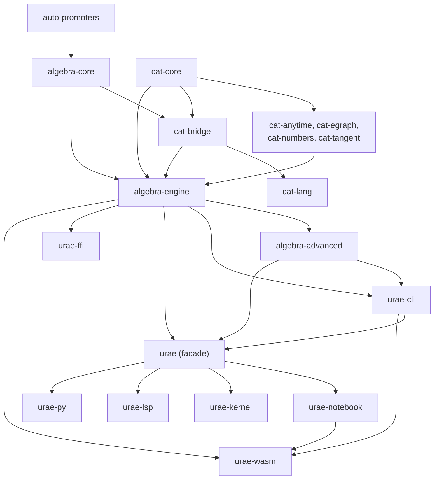
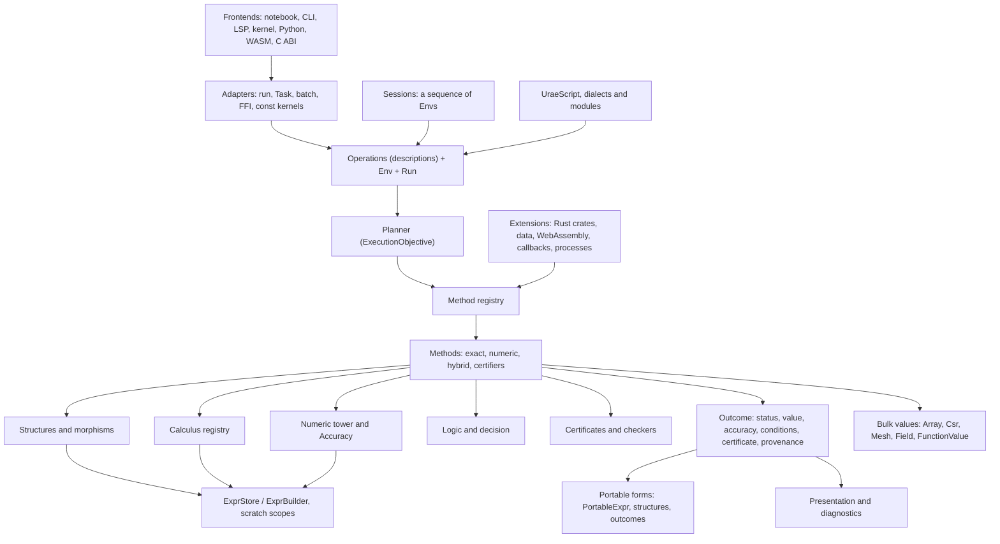

# URAE Design

*Checked 19 Nov 2026 against `dev` after v0.6.0 (unreleased changes are in the changelog). This file describes the architecture as it is built, the invariants the
code keeps, and how the long-range target in [`specs/ARCHITECTURE_SPEC.md`](specs/ARCHITECTURE_SPEC.md) grows out of it.
What is planned and in what order is in [`PLANNING.md`](PLANNING.md); what is wrong is in [`LEDGER.md`](LEDGER.md).
Sections 1 to 7 describe what is built. Section 8 is a proposal, not a description, and says so at its start.*

## 1. What URAE is

The Universal Rust Algebra Engine is a computer algebra system with a numerical and geometric core, written in Rust
(edition 2024). One expression language, one execution path and one set of verification habits serve several kinds of
work: symbolic algebra and calculus, exact and certified solving, numerical ODE/PDE and finite-element simulation,
parametric CAD and meshing, advanced mathematical domains (knots, p-adics, surreals, Clifford algebras, quantum
circuits), formal-proof export, and a set of frontends (CLI, egui notebook, WebAssembly, LSP, Jupyter kernel, Python,
C ABI).

It is a library first. Every frontend is a thin layer over the same crates.

## 2. Design invariants

These hold in the code today. Each names where to see it. A change that breaks one needs a design decision in this
file, not just a patch.

1. **One hash-consed expression arena.** Expressions are nodes in an `ExprGraph` (`algebra-core`); identical nodes share
   one `ExprId`, so equality of structure is equality of ids and subexpressions are shared, not copied. Rewrites
   build new nodes; nothing mutates a node.
2. **One operation language, one execution path.** Requests are parsed into a `MathOperation`
   (`algebra-core::operation`) and run by the executor (`algebra-engine::executor`), so the CLI, notebook, WASM, LSP
   and kernel frontends share semantics. The typed fluent API (`algebra-engine::api`) and the DSL macros sit on the
   same engine.
3. **Exact before floating point.** Where an exact answer exists it is computed exactly: rational polynomial
   arithmetic (`gosper::QPoly`), exact Gröbner bases (`poly::exact`), CAD projection and Sturm isolation over `Q`
   (`cad::projection`), exact telescoping proofs (`zeilberger_proof`), exact constant folding (`try_eval_exact`).
   Floating point is explicit: numerical evaluation goes through `numeric` and an `EvalContext`, and a float never
   silently replaces an exact value.
4. **Refuse rather than guess.** Operations return `AlgebraResult`. Unsupported input is an error that names the
   limitation (CAD with four or more variables, a solver that cannot decide, an integral outside the implemented
   families), not a plausible-looking answer. A wrong answer presented as a result is the worst failure mode; the
   ledger tracks every known instance.
5. **Results carry their evidence where they can.** Equivalence is tested by Schwartz–Zippel fingerprints
   (`algebra-core::probabilistic`) with an explicit error bound; solutions can carry a `Solution::Probabilistic`
   certificate; derivations are recorded as proof traces that export to Lean 4 and Coq (`algebra-advanced::proof`);
   recurrences found by creative telescoping are proved by a symbolic identity check; numerical code is tested
   against tabulated values and exact identities (Wronskians, Neumann sums, recurrences), not against itself.
6. **Bounded resources.** Heavy operations run under a `ResourceBudget` with soft and hard caps
   (`algebra-core::config`), and the anytime engine (`cat-anytime`) returns progressively refined, enclosed results
   under a time budget.
7. **No unsafe code outside the FFI crate; no panics on reachable input.** `unsafe_code` is denied for the workspace;
   `unwrap`, `expect` and `panic` are warnings that CI turns into errors; remaining intentional panics are the
   `std`-mirroring operators on matrices and `Uint`.
8. **Every defect gets a test that fails on the old code.** The test is the evidence the ledger cites.

## 3. Architecture as built

### 3.1 Crates

The workspace has 20 members: 19 crates and the `urae-tests` crate. About 111,000 lines of Rust live in `crates/`.



The arrows follow the crates' dependencies (`cargo metadata`). `algebra-core` has no engine knowledge; `algebra-engine`
uses the categorical crates for anytime evaluation, e-graphs, jets and the verification bridge; `urae-cli` is a
dependency of the `urae` facade, and the notebook, kernel, language server and Python crates sit on the facade; the
WebAssembly crate links the engine, the CLI and the notebook directly. `cat-lang` (the CatScript parser) is not used
by the engine.

| Crate | Role | Size |
| :--- | :--- | ---: |
| `algebra-core` | Expression arena, symbols, numbers, intervals, parser, formatters, bytecode VM, `MathOperation`, budgets, probabilistic verifier, lemma registry | 10.3k lines |
| `algebra-engine` | The computational core: simplification, calculus, solving, series, linear algebra, ODE/PDE/FEA, CAD, geometry, special functions, search | 63.4k |
| `algebra-advanced` | Formal proofs, category morphisms, quantum, cryptography, stochastic calculus, Galois theory, knots, surreals, p-adics, Clifford algebras, AI agent | 4.7k |
| `auto-promoters` | Integer arithmetic that promotes from machine words to arbitrary precision | 1.3k |
| `cat-core`, `cat-bridge`, `cat-numbers`, `cat-anytime`, `cat-tangent`, `cat-egraph`, `cat-lang` | The categorical engine: open hypergraphs, the lift/lower bridge with differential verification, hypercomplex and tensor numbers, anytime evaluation, jet/Itô/Colombeau/time-scale calculi, e-graphs and Buckingham-Pi reduction, the CatScript parser | 8.2k together |
| `urae` | Facade and prelude re-exporting the engines | 0.3k |
| `urae-notebook` | The egui reactive notebook (the largest frontend) | 19.5k |
| `urae-cli`, `urae-wasm`, `urae-lsp`, `urae-kernel`, `urae-py`, `urae-ffi` | REPL and JSON streams, WebAssembly and Workers target, language server, Jupyter kernel, Python bindings, C ABI | 3.8k together |
| `urae-tests` | Five integration suites (`core`, `engine`, `advanced`, `ecosystem`, `notebook`) | tests |

### 3.2 `algebra-engine` by area

| Area | Modules |
| :--- | :--- |
| Simplification and rewriting | `simplify` (rules, domain detector, bridges, probabilistic verification), `lifting` (domain lift and retraction), `lemma_miner`, `cat_eval` |
| Calculus | `calculus`, `limits`, `series`, `risch` (rational and elementary integration, linear-radical substitution), `gosper`, `zeilberger`, `zeilberger_proof`, `guess`, `autodiff`, `branch` |
| Solving | `solver` (`solveset`, ODE and PDE solutions), `systems` (linear, polynomial, Diophantine, differential, numerical), `poly` (multivariate, exact Gröbner, real roots), `linprog`, `smt` |
| Numerics | `numeric` (evaluation, special functions), `ode` (symbolic and adaptive numerical), `pde` (numerical solvers and FEA), `sparse`, `matrix`, `control`, `symplectic`, `neural_ode`, `pinn` |
| Geometry and simulation | `cad` (decomposition with exact projection, constraint solver, mesh builders, BVH), `geometry`, `iga`, `pipeline` (CAD to FEA bridge), `visualizer` |
| Algebraic structures | `tensor`, `cartan`, `cartan_symbolic`, `curvature`, `diffalg`, `weyl_dmodules`, `interconnect`, `exceptional_lie`, `cft`, `qft`, `padic_hodge`, `topology`, `tda`, `noneuclidean`, `tropical` |
| Search and learning | `mcts` (value head, heuristic and learned policy heads), `heuristic`, `geometric_dl` |
| Interfaces | `executor`, `api`, `macros`, `session`, `stream`, `query`, `workbench`, `html_export` |

### 3.3 Data flow

```text
text or JSON request
  -> parser (ExprParser, parse_operation)          algebra-core
  -> MathOperation                                  algebra-core
  -> executor, under an ExecutionContext/budget     algebra-engine
  -> engine module on ExprGraph nodes (exact first) algebra-engine / algebra-advanced
  -> result: ExprId, number, mesh, solution, certificate
  -> formatter (Unicode, LaTeX) or frontend view
```

Numerical evaluation is a separate step (`evalf` with an `EvalContext` of bindings and precision), never implicit in
a rewrite. The categorical crates provide the anytime and verification layer: `cat-bridge` lifts an expression into a
hypergraph and checks the lowered result differentially, and `cat-anytime` evaluates a lifted term at progressively
higher fidelity under a time budget.

## 4. Subsystem designs

**Simplification.** Rule sets are selected by a domain detector (commutative ring, non-commutative ring, trigonometric,
fractional, tropical, ...). Equality of two results is decided by exact reduction where possible and by Schwartz–Zippel
fingerprints otherwise. E-graph rewriting (`cat-egraph`) and the MCTS search (`mcts`) explore rewrite sequences; the
search scores states with a value head and orders actions with a policy head that is either the rule-based heuristic
or a `LearnedPolicy` trained from the engine's own searches (no pretrained weights are shipped).

**Calculus.** Limits combine direct substitution, L'Hôpital, Gruntz-style asymptotics and a finite-point rule for
`1^∞`-type powers. Integration is rational (Hermite reduction, Rothstein–Trager), elementary (an incomplete Risch
tower, honest refusals outside it) and a substitution rule for a polynomial times a non-integer power of a linear
form. Summation uses Gosper's algorithm for indefinite sums and creative telescoping for definite ones: the
telescoping system is solved exactly at sample points, and `zeilberger_proof` turns the recurrence into a statement
for all `n` by rebuilding the certificate as a rational function and checking the telescoping identity as an identity of
bivariate polynomials.

**Solving.** `solveset` returns exact roots (radicals, `RootOf` placeholders for transcendental equations, complex
roots as exact complex values) with extraneous-root filtering. Polynomial systems go through an exact Gröbner basis;
the back-substitution handles Shape-Lemma position only (ledger `C16`).

**Numerics.** Special functions are computed by methods that are accurate over the whole range: integral
representations by Gauss–Legendre quadrature (Bessel `Y`, `K`, non-integer orders, Airy), the trapezoid rule for
integer-order `J`, Euler–Maclaurin for zeta, Stirling with a shift for log-gamma. ODE solvers span explicit, implicit
and symplectic schemes with adaptive stepping; PDE solvers are one-dimensional method-of-lines and FEM plus the FEA
engine below.

**Geometry and CAD.** Cylindrical algebraic decomposition uses the McCallum projection (leading coefficients,
discriminants, resultants) computed exactly (resultants by interpolation of Sylvester determinants) and Sturm root
isolation, for one to three variables; lifting is over exact fibres. The constraint solver handles every 2-D constraint
kind, points in 3-D and N-D, lines and planes in space, by damped Gauss–Newton. Mesh builders produce closed,
outward-oriented solids (gears with true involutes, profile shift, cycloidal and internal forms; screws with chamfer
and key socket; airfoils; springs; marching-tetrahedra surfaces of implicit fields and CSG).

**FEA.** Element zoo: `Line2`, `Tri3`, `Tri6`, `Quad4`, `Tet4`, `Tet10`, `Hex8` for elasticity (plane stress and
strain, full 3-D) and heat conduction. Assembly is sparse; large systems are solved by Jacobi-preconditioned
conjugate gradients with a componentwise backward-error stop; Dirichlet conditions are eliminated exactly and reaction
forces reported. The CAD bridge meshes gears, wings, springs and screws as shared-prism tetrahedral solids whose
volume and stiffness are checked against the CAD solid and closed-form bar and coil formulas.

**Advanced domains.** `algebra-advanced` holds the domains that are mathematically deep but narrow: proof traces and
Lean/Coq export, braid-closure knot invariants by state sums, quantum circuits, Galois-group classification, elliptic
curves, p-adics, adeles, surreals. Several are thin and the ledger says where (`A13`–`A16`, `B16`).

**Frontends.** The notebook is a reactive document over the executor; the CLI offers a REPL and a JSON stream; WASM
targets browsers and Workers; the LSP, kernel, Python and C-ABI crates expose the same engine to editors, Jupyter and
other languages.

## 5. Quality design

- **Tests.** Five integration suites in `tests/` mirror the crate boundaries, plus per-crate tests. A defect fix adds a
  test that fails on the old code. Numerical code is tested against tabulated values to 12 to 15 digits and against
  identities that do not depend on the implementation. `known_defect_tests.rs` and the dated files named in the ledger
  are the regression record.
- **CI** (`.github/workflows/ci.yml`): lint and format (`cargo fmt`, `clippy -D warnings` over all targets and
  features), native tests with coverage, WASM browser tests, an Android and iOS build check, a dependency-licence check,
  and a version-bump check on pull requests to `main`.
- **Benchmarks.** Criterion suites for `algebra-core`, `algebra-engine`, `algebra-advanced`, `urae` and `auto-promoters`
  under a thin-LTO `[profile.bench]`; they are compiled and linted in CI but not run.
- **Documentation.** Rustdoc with KaTeX ([`../DOCUMENTATION_STANDARDS.md`](../DOCUMENTATION_STANDARDS.md)); the
  workspace sets no `missing_docs` lint, so "every public item is documented" is a convention.

## 6. Target architecture

[`specs/ARCHITECTURE_SPEC.md`](specs/ARCHITECTURE_SPEC.md) specifies a much larger system: a unified numerical analysis,
parametric CAD, multiphysics and AI platform with composable discretisations (FEM, IGA, FVM, BEM, SPH, MPM, LBM, VEM,
FEEC), a coupling algebra, a dual explicit/automatic orchestration mode, SciML and symbolic analysis of AI systems, a
certified-arithmetic and formal-proof spine, and a function registry. It is a specification, not a status report: its
section 2 states what exists, and this file and the ledger take precedence where they differ.

Its design rests on seven invariants. Four extend ones above: method-agnostic problem specification, the dual-control
paradigm (explicit composition and automatic orchestration), a unified exterior-calculus spine, and end-to-end
differentiability with symbolic, numerical and formal co-mingling. Three are new: structure preservation by
construction (symplectic, port-Hamiltonian, GENERIC), first-class analysis of AI systems, and polymorphic
carriers with shared algorithmic spines.

The spec's eight waves map to the milestones in [`PLANNING.md`](PLANNING.md):

| Wave | Scope | Builds on what exists |
| :--- | :--- | :--- |
| 1 | Carrier and operator trait hierarchy, `ScalarRing` versus `ContextualAlgebra`, numerical sparse types, Krylov and multigrid solvers, compensated arithmetic, `const` and WGSL lowering, and the audit fixes | `CsrMatrix` and conjugate gradients in the FEA engine; `numeric`; `auto-promoters` |
| 2 | Multi-representation CAD (B-Rep, NURBS, SDF), exact offsets, file-format hub, differentiable CAD | exact CAD to three variables, solid mesh builders, the constraint solver, `iga` |
| 3 | FVM, BEM, IGA extensions, VEM, HDG, FEEC | the FEA element zoo and sparse assembly |
| 4 | Particle and kinetic methods, cloth and multibody, acoustics, rough SDEs | none yet |
| 5 | Cross-method couplers and the composition DSL | wave 3 |
| 6 | The automatic orchestrator, index reduction, registry | wave 5, `cat-anytime` |
| 7 | Multi-solution discovery, expansions, risk and econometrics, physics domains, complete CAS | `risch`, `zeilberger`, `solver`, `poly` |
| 8 | SciML, AI analysis, federated loop, formal kernel, non-classical logics | `pinn`, `neural_ode`, `mcts`, `algebra-advanced::proof` |

Design decisions to settle before wave 1 starts: the trait boundary between scalar rings and contextual algebras; whether
numerical `CsrMatrix<f64>` is the generic `CsrMatrix<R>` of the carrier design or a first step toward it (the symbolic
`sparse::CsrMatrix` and the FEA CSR type already exist separately); how errors and certificates thread through the
operator traits; and how the executor's `MathOperation` grows to cover composed pipelines without becoming a
second language. Section 8 proposes answers to the first and the last two.

## 7. Known design debts

- Two surreal-number engines (`algebra-advanced::surreal`, `cat-numbers::surreal`) with an `f64` shortcut in the
  comparison (`B16`).
- Several CSR and sparse types (symbolic `sparse`, the FEA assembly, `cat` crates) with no shared trait.
- Some modules still use `f64` coefficients where exact ones are the invariant (differential forms keep `f64`
  coefficients beside the symbolic ones, `C5`).
- Frontend coverage of the engine is uneven; the notebook is far ahead of the LSP's completion catalogue (`C15`).
- Documentation numbers (test counts, line counts) drift; the ledger and this file avoid them where they can.

## 8. Proposal: one operation model across algebras, calculi and precision

*Status: proposed, revision 4 (27 Nov 2026). Nothing in this section is built. Revision 1 (commit `fbc3d09`) designed
the calling conventions: operations as values, one result type, read and build capabilities, memory by scope, async
and FFI adapters. Revision 2 (commit `e614cb3`) tested that design against the rest of URAE's scope (several calculi,
arbitrary algebraic structures, symbolic and numerical analysis together, arbitrary precision with error tracking,
automatic choice of methods) and changed it where it did not fit. Revision 3 (commit `fc89f9a`) added what the plan
and the specification still required (logic and decision, proofs and certificates, function identity, units,
interoperability, serialisation, one registry, composition) and a performance section with measured baselines, data
layouts and gates. Revision 4 (commit `4ed0ea9`) weighed the alternatives to each decision (section 8.33) and
adopted the better option where the review found one. Revision 5 fixes the contradictions a full read-through found,
adds what was still missing (sessions, numerical data and simulation, the categorical engine, presentation and
diagnostics, safety, crate placement and API evolution), and adds a coverage check of every subsystem, invariant and
specification wave (8.34). Revision 6 (commit `840a4c2`) added differentiation and machine learning, dimensions and shapes,
randomness, the remaining domains, and the ways external libraries integrate (8.18 to 8.22). Revision 7 (commit `1c34fad`)
designed UraeScript, tier B modules in full and memoisation, and traced a worked example through every layer (8.23 to
8.26). Revision 8 makes spacing decide implicit multiplication, deprecates the old syntaxes behind a converter, and
adds auditable records and their exports (8.23, 8.27). Section 8.38 lists the changes in each revision and why. The section proposes answers to
the first, third and fourth of the open decisions in section 6. It reuses the specification's names where one exists
(`ExecutionObjective`, `AccuracyGoal`, `NumericRep`, `RuntimeEnv`, `ScalarRing` and `ContextualAlgebra`,
certify-or-escalate) and says where it differs.*

### 8.1 Requirements

| # | Requirement | Source |
| :--- | :--- | :--- |
| R1 | One operation can be called synchronously, asynchronously, in a batch, from C, Python and WASM, and (for small exact kernels) in `const` code, without a separate implementation per style | this proposal |
| R2 | The types say whether a call reads expressions, adds expressions, or mutates an owned buffer | this proposal |
| R3 | Calculi beyond the classical one: difference and umbral calculus, q-calculus, time scales, Itô and Stratonovich stochastic calculus, Colombeau generalised functions, fractional calculus, and later rough paths | spec 24.4, `cat-tangent` |
| R4 | Any algebraic structure: groups, rings, fields, modules, non-associative algebras; finite structures; tensor algebras; structures built from others (polynomials, quotients, extensions, matrices, tensor and direct products, completions); p-adic, adelic, formal-series and surreal arithmetic | spec 27, `cat-numbers`, `algebra-advanced` |
| R5 | Symbolic and numerical analysis, separately and combined within one request | invariants 3 and 5 |
| R6 | Arbitrary precision where the problem allows it; where machines or budgets do not, a tracked and honest statement of how accurate the result is | invariants 4 and 6, spec 17 and 25.1 |
| R7 | Automatic blending of methods to reach the requested accuracy at the lowest cost, with the user able to override any choice | spec 9, 19, 44.4 |
| R8 | Every rule above keeps the existing invariants: exact before floating point, refuse rather than guess, bounded resources, no unsafe code outside the FFI crate | section 2 |
| R9 | Logics and decision: assumptions as formulas in a stated logic, classical and non-classical logics, decision procedures that return evidence | spec 35, `logic.rs`, `smt.rs` |
| R10 | Proofs: results carry checkable certificates, and proof traces export to Lean 4 and Coq with the right types and tactics | invariant 5, spec 23, `algebra-advanced::proof` |
| R11 | Interoperability: one identity per function, domains and units as part of typing, conversions between Rust carriers and external type systems | spec 38, 41, `D13`, `units.rs` |
| R12 | Serialisation: every value, structure, operation and result that leaves a session has a portable, versioned form | audit `E8` |
| R13 | One registry for operations and methods, and composed pipelines as first-class operations | spec 8, 29, 37 |
| R14 | Performance: the new layers cost nothing when unused and little when used; hot paths are measured and gated | this proposal |
| R15 | Sessions: state that changes statement by statement, with undo, isolation between documents, and tasks that keep their own view | `session.rs`, the notebook, the LSP, the kernel |
| R16 | Numerical data and simulation: arrays, sparse matrices, meshes, fields and computed functions as first-class values, with honest accuracy | `numeric`, `ode`, `pde`, `cad`, section 6 (decision 2) |
| R17 | The categorical engine works inside the same model, not beside it | `cat-*` crates |
| R18 | What users see is as honest as the types: accuracy, conditions, cases and refusals always shown; diagnostics with source spans | invariant 4, spec 29, the LSP |
| R19 | Hostile input (the public Worker, loaded files, the FFI) cannot exhaust resources or crash the engine | invariants 6 and 7, `wrangler.toml` |
| R20 | The public API evolves gradually, with deprecations and migration notes, and the design states which crate holds what | the `urae` prelude, `api.rs`, `macros.rs` |
| R21 | Coverage is checkable: every subsystem, invariant and specification wave maps to a part of the design | this proposal (8.34) |
| R22 | Differentiation through operations (forward and reverse), with derivative accuracy reported separately | spec 10, `autodiff.rs` |
| R23 | Machine learning: models as values, training as an operation, learned methods with validity regions, analysis of models, tabular data | spec 10 to 12, `pinn`, `neural_ode`, `geometric_dl`, `heuristic.rs` |
| R24 | Dimensions: symbolic sizes, shape checking, fixed-size fast paths, dimension as a cost, units on bulk data, manifolds | spec 27, cat-core `SymDimId` |
| R25 | One reproducible randomness policy, and honesty about results that depend on chance | `probabilistic.rs`, `numbertheory.rs` |
| R26 | External libraries can integrate without forking: defined extension points, several ways to load, a contract, and a testing kit | this proposal |
| R27 | The remaining domains (GPU, plotting, geometry representations, interchange, telemetry, long-running work, locale) each have a place in the model | spec 7, 13, 17 |
| R28 | One language with a written grammar, defined afresh: permissive mathematical notation, no text rewriting, every ambiguity resolved by a stated default and reported; the old syntax and CatScript deprecated and converted once | spec 42 to 45, `examples/notebooks/` |
| R29 | Native dynamic extension: modules written in that language, provided in context (file, package, cell, string, request), with the reach of static extensions wherever data can express it | this proposal |
| R30 | Memoisation that the internals use automatically: results, functions, shipped tables, shared intermediate facts and mined knowledge, reused only when accurate and valid enough | this proposal |
| R31 | Auditable results: every result can be saved as a record of its interpretations, premises and path, verified later, and exported to UraeScript, the binary form, Lean, LaTeX and other formats | invariant 5, this proposal |

### 8.2 What exists and what is in the way

Each item was checked against `dev` at commit `1dfd2d4`. P1 to P10 come from revision 1; P11 to P20 were found while
testing it against R3 to R7; P21 to P30 while testing revision 2 against R9 to R14; P31 to P36 while reviewing
revision 4 against R15 to R21; P37 to P42 while testing revision 5 against R22 to R27; P43 to P46 while designing the language (R28 to R30); P47 for R31.

| # | Observation | Where |
| :--- | :--- | :--- |
| P1 | Every graph parameter is `&ExprGraph` (668 sites, none `&mut ExprGraph`), because interning works through locks inside the graph. A signature does not say whether a call adds nodes. | `algebra-core/src/graph.rs` |
| P2 | `ExprGraph::get` returns a clone of the node, which allocates when the node owns heap data (a spilled `SmallVec`, a `BigInteger`, a `Matrix` `Vec`). Every node is stored twice: in the `Vec` and as the key of the deduplication map. | `graph.rs` |
| P3 | The graph only grows. The notebook creates its graph once and never resets it. | `urae-notebook/src/notebook/mod.rs` |
| P4 | Variations are method-name suffixes (`diff` and `diff_with_steps`; `solveset`, `solveset_outcome` and `solveset_certified`; `simplify`, `simplify_with_conditions` and `simplify_with`), so each new axis multiplies the methods. | `calculus.rs`, `solver.rs`, `api.rs` |
| P5 | Result types disagree: `diff` cannot fail, `integrate` returns `AlgebraResult`, `solveset_outcome` a typed outcome, and `SymbolicSimplifier::simplify` returns its input unchanged on failure. | `calculus.rs:15`, `simplify/mod.rs:1954` |
| P6 | Nine engine traits each have one implementation, for `ExprGraph`; `Simplifier` is a unit struct of associated functions. Nothing is generic over storage. | `impl ... for ExprGraph` |
| P7 | `ComputeFuture::spawn` starts one OS thread per call, and dropping the future does not stop the work. No algebra-engine module reads `ResourceBudget`. | `stream.rs` |
| P8 | `ConstRational` multiplies plain `i64`s. An overflow is a compile error in `const` code and wraps silently at run time (`overflow-checks = false` in the release profile). | `api.rs`, `Cargo.toml` |
| P9 | The C ABI is three string-in, string-out calls. Every failure is `NULL`; there is no `catch_unwind` and release builds abort on panic, so an engine panic ends the host process; `urae_session_execute` takes `&mut *session` with no lock. | `urae-ffi/src/lib.rs` |
| P10 | `urae-py` has no Python binding layer: `PyExprGraph` holds LaTeX and Unicode strings and re-parses on every call. | `urae-py/src/lib.rs` |
| P11 | The abstract-algebra trait hierarchy (21 traits, `MathSet` to `ValuationProvider`) has no implementation outside one test. `MathSet` requires `zero()` and `one()`, which a bare set or a group does not have, and equality is not part of any trait. | `algebra-core/src/traits.rs`, `tests/tests/engine/phase6_cartan_tests.rs` |
| P12 | Carriers are duplicated: two p-adic types (`algebra-advanced::padic`, digits `Vec<u64>`; `cat-numbers::adele`, digits `SmallVec<[u8; 8]>`, which cannot store a digit above 255), two adele types, two surreal engines (ledger `B16`), and Itô calculus twice (`cat-tangent`, on `f64` jets; `algebra-advanced::stochastic`, symbolic). | the named modules |
| P13 | `WeilJet` stores its calculus in each value, and `mul` reads only the left operand's: an Itô jet times a classical jet silently takes whichever regime is on the left. | `cat-tangent/src/weil_ideal.rs` |
| P14 | Umbral calculus exists only in spodeian-core (`sml-runtime::umbral`, integer lattices for training); in algebra-engine it is a detector flag (`has_umbral_terms`). `ExprKind::Derivative` has no field saying which calculus it belongs to. | `simplify/detector.rs`, `algebra-core/src/expr.rs` |
| P15 | `BigValue`, documented as "High-precision real number", is `Real(f64)`. `EvalContext::precision_digits` defaults to 50, but arbitrary precision exists only in `bigfloat::evaluate` for constant expressions (`N(...)`, `executor.rs:747`). `dashu` is a dependency and `numeric.rs` says it is used; no code uses it. | `numeric.rs`, `bigfloat.rs` |
| P16 | `RealInterval` ("rigorous ... directed inclusions") and `UniversalBall` round endpoints to nearest. `[0.1, 0.1] + [0.2, 0.2]` gives `[0.30000000000000004, 0.30000000000000004]`, which does not contain the exact sum of the two doubles (0.3000000000000000166...). The ledger records that the interval claims of `F5` were never checked. | `algebra-core/src/interval.rs`, `cat-core/src/ball.rs` |
| P17 | `UncertaintyKind::worst_case_radius` returns three standard deviations for a probabilistic spread, so a probabilistic estimate can be read as a worst-case bound. | `cat-core/src/enclosure.rs` |
| P18 | 41 places outside test modules in algebra-engine build a fresh `EvalContext` (`::default()` or `::new`), losing the caller's bindings and precision (spec 44.4, audit `J4`). | algebra-engine |
| P19 | Method choice is spread over the simplifier's domain detector, the lifting router (`LiftingFunctor`), the MCTS and heuristic tiers, and `cat-anytime`'s `FidelityMode`, with no shared description of what a method costs, guarantees or applies to. | `simplify/detector.rs`, `lifting/router.rs`, `heuristic.rs`, `cat-anytime` |
| P20 | Three overlapping error types (`UncertainValue`, `UncertaintyKind`, `ErrorEnclosure`), and `ErrorEnclosure::method` is a free-form `String`. | `interval.rs`, `enclosure.rs` |
| P21 | Nothing portable exists. `ExprNode` derives `Serialize`, but its children serialise as indices into one session's graph; `ExprGraph` cannot be serialised; `MathOperation` carries expressions as text (`String` fields throughout, no `ExprId`); the notebook saves only document text. Revision 2's JSON entry point assumed a portable expression format that does not exist. | `graph.rs`, `operation.rs`, `urae-notebook/src/notebook/session.rs` |
| P22 | A proof step is a rule name plus a before and an after. The Lean and Coq export types every step over `ℝ` and closes it with `ring` or leaves `sorry` / `Admitted`. Evidence from `zeilberger_proof`, the Schwartz–Zippel tier and `FormalEquivalenceProver` has three unrelated shapes. | `algebra-advanced/src/proof.rs`, `lemma_miner.rs` |
| P23 | The logic layer (`AssumptionsContext`, `Predicate`, `ThreeValuedLogic`, `GeneralizedValuedLogic<N>`, `SatSolver`, `smt.rs`) has no connection to structures or results; conditions are not formulas of a stated logic. | `logic.rs`, `smt.rs` |
| P24 | Functions are identified by name. Alias lists (`"atan" \| "arctan"`) are repeated in `vm.rs`, `numeric.rs`, `limits.rs`, `executor.rs` and `simplify/mod.rs` (`canonical_function_name` normalises some spellings at intern time, but identity is still a string). | spec 38 |
| P25 | Two unit models: `units.rs` (seven integer SI exponents) and cat-core's `DimVector` (eight rational exponents), which algebra-engine never uses. | `units.rs`, `cat-core/src/dimensions.rs` |
| P26 | Two command tables that must stay in step (`parser.rs`, `numeric_commands.rs`), an ordered hook list (`COMMAND_HOOKS`) and inline special cases before it; no single registry of operations. | `PLANNING.md` (Structure), `session.rs` |
| P27 | The deduplication maps (`ExprGraph`, `SymbolTable`, the cat-core arenas) are `DashMap`s with the default SipHash: 25–41 ns to hash a node, against 4–8 ns for ahash or FxHash (ahash is already a dependency). | `graph.rs`, `symbol.rs`, `cat-core/src/context.rs` |
| P28 | A node read costs 40–46 ns (read lock, clone, `SmallVec` copy of the children) against 2.5 ns from a flat `u32` array; a node is 72 bytes, 32 of them a `Domain`, and is stored twice. | 8.32.1 |
| P29 | Walkers are recursive (audit `E4`), and `parallel.rs`'s `contains_matching` starts a parallel iterator at every level of the tree. | `parallel.rs`, `format.rs`, `simplify` |
| P30 | The bytecode VM is `f64`-only (`LoadConst(f64)`, a fixed 32-slot stack and 16 locals), so balls and arbitrary precision have no compiled lane; the criterion suites are compiled in CI but never run, so nothing guards performance. | `vm.rs`, section 5 |
| P31 | Session state is a set of separate mutable maps on `UraeSession`; the notebook keeps its own undo stacks; the LSP builds a fresh session for every request. | `session.rs`, `urae-notebook/src/notebook/history.rs`, `urae-lsp/src/lib.rs` |
| P32 | Two unrelated CSR types (`sparse::CsrMatrix`, `pde::fea::CsrMatrix`); dense numerical data has no common type; an ODE solution (`OdeTrajectory`) is not a value the rest of the engine can use. | `sparse.rs`, `pde/fea.rs`, `ode/numerical.rs` |
| P33 | The categorical crates keep their own arenas and parallel versions of the error, fidelity, budget and equivalence types (`UniversalBall`, `FidelityMode`, `AnytimeBudget`, `EquivalenceKind`). | `cat-core`, `cat-anytime`, `cat-egraph` |
| P34 | Step-by-step explanations (`StepByStepResult`, `MathStep`) and proof traces (`ProofTrace`) are two unrelated types. | `algebra-core/src/step.rs`, `algebra-advanced/src/proof.rs` |
| P35 | The WASM engine is a public Cloudflare Worker (`workers_dev = true`, a `fetch` handler), so it receives untrusted input; there are no fuzz targets and no memory metering. | `wrangler.toml`, `crates/urae-wasm/worker.js` |
| P36 | Results carry no diagnostics channel or source spans, so warnings (shadowing, reinterpretation, lowered precision) have nowhere to go and the LSP cannot point at them. | `executor.rs`, `urae-lsp` |
| P37 | Differentiation is forward-mode only: dual and hyper-dual numbers, and a vector-Jacobian product (`TapeFreeVjp`) built on forward duals over `f64` closures. Nothing differentiates through an operation such as a solve. | `autodiff.rs` |
| P38 | A trained model is not a value: weights are loaded for the heuristic tier only, and `pinn`, `neural_ode` and `geometric_dl` each keep their own representation. | `heuristic.rs`, `pinn.rs`, `neural_ode.rs`, `geometric_dl.rs` |
| P39 | Sizes are Rust `usize`s (`ExprKind::Matrix { rows, cols, .. }`); symbolic dimensions exist only in cat-core (`SymDimId`). | `algebra-core/src/expr.rs`, `cat-core/src/dimensions.rs` |
| P40 | No shared randomness: modules make their own sample points and generators (the fingerprint points in `probabilistic.rs` come from an arithmetic formula of round and index). | `probabilistic.rs`, `lemma_miner.rs`, `numbertheory.rs`, `visualizer.rs` |
| P41 | Tabular data exists only as a stream: `StreamProcessor` evaluates an expression per CSV row, but a table is not a value the statistics commands can take. | `stream.rs` |
| P42 | No extension mechanism: adding a function means editing five files (P24), adding a command means editing two tables and a hook list (P26), and an outside library cannot integrate without forking. | P24, P26 |
| P43 | There is no grammar. `parser.rs` mixes a `nom` expression parser with string-prefix intent detection (268 `starts_with` and `strip_prefix` calls) and destructive pre-passes (`normalize_latex_input`); `query.rs` and `input_text.rs` hold a second set of rewrites. | `parser.rs`, `query.rs`, `input_text.rs` |
| P44 | Definitions are substituted into the input text (`UraeSession::expand_definitions`, up to eight passes) instead of being bound and resolved. | `session.rs` |
| P45 | Three surface syntaxes (the permissive parser, CatScript, the notebook's role and domain lines) with no shared specification; the 48 example notebooks are the de facto definition, and some pass expressions as strings. | `cat-lang`, `urae-notebook/src/notebook/parser.rs`, `examples/notebooks/` |
| P46 | Nothing memoises across operations: the notebook's line and plot caches are per view, and the VM compiler's `subexpr_cache` is read but never written (audit `E4`). | `urae-notebook/src/notebook/cache.rs`, `vm.rs` |
| P47 | No result is auditable. The notebook saves its text; `ProofTrace` export is a separate feature reached from two places; results record neither the assumptions and definitions they used, nor how the input was read, nor the methods behind them. | `urae-notebook/src/notebook/session.rs`, `urae-cli/src/json_api.rs`, `urae-notebook/src/export.rs` |

### 8.3 Overview

Nine decisions carry the design:

1. **Requests are values.** An operation is a plain description; methods carry it out; a planner picks among them
   (8.4, 8.9).
2. **Structure is data supplied by context.** The same expression can be read in `Q`, `GF(7)` or `Mat_3(Q)`; the
   structure comes from the request's context, not from the node (8.6).
3. **Every value says how well it is known.** Exact, rigorously enclosed, estimated, probabilistic or asymptotic, as
   distinct cases that never convert silently (8.7).
4. **A calculus is a registered rule set, not a fork of the engine** (8.8).
5. **Storage and calling style are adapters** around one core (8.5, 8.28, 8.29).
6. **Everything that leaves a session has a portable form,** everything that claims to be true can carry evidence, and
   every result can be audited: its interpretation, premises and path saved, verified and exported (8.11, 8.12, 8.27).
7. **Performance is a measured contract.** A `u64` header column and `u32` pools, dense ids and monomorphised inner
   loops; the new layers are paid for only when used, and hot paths are gated (8.32).
8. **Nothing is left implicit.** Sessions, bulk numerical data, the categorical engine, presentation, safety, crate
   placement, differentiation and learning, dimensions, randomness, the language, modules and memoisation each have a
   section, and 8.34 maps every
   subsystem, invariant and specification wave to the design.
9. **Open to outside libraries.** Defined extension points, five ways to load an extension, a contract and a testing
   kit, proved on first-party code (8.22).



### 8.4 Operations, environment and result

**Operations.** Each operation is a plain struct that describes the request and nothing else:

```rust
pub struct Differentiate { pub expr: Input<ExprId>, pub wrt: SymbolId, pub order: u32, pub calculus: CalculusId }
pub struct Evaluate { pub expr: Input<ExprId>, pub target: StructureId, pub goal: AccuracyGoal }
pub struct Solve { pub system: SmallVec<[Input<ExprId>; 2]>, pub unknowns: SmallVec<[SymbolId; 2]>, pub over: StructureId }
// `Input<T>` is either a given value or another step's output (8.13); a direct call passes `Input::Given`.

pub trait Operation: Send + Sync {
    type Output: Send;
    fn kind(&self) -> OpKind; // registry key and serde tag
}

/// Run an operation: the planner chooses and runs methods (section 8.9).
pub fn run<O: Operation>(op: &O, env: &Env, run: &mut Run<'_>) -> Outcome<O::Output>;
```

Revision 1 gave `Operation` a `run` method. That cannot express several methods for one operation with different costs
and guarantees, which R7 needs, so execution now goes through the registry.

Families of operations: structural (simplify, expand, factor, canonicalise), calculus (differentiate, integrate, sum,
limit, series, transform, each with a `CalculusId`), solving (equations, systems, ODEs, PDEs, optimisation),
evaluation (`Evaluate` into a numeric or finite structure), conversion (apply a morphism, section 8.6.4), tensor
operations (contract, symmetrise, canonicalise) and structure queries (is this a field, the order of this group).
`MathOperation` becomes a serde-tagged enum over these structs, so every frontend dispatches to the same code
(invariant 2) and the request language does not grow separately. Its fields hold portable inputs (8.12), and an input
may be another operation's output, which is how pipelines compose (8.13).

**Environment and run state.** Revision 1 had one mutable `Cx`. Parallel portfolios (8.9) and tasks (8.28) need the
shared part separated from the exclusive part:

```rust
/// Shared, immutable, cheap to clone (an Arc). The specification's `RuntimeEnv`.
pub struct Env {
    pub objective: ExecutionObjective, // time, accuracy and memory constraints (spec 44.4)
    pub knowledge: ScopeFrame,         // assumptions and the structure of each symbol (8.6.2)
    pub calculus: CalculusId,          // default calculus for d/dx, integral and sum
    pub numeric: NumericPolicy,        // representation bounds, maximum precision, rigour required
    pub overrides: Overrides,          // pin a method, a precision or a structure
    pub record: RecordFlags,           // steps, certificate, provenance detail
    pub seed: u64,
}

/// Exclusive to one execution.
pub struct Run<'a> {
    pub builder: ScratchScope<'a>, // where new nodes go (8.5)
    pub meter: BudgetMeter,        // ResourceBudget, wall clock and memory, charged as work happens
    pub cancel: CancelToken,
    pub recorder: Recorder,        // steps and provenance
    pub progress: Option<ProgressSink>, // anytime refinements (8.28)
}
```

Every engine function takes `&Env` instead of building its own context, which removes the 41 fresh `EvalContext`s
(P18). `run.checkpoint()?` checks the cancellation token and charges the meter; long loops (Gröbner S-pairs, e-graph
saturation, series terms, solver iterations, ODE steps) call it.

**Result.**

```rust
pub struct Outcome<T> {
    pub result: Result<Answer<T>, Refusal<T>>,
    pub info: Info,                  // provenance, diagnostics (8.17), and the derivation when asked for (8.11)
}

pub struct Answer<T> {
    pub value: T,
    pub goal: GoalState,             // Met | NotMet | Partial (an anytime result cut short)
    pub accuracy: Accuracy,          // how close `value` is known to be (8.7)
    pub relation: Relation,          // Equal, or Associated (an approximate or Colombeau-style equality, 8.7.4)
    pub holds_when: Conditions,      // what the result depends on: x != 0, the principal branch, p not dividing n
    pub certificate: Option<Box<Certificate>>,
}

pub enum Refusal<T> {
    Unsupported(AlgebraError),       // names the limitation
    Undecidable(AlgebraError),
    InvalidInput(AlgebraError),
    BudgetExceeded { resource: Resource, best: Option<Box<Answer<T>>> }, // time, memory, steps, size (8.30)
    Contradiction { facts: Conditions }, // the scope's facts contradict each other (8.10)
    Cancelled { best: Option<Box<Answer<T>>> }, // the best answer so far, if any
}
```

**Answers that split.** A result often depends on cases ("if `a > 0` ..., otherwise ..."), or is an infinite family
such as `x = pi/2 + 2 pi k`. Two output types carry that, so `holds_when` is not stretched to cover it:

```rust
pub struct Cases<T> { pub branches: SmallVec<[(Conditions, T); 2]>, pub exhaustive: bool }
pub enum SolutionSet {
    Finite(SmallVec<[ExprId; 4]>),
    Intervals(Vec<Enclosure>),
    Family { template: ExprId, params: SmallVec<[(SymbolId, StructureId); 1]> }, // pi/2 + 2 pi k, k in Z
    Condition { set: ExprId },                                // the solutions of an unsolved condition, kept as a set
    Union(Vec<SolutionSet>),
}
```

Any operation may return `Cases<T>` when it must branch on an undecided condition (spec 24.1's demand-driven
`Piecewise`). `Solve` returns a `SolutionSet`, possibly inside `Cases`. `exhaustive: false` says the branches do not
cover every case, and renderers say so (8.17).

**Which setting wins.** `objective.accuracy` is the goal. `NumericPolicy` bounds the means: the representations
allowed, the maximum precision and whether rigour is required. `Overrides` beat both. A goal that the policy makes
unreachable gives `GoalState::NotMet`, never a quiet relaxation of either.

The shape keeps invariant 4 and makes illegal states unrepresentable: there is a value exactly when there is an
answer.

- `GoalState::Met` means the value meets the requested goal.
- `NotMet` gives the best value with its true accuracy and is never presented as meeting the goal.
- `Partial` is an anytime result cut short by time.
- A refusal has no value and names the limitation.
- `?` works on `result`.
- Steps, certificates and conditions are fields, not method variants (P4, P5).

Revision 4 replaced revision 3's struct of optional fields; 8.33.4 gives the comparison.

### 8.5 Storage and memory

Revision 1's measurements stand. With a counting allocator around ten typical commands (simplify, diff, integrate,
expand `(x+y+z)^6`, factor, solve, series, limit) run 30 times per session, release build, 27 Nov 2026: about 230,000
allocations per pass, 74% of them 16 bytes or smaller, peak 0.6 MB in use. mimalloc and the system allocator were
within noise of each other (588 to 731 ms, best of five). A bump allocator that never frees, the best case for any
arena-style global allocator, took 767 to 831 ms and left 1,535 MB unreclaimed. A global allocator sees only `alloc`
and `dealloc` calls in arbitrary order; it has none of the scope information that makes region allocation fast in a
language like Goose, and engine results deliberately outlive the calls that make them. **The global allocator stays
mimalloc.**

What the measurements do support is reclaiming by scope. Nodes a result still uses, against nodes the command
created on a fresh graph: `simplify (x+1)^2 - (x^2+2x+1)` 1 of 24; `diff sin(x)*exp(x^2)*log(x)` 14 of 54;
`series exp(x)*sin(x)` 20 of 55; `solve x^3-6x^2+11x-6 = 0` 0 of 23.

- **Capabilities.**

  ```rust
  pub trait ExprStore: Sync {
      fn node(&self, id: ExprId) -> NodeRef<'_>; // a borrowed view, no clone (P2)
      fn len(&self) -> usize;
  }
  pub trait ExprBuilder: ExprStore {
      fn intern(&self, node: NodeSpec) -> ExprId;
  }
  ```

  Formatters, equivalence tests and free-symbol queries take `&impl ExprStore`; methods add nodes through `Run`'s
  builder (P1). `ExprGraph`, the scratch scope and a later flat encoding implement both, so engine code is written once
  (P6). The store's layout, a header column and a child pool with lock-free reads, is set out in 8.32.2.
- **Scratch scopes.** Each run interns into a scratch graph layered over the session graph. At the end the nodes the
  result reaches are copied into the session graph and the scratch graph is dropped in one step. Scratch ids continue
  the session's numbering (8.32.2), and `run` promotes every id in an `Outcome` before returning it, so a scratch id
  cannot escape the run.
- **Small nodes, payloads beside them.** Big integers, big rationals, balls and p-adic digit vectors live in side tables
  keyed by node, so nodes stay small and cheap to hash. Precision and accuracy are never stored in a node (they belong
  to values, 8.7). `Domain` leaves the node too (8.6.2).
- **The deduplication map** holds hashes and ids, not a second copy of each node.
- **Lifetimes of graphs.**
  - The notebook keeps one region per cell. A cell may refer only to earlier cells, so editing cell `k` drops the
    regions of cells `k` onward and nothing else (8.33.7).
  - Until regions exist, the notebook rebuilds its graph on each `evaluate_all`. Its caches hold strings and floats,
    never `ExprId`s, so this is safe now (P3).
  - Long-lived sessions compact when the node count passes a limit tied to the memory constraint: copy what the
    session's roots reach, remap, and bump an epoch carried in every handle so a stale id is detected.
  - Compaction never invalidates a running task. The task's snapshot keeps the old segments alive (they are `Arc`s,
    8.32.2), and the compaction keeps its old-to-new remap table until every task that started before it has promoted.
    A promotion from such a task remaps through the table first.

### 8.6 Algebraic structures

#### 8.6.1 Structure objects

An element type alone cannot say which structure it lives in: a `u64` may be in `Z/7Z` or `GF(2^64)`, and a polynomial
may be over `Q` or over `GF(p)[t]/(f)`. So, as `traits.rs` already does with `&self`, operations go through a
**structure object** that holds the run-time parameters (modulus, defining polynomial, Clifford signature, precision,
index spaces). This is the specification's `ContextualAlgebra`. Its `ScalarRing` is the special case of a context-free
element type, which gets a zero-sized structure object `Std<T>` by a blanket implementation.

```rust
pub trait Structure: Send + Sync {
    type Elem: Clone + Send + Sync;
    fn info(&self) -> &StructureInfo;
    fn eq(&self, a: &Self::Elem, b: &Self::Elem) -> Ternary; // True, False or Unknown
}
pub trait AdditiveGroup: Structure {
    fn zero(&self) -> Self::Elem;
    fn add(&self, a: &Self::Elem, b: &Self::Elem) -> Fallible<Self::Elem>;
    fn neg(&self, a: &Self::Elem) -> Fallible<Self::Elem>;
    /// In-place accumulation: no allocation for big numbers, balls or matrices in loops.
    fn add_into(&self, acc: &mut Self::Elem, b: &Self::Elem) -> Fallible<()> {
        *acc = self.add(acc, b)?;
        Ok(())
    }
}
pub trait Ring: AdditiveGroup {
    fn one(&self) -> Self::Elem;
    fn mul(&self, a: &Self::Elem, b: &Self::Elem) -> Fallible<Self::Elem>;
    fn mul_into(&self, acc: &mut Self::Elem, b: &Self::Elem) -> Fallible<()>;
}
pub trait Field: Ring { fn inv(&self, a: &Self::Elem) -> Fallible<Self::Elem>; }
pub trait Group: Structure { // multiplicative notation: permutation, matrix and presented groups
    fn identity(&self) -> Self::Elem;
    fn op(&self, a: &Self::Elem, b: &Self::Elem) -> Fallible<Self::Elem>;
    fn inverse(&self, a: &Self::Elem) -> Fallible<Self::Elem>;
}
pub trait Module<R: Ring>: AdditiveGroup {
    fn scale(&self, ring: &R, s: &R::Elem, v: &Self::Elem) -> Fallible<Self::Elem>;
}
pub trait Valued: Structure {           // absolute values and valuations
    fn magnitude(&self, a: &Self::Elem) -> Enclosure; // in the structure's own metric (8.7)
}
pub trait Ordered: Structure {
    fn cmp(&self, a: &Self::Elem, b: &Self::Elem) -> PartialTernary; // Less, Equal, Greater or Unknown
}
```

Choices behind the sketch:

- **`Ternary` equality.** Zero-testing real expressions is undecidable in general and so is the word problem for
  presented groups; overlapping balls are neither equal nor unequal. `Unknown` is an answer, and a rewrite guarded on
  `is_zero` treats `Unknown` as "not proven" and records a condition instead.
- **`Fallible` everywhere.** Division by zero, a reduction that does not exist (`1/3` into `GF(3)`), overflow of a
  fixed-size representation and a budget stop are errors, not panics (invariant 7). The `ScalarRing` fast path keeps
  infallible operations for types where they truly cannot fail.
- **`*_into` methods** give mutation where it belongs: on owned elements, inside loops. Expressions stay immutable.
- The 21 traits in `traits.rs` are replaced, not extended, since nothing implements them yet (P11).
- **Laws are tested.** Every structure gets property tests of the axioms its `StructureInfo` claims, checked on random
  elements: associativity, distributivity, inverses, Jacobi and so on. Where equality is undecidable, the check uses
  `Ternary` and fails only on a definite `False`.
- **Dispatch** is layered (8.33.8):
  - a `StructureDesc` enum tree, hash-consed into a `StructureId`, describes every structure for typing, planning and
    serialisation;
  - kernels are monomorphised for a fixed table of element representations and selected once per batch;
  - anything outside the table runs through a `dyn Structure` fallback.

  Axioms exist both as run-time flags and as marker traits on the static kernels, and a test checks that they agree.

#### 8.6.2 What a structure promises

```rust
pub struct StructureInfo {
    pub axioms: Axioms,                 // flags known to hold (below)
    pub characteristic: Known<Natural>, // Zero, Positive(n) or Unknown
    pub cardinality: Cardinality,       // Finite(n), Countable, Uncountable or Unknown
    pub dimension: Option<(Dimension, StructureId)>, // and over what
    pub grading: Option<Grading>,
    pub topology: Topology,             // Discrete, Archimedean, NonArchimedean { p }, Formal { var }, Surreal, Product(..)
    pub decidable_eq: bool,
}
```

`Axioms` flags include associativity and commutativity of each operation, units, distributivity, division, no zero
divisors, alternativity, power-associativity, the Jacobi identity, idempotent addition (tropical) and order
compatibility. A set flag means "known to hold". A missing flag means "not known", never "known false".

Rewrite rules declare the axioms they need: reordering the factors of a `Mul` needs multiplicative commutativity,
cancelling `a*b = a*c` to `b = c` needs no zero divisors and `a` known non-zero, and `(a*b)*c = a*(b*c)` needs
associativity (octonions do not have it). The simplifier's domain detector becomes a lookup of these flags.

**Expressions are typed by context.** `Domain` leaves `ExprNode` (audit `J2`), so `x + 1` is one node whether `x` is
real, complex, in `GF(7)` or a matrix. `Env.knowledge` records each symbol's structure (`x in GF(7)`, `A in Mat_3(Q)`,
`t` on the time scale `hZ`). Typing assigns a structure to each node a run touches, lazily and memoised in the run, and
methods read it. Whole-graph passes type in one forward sweep instead (8.33.9). Domains and physical dimensions ride on
the same pass (8.12).

#### 8.6.3 Structures built from structures

Each constructor is a generic structure object over its parts, derives its `StructureInfo` conservatively, and absorbs
code that exists today:

| Constructor | Meaning | What it derives | Absorbs |
| :--- | :--- | :--- | :--- |
| `Poly<A>`, `Laurent<A>` | polynomials, Laurent polynomials | commutative if `A` is; domain if `A` is | `poly`, `gosper::QPoly` |
| `Series<A>` | formal power series known to `O(x^N)` | precision per element (8.7) | `series` |
| `Frac<A>` | field of fractions of a domain | a field | rational functions |
| `Quot<A, I>` | quotient by an ideal | a field only with a maximality certificate (for example an irreducibility proof of `f` in `F_p[x]/(f)`) | `finite::GaloisField`, `ModuloInt`, `GfArithmetic` |
| `Ext<A, f>` | algebraic extension by a root of `f` | as `Quot` | `RootOf`, number fields in `galois` |
| `Mat<A, n>` | square matrices | loses commutativity for `n > 1` | `matrix`, `matexpr` |
| `Tensor<A, B>`, `Product<A, B>` | tensor and direct products | a tensor product of fields is not assumed to be a field; a direct product has zero divisors | `structure_tensor` (Kronecker structure constants) |
| `StructureConstants<A>` | any finite-dimensional algebra given by `e_i e_j = sum c_ij^k e_k` | axioms checked from the constants, exactly, when `A` has decidable equality | `structure_tensor`, octonions, Jordan and Lie algebras, `cocycle` |
| `Clifford<A, q>`, `Exterior<A>` | `T(V)/(v (x) v - q(v))` | graded; anticommutation rules | `algebra-advanced::clifford`, `cat-numbers` multivectors, `differential_forms` |
| `TensorSpace<A>` | index slots (valence, dimension, metric), a symmetry group, coefficients in `A` | canonical form by Butler–Portugal, independent of `A` | `cat-numbers::tensor`, `butler_portugal`, `algebra-engine::tensor` |
| `GroupAlgebra<A, G>` | `A[G]` | commutative if `G` is abelian | `quantum`, representation work in spec 24.4 |
| `Completion<A, place>` | `Q_p`, the reals as balls | `Valued`, precision per element | `padic`, `cat-numbers::adele` |
| `Adeles<K>` | restricted product of all completions of `K` | finitely many places carry data; the rest are known to be integral | the two adele types (P12) |
| `Surreal` | Conway normal forms (Hahn series in `omega`) | an ordered field; truncated forms carry a halo (8.7) | the two surreal engines (`B16`) |
| `Weil<A, I>` | `A[e_1..e_k]/I`: jets and nilpotent infinitesimals | the calculus regime lives in `I` (8.8) | `cat-tangent::WeilJet`, `autodiff` |
| `Tropical<T>`, `Boolean` | max-plus and min-plus semirings, Boolean algebras | idempotent addition | `tropical`, `logic` |

#### 8.6.4 Morphisms

Moving between structures is explicit. `Hom<A, B>` covers embeddings (`Z` to `Q`, `Q` to balls at a precision),
reductions (`Z` to `Z/nZ`; `Q` to `GF(p)`, partial when `p` divides a denominator), completions (`Q` to `Q_p` to a
precision), lifts (Chinese remaindering and rational reconstruction from several `GF(p)`; Hensel lifting), evaluation (an
expression into a numeric or finite structure) and conversions between calculi (8.8). Each morphism declares whether it
is exact or approximate, total or partial, and injective, and gives an error model for the approximate case. This
generalises `cat-bridge`'s lift and lower pair, and it is the only place where precision changes (8.7).

#### 8.6.5 Particular families

- **Finite structures** (`Z/nZ`, `GF(p^n)`, finite groups, Boolean algebras) have decidable equality and small
  elements. Elements are `Copy` with the modulus in the structure object, and a const-generic `Zp<const P: u64>` serves
  the `const` tier. They are also tools: exhaustive checks for small cases, fingerprints for exact identity testing (the
  Schwartz–Zippel tier already works over `F_p`), and the images in multi-modular methods (8.9).
- **Tensor algebra** separates index structure from coefficients, so the same contraction and canonicalisation code
  serves symbolic, ball, `f64` and `GF(p)` tensors.
- **Abstract groups and non-associative algebras** get honest equality: `Unknown` for presented groups without a
  confluent rewriting system, exact for permutation and matrix groups.
- **Completions and their relatives** (p-adics, formal power series, reals, surreals, adeles) all hold elements that
  are known up to a precision measured in their own metric. That is the same problem as numerical error, and section
  8.7 treats it once.
- **Random variables** are values in a probability structure (`distributions.rs`, and `assume X ~ Normal(0, 1)` in
  8.10). They are distinct from `Probabilistic` accuracy (8.7.1), which describes uncertainty about a computed value.

### 8.7 Numbers, precision and error tracking

#### 8.7.1 What is known about a value

```rust
pub enum Accuracy {
    Exact,
    /// Rigorous: the true value lies inside.
    Enclosed(Enclosure),
    /// An error estimate that is not a guarantee (an ODE stepper's local error, a Richardson estimate).
    Estimated { abs: f64, rel: f64, basis: EstimateBasis },
    /// A statistical statement (Monte Carlo, stochastic solvers).
    Probabilistic { spread: Spread, confidence: f64 },
    /// A truncated expansion with remainder O(x^N), optionally with a bound on the constant.
    Asymptotic { order: u32, bound: Option<Enclosure> },
}

pub enum Enclosure {
    Ball { mid: BinaryFloat, rad: Mag },  // archimedean: midpoint and an upward-rounded radius
    ComplexBall { re: BinaryFloat, im: BinaryFloat, rad: Mag },
    Interval { lo: BinaryFloat, hi: BinaryFloat },
    Ultrametric { abs_precision: i64 },   // known modulo p^N
    Formal { abs_precision: u32 },        // known modulo x^N
    SurrealHalo { order: u32 },           // known up to omega^-order
    Adelic { places: SmallVec<[(Place, Enclosure); 4]> }, // integral at every other place
    LieGroup { group: LieGroupKind, center: [f64; 6], radius: [f64; 6] },
}
```

Rigorous and non-rigorous cases are different variants and never convert implicitly. Reading a probabilistic spread
as a worst-case radius (P17) becomes impossible; lowering `Enclosed` to `Estimated` is a recorded step. `Accuracy`
replaces `UncertainValue`, `UncertaintyKind` and `ErrorEnclosure` (P20); the `UniversalBall` variants become
`Enclosure` cases.

#### 8.7.2 The representation tower

The specification's `NumericRep`, ordered by cost:

| Level | Representation | Accuracy it can carry |
| :--- | :--- | :--- |
| Exact | integers, rationals, algebraic numbers (minimal polynomial plus isolating interval), expressions, finite-field and p-adic elements to stated precision | `Exact` |
| Arbitrary-precision ball | binary floating-point midpoint at `p` bits, small upward-rounded radius | `Enclosed` |
| `f64` ball or interval | outward-rounded `f64` | `Enclosed` |
| Double-double ball | 106-bit midpoint | `Enclosed` |
| Point float | `f64`, `f32`, and the specification's posit, LNS and minifloat formats | `Estimated`, or `Enclosed` only after certification (8.9) |

Rules:

- Exact stays exact unless the goal asks for a number or the budget forces a numerical route, and either is recorded.
- Going down the tower is a morphism with an error model.
- Going up is recomputation, not widening.
- Constants (`pi`, `e`, special functions) are generators that return a ball at any requested precision.
  `bigfloat.rs` already proves `2^-(p-20)` for its series and becomes the first such generator.

#### 8.7.3 Controlling precision while computing

- **Forward propagation.** Ball arithmetic carries a rigorous radius through every operation. This needs outward
  rounding in every primitive. On `wasm32`, which cannot set rounding modes, that means `next_up` and `next_down`
  after each operation (spec 17.2). Fixing P16 is a precondition.
- **Goal-driven retry (Ziv's strategy).** For an `AccuracyGoal`, evaluate at a working precision. If the enclosure is
  too wide, raise the precision geometrically and repeat, within the budget. Stop with `GoalState::NotMet` and the best
  enclosure, never a narrower claim.
- **Prediction instead of blind doubling.** The exact derivative gives the condition number `|x f'(x) / f(x)|` of each
  input, and a cancellation check on sums gives the precision a subexpression will lose, before evaluating anything.
  This is symbolic work making numerical work cheaper.
- **Local precision.** Each subexpression gets its own working precision, so only ill-conditioned parts pay for
  multiprecision (spec 17.2).
- **Machine limits.** `NumericPolicy` bounds the maximum precision, and `MemoryConstraint` bounds the space. On hitting
  either, the answer is `GoalState::NotMet` with what was achieved. Non-rigorous lanes (compiled `f64`, `f32` or GPU
  surrogates) return `Estimated` unless a certifier upgrades them.
- **Non-archimedean precision.** Absolute precision `O(p^N)` propagates by the ultrametric rules: a sum is known to the
  smaller precision, and a product's precision shifts by valuations. Formal series behave the same way with `O(x^N)`,
  and surreal truncations with their halo. For p-adic linear algebra, where per-entry tracking is pessimistic,
  lattice-based precision tracking is an option to evaluate later.
- **Errors on inputs.** Uncertain parameters (`a = 5.0 +/- 0.1`) enter as `Probabilistic`, interval parameters as
  `Enclosed`, and the two are propagated separately. This replaces today's mixing of a standard deviation and an
  interval in `UncertainValue`.

#### 8.7.4 Equality of approximate things

`Structure::eq` returns `Ternary`. When balls overlap, the planner can escalate: exact methods (minimal polynomials,
recognising a constant and then proving the identity) or more precision. Otherwise the answer stays `Unknown`, with the
undecided comparison added to `holds_when`.

Approximate equality has its own name. `Relation::Associated { tolerance }` corresponds to `cat-egraph`'s weak tier and
to Colombeau association. It is never shown as `=`.

### 8.8 Calculi

#### 8.8.1 What the calculi have in common

| Calculus | Operator | Product rule | Algebraic model | Inverse | Today |
| :--- | :--- | :--- | :--- | :--- | :--- |
| Classical | `D` | `D(fg) = Df g + f Dg` | derivation; `Weil` with `e^2 = 0` | antiderivative | `calculus`, `risch`, `autodiff` |
| Difference and umbral, step `h` | `Delta_h f = (f(x+h) - f(x))/h` | `Delta(fg) = Delta f g + f Delta g + h Delta f Delta g` | sigma-derivation with `sigma` the shift `E_h`; `Weil` with `e^2 = h e` | indefinite sum | `gosper`, `zeilberger`; `sml-runtime::umbral` in spodeian-core |
| q-difference | `D_q f = (f(qx) - f(x))/((q-1)x)` | `D_q(fg) = D_q f g + f(qx) D_q g` | sigma-derivation, `sigma(x) = qx` | Jackson integral | none |
| Time scales (Hilger) | `f^Delta` | `(fg)^Delta = f^Delta g + f^sigma g^Delta` | sigma-derivation; `Weil` with `e^2 = mu(t) e` | Delta-integral | `cat-tangent` (`HilgerTimeScale`) |
| Itô | `d` | `d(XY) = X dY + Y dX + d[X, Y]` | covariation table `dW_i dW_j = rho_ij dt`, `dt^2 = dt dW = 0` | Itô integral | `cat-tangent` (`f64`), `algebra-advanced::stochastic` (symbolic) |
| Stratonovich | `o d` | classical | classical rules on paths | Stratonovich integral | `cat-tangent` |
| Colombeau | `D` on nets of smooth functions | classical on representatives | quotient of moderate by negligible nets; equality versus association | none | `cat-tangent::colombeau` |
| Fractional (Riemann–Liouville, Caputo, Grünwald–Letnikov) | `D^alpha` | no local Leibniz rule (an infinite series) | non-local operator with a kernel | `I^alpha` | none |
| Rough paths (later, spec wave 4) | signature | depends on the second level | level-2 path | none | none |

The first four rows are one family. Each is a sigma-derivation, `delta(fg) = delta(f) g + sigma(f) delta(g)`: the data
of an Ore operator. A time scale with constant graininess `h` *is* the forward-difference calculus, and the
continuous case is `sigma = id`.

So one symbolic engine over Ore operators covers difference, umbral, q and time-scale calculus. The existing Gosper and
Zeilberger code (difference case) and `weyl_dmodules` (differential case) are instances of Ore-algebra algorithms and
should be generalised rather than copied per calculus.

The umbral identities become morphisms between calculi with stated remainders: `D = (1/h) ln(I + h Delta_h)`,
`E_h = e^{hD}`, Newton series against Taylor series, and the Euler–Maclaurin bridge.

#### 8.8.2 Design

```rust
#[repr(u8)]
pub enum CalculusKind {             // closed: rules match on it exhaustively (8.33.10)
    Classical, Difference, QDifference, TimeScale, Ito, Stratonovich, Colombeau, Fractional,
}

pub struct CalculusId(u16);         // index into the session's table of (kind, parameters); 0 is classical

pub struct CalculusSpec {
    pub kind: CalculusKind,
    pub params: CalculusParams,     // h, q, the graininess, the covariance table, alpha, the mollifier
    pub product_rule: ProductRule,  // drives both the symbolic rules and jet arithmetic
    pub chain_rule: Option<ChainRule>, // absent where none holds in general (difference calculus)
    pub inverse: Option<OpKind>,    // the integral or sum that inverts it
}
```

The classical path tests `CalculusId(0)` and never consults the table, so the common case pays nothing for the
generality.

- `ExprKind::Derivative`, `Integral` and `Sum` gain a `CalculusId`, so `d/dx`, `Delta_h`, `D_q` and Itô `d` are
  different nodes and cannot be confused (P14).
- Symbolic rules are keyed by calculus. Where a rule does not hold (no general chain rule for `Delta_h`), the method
  refuses instead of applying the classical one.
- Automatic differentiation runs on `Weil<A, I>`: the calculus lives in the structure object, not in each value (fixes
  P13), and the coefficients may be any structure. Balls give rigorous derivative enclosures, `GF(p)` gives
  fingerprints, and expressions give symbolic jets of any order.
- Conversions are operations with evidence: Itô to Stratonovich (drift correction `1/2 b db/dx`), umbral to
  continuous (a series in `Delta_h` with a remainder), and discretising a continuous problem onto a time scale (the
  truncation error as `Asymptotic` or `Enclosed`).
- Stochastic numerical solvers report `Probabilistic` accuracy (strong and weak orders), kept apart from `Enclosed`.
- One home per calculus: the two Itô implementations merge (P12). The umbral bases (falling factorials, Newton
  series, Sheffer and Appell families) join `poly` and `series` through the specification's `ApproximationBasis`.

### 8.9 Combining methods automatically

#### 8.9.1 Methods describe themselves

```rust
pub trait Method<O: Operation>: Send + Sync {
    fn id(&self) -> MethodId;
    fn applies(&self, op: &O, env: &Env) -> Applicability; // No(reason) | Yes | Partial(scope)
    fn predict(&self, op: &O, env: &Env) -> Prediction;    // time, memory, reachable Accuracy, certifying or not
    fn run(&self, op: &O, env: &Env, run: &mut Run<'_>) -> Outcome<O::Output>;
}
```

The registry lists methods per operation kind, and today's code registers as methods. For definite integrals that
means `risch`, `rational_pf`, Gauss–Legendre quadrature and series. For roots it means `solveset`, Sturm isolation,
Newton with interval verification and homotopy continuation. For simplification it means the rule sets, e-graph
saturation and MCTS. The domain detector, the lifting router and the heuristic tiers become sources of `applies` and
`predict` (P19).

#### 8.9.2 The planner

Given the `ExecutionObjective`, the planner builds one of four plans: a single method, a fallback sequence, a portfolio
raced in parallel, or a split into parts. Its default policy:

1. Try exact methods first when they are predicted to fit the budget (invariant 3).
2. Otherwise choose the cheapest plan predicted to reach the accuracy goal.
3. Under a frame-rate constraint, choose an anytime plan: a coarse enclosure within the frame, then refinements.
4. Never use a non-rigorous method alone when the goal requires `Enclosed`; such a method is always followed by a
   certifier.
5. Respect `Env.overrides`, so explicit composition and automatic orchestration (the specification's dual control)
   are the same machinery with different inputs.

#### 8.9.3 Patterns of blending

1. **Numbers guide symbols.** Numerical evaluation picks branches and signs, flags likely zeros, and proposes closed
   forms by integer-relation search (PSLQ or LLL on a high-precision value) or by `guess` for recurrences. The
   proposal is then proved exactly; a candidate that is not proved is reported as `Associated`, never as `Equal`.
2. **Symbols condition numbers.** Exact derivatives and Jacobians feed Newton steps. Simplification removes
   cancellation before evaluation. Series expansions replace quadrature near singularities and endpoints.
   Buckingham–Pi reduction (`cat-egraph`) removes variables. Symbolic structure detection (stiffness, symplectic form,
   conservation laws) chooses the stepper.
3. **Modular methods.** Compute images in several `GF(p)`, reconstruct by Chinese remaindering and rational
   reconstruction, then verify. The result is exact at close to numerical speed, for gcds, determinants, linear systems
   and Gröbner bases.
4. **Splitting.** Exact subtrees stay exact and ill-conditioned subtrees get more precision. Domains split too: a series
   near the singular point, quadrature elsewhere, with the pieces' enclosures summed.
5. **Certify or escalate** (spec section 26). A fast untrusted method (`f64`, GPU, MCTS, a learned policy) produces a
   candidate and a small checker accepts or rejects it. Checkers include ball evaluation, exact substitution,
   Krawczyk or interval Newton for roots, and differentiation for antiderivatives. On rejection the planner raises
   precision or changes method.
6. **Portfolios with cancellation.** Competing methods run as tasks, and the losers are cancelled. When two finish,
   their results are cross-checked (`cat-bridge`'s differential verification).

   The winner is chosen deterministically. Among the results that met the goal by the portfolio's decision point, it
   ranks exact over certified over estimated, then by method priority. So the outcome does not depend on which thread
   finished first, and a replay (8.9.4) reproduces it. Only under a frame-rate objective may the first acceptable
   result win outright, and provenance records which one it was.

#### 8.9.4 Learning without losing reproducibility

Predictions start as static cost formulas. Each run records predicted against actual time, memory and accuracy in
`Provenance`, and per-machine calibration and the MCTS `LearnedPolicy` refine later predictions. The plan and the seed
are recorded, so a replay reproduces the run exactly; pinning a method in `Env.overrides` makes any choice explicit.
`Provenance` is the specification's "why this method?" record (spec section 19) and replaces the free-form `method`
string (P20).

### 8.10 Logic, assumptions and decision

**Truth values are structures.** Each logic is a structure object with axiom flags, exactly like the algebras of
8.6:

- Boolean algebra;
- Kleene's strong three-valued logic, which is what `Ternary` (8.6.1) implements;
- Belnap's four-valued logic;
- Heyting algebras for intuitionistic logic;
- Łukasiewicz, Gödel and product t-norm logics;
- orthomodular lattices for quantum logic;
- the probability semiring and the tropical semiring.

These form the specification's residuated-semiring continuum (spec 35). `ThreeValuedLogic` and
`GeneralizedValuedLogic<N>` (`logic.rs`) become instances.

**Formulas are expressions.** Connectives, quantifiers and predicates are function nodes with `FunctionId`s (8.12), read
in the logic that `Env` names (classical by default). So `holds_when` (8.4) is a list of formulas in a stated logic, not
opaque strings, and conditions can be combined, simplified and exported as hypotheses (8.11).

**Knowledge is formulas plus declarations.** `AssumptionsContext` becomes the facts part of `Env.knowledge`. The
specification's four declaration verbs (spec 42.2) map onto it:

| Verb | Effect on the environment |
| :--- | :--- |
| `declare` | sets a symbol's structure (`declare A in Mat_3(Q)`) or domain |
| `assume` | adds a formula (`x > 0`), or a distribution for a random variable |
| `define` | adds a scoped rewrite or alias |
| `let` | binds a value |

Inner scopes shadow outer ones and report the shadowing. A fact that contradicts the same scope makes the scope
unsatisfiable, and the next operation reports it rather than computing from it.

**Deciding is an operation.**

- `Decide { formula, logic }`, `Prove { goal, hypotheses }` and `FindModel { formula }` have methods like any other
  operation (8.9):
  - the SAT solver in `logic.rs` and the SMT layer in `smt.rs`;
  - cylindrical algebraic decomposition for real quantifier elimination;
  - Presburger arithmetic (Cooper's method) and linear arithmetic with Farkas certificates;
  - Gröbner bases with Nullstellensatz cofactors;
  - tableaux for the modal logics in spec 35.
- A `True` answer carries a certificate (8.11). A `False` answer carries a model or counterexample.

**Guards stay cheap.** When a rewrite needs `a != 0`, the planner first tries the cheapest deciders under a small fixed
budget: exact evaluation, an interval bound, a lookup in the scope's facts. Only if those fail does it record `a != 0`
in `holds_when`. A guard check must never cost more than the rewrite it protects (8.32).

### 8.11 Proofs and certificates

A certificate is evidence that a small checker can confirm without repeating the search that found it:

```rust
pub struct Certificate {
    pub claim: Claim,       // what is certified: an identity, a bound, a root, an antiderivative, a decision
    pub evidence: Evidence,
    pub trust: Trust,
}

pub enum Evidence {
    Recomputation { structure: StructureId },           // re-evaluated exactly in a decidable structure
    Enclosure(Enclosure),                               // a ball or interval proof of a bound or a sign
    RootBox { krawczyk: Enclosure },                    // existence and uniqueness of a root in a box
    Fingerprint { prime: u64, points: u32, error_bound: f64 }, // Schwartz–Zippel: probabilistic
    Telescoping { certificate: ExprId },                // creative telescoping (`zeilberger_proof`)
    Antiderivative,                                     // checked by differentiation and simplification
    Farkas { multipliers: Vec<BigRational> },           // infeasibility of a linear system
    SumOfSquares { gram: ExactMatrix },                 // positivity
    Nullstellensatz { cofactors: Vec<ExprId> },         // inconsistency of polynomial equations
    Primality(PrimalityCertificate),
    Rewrite(Derivation),                                // a chain of rule applications
    External { system: ProofSystem, artefact: ContentHash },
}

pub enum Trust { CheckedHere(CheckerId), CheckableExternally(ProofSystem), Unchecked }
```

- **Checkers are methods.** Each evidence kind has a registered checker, and a certificate on an answer means the
  checker accepted it.
  - Probabilistic evidence (fingerprints) keeps its error bound. It is never reported as a proof of an exact claim;
    the outcome's `relation` stays `Equal` only with deterministic evidence.
  - The specification's formal kernel (spec 23) is one more checker, not a separate path.
- **One derivation type.** Today the step-by-step explanations (`StepByStepResult` and `MathStep` in
  `algebra-core/src/step.rs`, returned by `diff_with_steps`) and the proof traces (`ProofTrace` in
  `algebra-advanced/src/proof.rs`) are two unrelated types. Both become one `Derivation`, the steps of 8.4's `Info`.
  It is rendered as an explanation for people (8.17) and exported as a proof for Lean and Coq.
- **Proof steps record what they relied on.** Each step records the rule's id, the structure it ran in, the axiom flags
  it used and the conditions it added. Today's step is a rule name plus a before and an after (P22). The export to Lean
  4 and Coq can then:
  - use the right types (`ℚ`, `ℂ`, `ZMod n`, `GaloisField p n`, `Matrix (Fin n) (Fin n) R`, `Polynomial R`) instead of
    typing every step over `ℝ`;
  - turn `holds_when` into hypotheses;
  - choose the tactic from the axioms: `ring` for commutative rings, `noncomm_ring`, `field_simp` with the non-zero
    side goals, `norm_num`, `linarith` given the Farkas multipliers, `positivity` given the sum of squares, `decide`
    for finite structures.

  A step that cannot be closed stays `sorry` or `Admitted`, and the certificate's trust says `Unchecked`.
- **Equivalence classification** (`morphism.rs`, audit `A13`) answers through certificates, so a claimed isomorphism is
  either evidenced or reported as unknown.
- **Cost.** Proof objects live in side tables and are built only when `Env.record` asks for them (8.32).

### 8.12 Identity, interoperability and serialisation

**Function identity.** `FunctionId(u32)` (spec 38) names each function once, with its arities and a `DisplayAliasTag`
so printing can reproduce the user's spelling. The built-in functions are a closed `#[repr(u16)] enum Builtin` whose
discriminants are the low ids (8.33.2). The differentiator, evaluator and simplifier match on `Builtin` exhaustively,
and every other id goes through its registry descriptor.

- The parser resolves a name to its id once.
- Rules, methods, numeric kernels and certificates key on the id. That removes the alias lists repeated today in
  `vm.rs`, `numeric.rs`, `limits.rs`, `executor.rs` and `simplify/mod.rs` (P24).
- User-defined functions get ids in the session's table.

**Structures and domains.** A structure (8.6) is the algebraic carrier. A domain (spec 41's `MathDomain`) is a subset of
a carrier: an interval, a punctured or slit set, a union, a manifold chart.

- Symbols carry both, in `Env.knowledge`.
- The typing pass gives each node a structure and, where known, a domain.
- `FunctionContract` reports, for each function over a structure, its domain, range and properties.

So "`x` in `R`" and "`x` in `(0, oo)`" are one structure with two domains, not two types.

**Units and dimensions.** A physical quantity lives in `Quantity<A>`: a value in `A` together with a dimension vector.

- The dimension vector is cat-core's `DimVector`: eight base dimensions including angle (audit `J5`), with rational
  exponents.
- Multiplication adds dimension vectors. Addition requires equal dimensions and is an error otherwise.
- Converting units is a morphism with a scale and, for temperatures, an offset.
- `units.rs` (seven integer SI exponents) and `DimVector` (unused by algebra-engine today, P25) merge into this one
  model.
- Dimensions are checked in the typing pass as small fixed-size arrays, so the check costs almost nothing.

**Conversions in Rust.** Exact, injective morphisms implement `From`; partial ones implement `TryFrom`. The dynamic
value used at boundaries (the specification's `MathValue`) is an enum of:

- an expression;
- an integer, a rational, a ball, a p-adic element;
- a finite-structure element (structure plus a word);
- a matrix, a tensor, a mesh;
- a truth value.

**Mapping to external type systems:**

| System | Mapping |
| :--- | :--- |
| Lean 4, Coq | the types in 8.11 |
| SMT-LIB | `Int`, `Real`, `BitVec`, `Array` sorts; finite fields where the solver supports them |
| Python | `int`, `fractions.Fraction`, mpmath `mpf` and interval values for balls, NumPy arrays through the buffer protocol |
| JavaScript | `BigInt`, `Number`, typed arrays |
| C | the tagged `urae_value` of 8.29 |

**Serialisation.** Today nothing portable exists (P21):

- `ExprNode` derives `Serialize`, but its children serialise as indices into one session's graph;
- `ExprGraph` cannot be serialised at all;
- `MathOperation` carries expressions as text (`String` fields throughout, no `ExprId`), so every request is re-parsed.

Every artefact that leaves a session gets a portable, versioned form:

- **`PortableExpr`**:
  - `schema_version`;
  - a symbol table and a function table (canonical names, and the bodies of user-defined functions);
  - the calculus table of the calculus ids its nodes use (kind and parameters, 8.8.2);
  - a payload table (big integers as limbs, binary floats as exact mantissa and exponent);
  - the node header and pool arrays in the layout of 8.32.2, with local, dense ids and children before parents;
  - the roots.

  Loading re-interns into the target store in one linear pass. It checks that every child id is smaller than its
  parent's, that arities and tags are valid, and that payload indices are in range, so untrusted input cannot build a
  cycle or read out of bounds.
- **Bulk values** (8.15) serialise as typed byte arrays with their shape and element structure.
- **Structures** serialise as their constructor tree with parameters (for example
  `Quot(Poly(GF(7)), x^3 + x + 1)` or `Balls(256)`). Ids are resolved again on load.
- **Accuracy and enclosures** keep midpoints exact (mantissa and exponent as integers, never a rounded decimal) and
  radii rounded upward.
- **Operations, outcomes, certificates and provenance** use serde with a `schema_version`. `MathOperation`'s fields
  become `Input<...>` over portable values (8.13). Text stays an input syntax, not the wire format.
- **Formats** (8.33.14).
  - A CBOR envelope (RFC 8949) holds the metadata, tables and versioned keys. The header and pool arrays sit inside it
    as little-endian byte strings, so the bulk is copied, not parsed, and any language with a CBOR reader can load it
    without generated code. This form serves FFI, caches, Web Worker messages (8.28) and bulk data.
  - JSON is a debug and interoperability view of the same envelope.
  - Renderers (LaTeX, Unicode, MathML, SMT-LIB, Lean) registered per operation and type (8.13).
- **Compatibility.** Readers accept the current and the previous schema version (audit `E8`). A saved notebook keeps its
  document text as the source of truth, with an optional `PortableExpr` cache beside it.

### 8.13 Registry, discovery and composition

**One registry.** Each operation kind has one descriptor (the specification's `OperationDescriptor` in its
`SubsystemRegistry`, spec 29) holding:

- the canonical name and argument schema;
- parser aliases and natural-language triggers;
- serialisers and renderers;
- GUI metadata;
- the methods of 8.9.

That one table replaces the two command tables that must stay in step (`parser.rs` and `numeric_commands.rs`), the
ordered `COMMAND_HOOKS` in `session.rs` and the inline special cases before them (`PLANNING.md`, P26).

- Registration is explicit: each crate exposes `register(&mut Registry)`, and the `urae` facade calls them in a fixed
  order. This avoids link-section tricks, which behave differently on `wasm32`.
- A CI test checks that every public operation module has a descriptor (spec 29's completeness gate).

**Composition.** An operation's input can be another operation's output:

```rust
pub enum Input<T> { Given(T), From(StepRef) }
pub struct Pipeline { pub steps: Vec<AnyOperation>, pub outputs: SmallVec<[StepRef; 2]> } // a DAG; itself an Operation
```

A pipeline is the specification's `AnalysisPlan` (spec 37) in data form. The planner plans it whole:

- adjacent symbolic steps share one scratch scope, so nothing is promoted between them;
- a representation is kept across steps (a ball stays a ball rather than being made exact and then approximated again);
- the pipeline streams anytime refinements end to end.

Pipelines nest and serialise. The composition DSL (spec 8) and notebook cells compile to them, and the notebook's
dependency tracking becomes the pipeline's DAG plus content hashes. A changed cell then re-runs only the steps
downstream of it.

**Result cache.** Results are memoised across operations:

- The key is the operation kind, the content of its inputs (session-stable ids, thanks to hash-consing), the accuracy
  goal, and a fingerprint of the part of `Env` the run actually read. Each run records that part as its read set: the
  facts it consulted and the settings it used.
- A change to `Env` invalidates only the entries whose read set it touches.
- The cache is bounded by the memory constraint, evicting least-recently-used entries, and lives in the session (8.14).
- It is what makes re-evaluating a notebook after a small edit, or scrubbing a slider, cheap.

**"Interpreted as."** The parser records, in provenance, the canonical form it chose and the alternatives it rejected
(spec 45). Each reinterpretation of input (an English phrase, a shorthand, a retry after a failed parse) is a
registered input method with its guards and tests. `PLANNING.md` records that almost every wrong answer found by the
usability probes came from such rewrites; making each one visible and tested is the fix.

### 8.14 Sessions and state

`Env` is immutable (8.4), yet a session changes with every statement: `let`, `assume`, `declare`, `define`, `ans`.

Today all of that lives as mutable maps on `UraeSession`: bindings, uncertainties, intervals, symbol domains and
metadata, user functions, aliases, matrix variables, the last result and the history. The notebook keeps its own undo
and redo stacks (`UndoRedoHistory`). The LSP builds a fresh `UraeSession` for each request, and the kernel keeps one
for its lifetime.

**A session is a sequence of environments.**

```rust
pub struct Session {
    pub store: SessionStore,                 // the shared expression store (8.32.2)
    pub calculi: CalculusTable, pub functions: FunctionTable, // the session's tables (8.8, 8.12)
    pub env: Arc<Env>,                       // the current environment
    pub history: PersistentVec<Arc<Env>>,    // every earlier environment, shared structurally
    pub cache: ResultCache,                  // 8.13
}
```

- Each statement produces a new `Env` from the old one. `knowledge` is a persistent map (a hash array mapped trie), so
  a new environment shares everything it did not change. The cost of a statement is its own change, not the size of
  the session.
- `ans`, bindings, user functions, aliases and matrix variables are entries in `knowledge`, not separate fields. One
  scoping rule (8.10) governs all of them, which removes today's mix of maps.
- **Undo** steps back to an earlier `Env` in `history`, and redo steps forward. Nodes are immutable and shared, so
  neither copies expressions. The notebook's snapshots of document text stay as they are, because text remains the
  source of truth (8.12).
- A **running task** keeps the `Env` it started with. A statement entered meanwhile does not change what the task
  computes, and its result is promoted into the session's store whatever environment is current by then (see 8.5 for
  compaction).
- **Several documents** (LSP, notebook tabs, kernel connections) are several sessions. They share nothing mutable, and
  a read-only session store for the standard library of definitions can be shared between them.
- Building a session per LSP request becomes cheap enough to stop: one session per open document, updated per edit.
- **Saving a session** saves its document text and, optionally, a `PortableExpr` cache with its tables (8.12).

### 8.15 Numerical data, functions and simulation

Expressions are the wrong representation for bulk data. A `Matrix` node with up to 2^24 child ids is a fine symbolic
matrix and a poor numerical one. Large parts of URAE are numerical: ODE and PDE solvers, FEA, CAD, meshes, sparse
linear algebra. This section gives them first-class values.

**Bulk values.** These are values (`MathValue`, 8.12), never expression nodes:

| Value | Layout | Element structure | Replaces or absorbs |
| :--- | :--- | :--- | :--- |
| `Array<A>` | dense, n-dimensional, shape and strides, structure-of-arrays for compound elements (a ball is two arrays) | any structure in the kernel table (8.6.1) | `NumMat`, `MatrixBuffer`, ad hoc `Vec<f64>`s |
| `Csr<A>`, `Csc<A>` | compressed sparse rows or columns: `u32` indices, values in a lane | any structure | `sparse::CsrMatrix` (symbolic) and `pde::fea::CsrMatrix` (numeric), today two unrelated types |
| `Mesh` | vertex coordinates as arrays, connectivity as `u32` arrays, entity tags | coordinates in `f64` or exact rationals for exact geometry | `FeaMesh`, the CAD mesh builders |
| `Field<A>` | an `Array<A>` attached to the entities of a mesh | any | FEA nodal and element results |

This answers the second open decision of section 6: the numerical CSR matrix is the generic `Csr<A>` with
`A = f64` (or `f64` balls). It is not a separate type. Kernels are monomorphised for the representations in the kernel
table, as for scalars (8.32.4), so the generic type costs nothing over a hand-written `f64` one.

**Functions as values.** A computed function is a value:

```rust
pub enum FunctionValue {
    Symbolic { body: ExprId, params: SmallVec<[SymbolId; 2]> },
    Compiled { program: ProgramId, tier: PrecisionTier },          // the VM of 8.32.6
    Basis { basis: ApproximationBasis, coefficients: Array<Elem> }, // Chebyshev, splines, ... (spec 27.2)
    OdeSolution { segments: Vec<DenseSegment>, accuracy: Accuracy }, // dense output, today `OdeTrajectory`
    Piecewise(Cases<Box<FunctionValue>>),
}
```

A `FunctionValue` can be evaluated, differentiated where its form allows, composed and plotted. Its accuracy is uniform
over a stated domain (a sup-norm bound) or given per sample, and says which.

**Simulation fits the same model.**

- ODE, PDE and FEA problems are `Solve` operations whose outputs are `FunctionValue`s or `Field`s.
- Discretisations and time steppers are methods (8.9) with predictions of cost and accuracy. Choosing between implicit,
  explicit and symplectic steppers is planning, and symbolic structure detection informs it (blending pattern 2).
- Each step calls `checkpoint()`, so budgets and cancellation reach long simulations.
- Anytime results come from coarse meshes or large steps first.
- Accuracy is honest about what each method knows:
  - an a posteriori error estimate (residual or dual-weighted) is `Estimated`;
  - a validated integrator (interval Taylor models) gives `Enclosed`;
  - a stochastic solver gives `Probabilistic`, with its strong or weak order.
- Exact geometric predicates (orientation, in-circle) are exact methods with a floating-point filter, so meshes never
  invert from rounding (spec 17.3).
- CAD-to-FEA is a pipeline (8.13), and the existing `pipeline` module becomes one.

### 8.16 The categorical engine

The categorical crates have their own term system:

- `cat-core`'s three-tier `CatTerm` (object descriptors, enriched scalar spines, open hypergraphs) with its own
  interning arenas (`ObjArena`, `ScalarArena`, `HyperArena`);
- `cat-bridge`, which translates expressions to and from `CatTerm` and verifies the translation by running both sides
  (`ShadowVerifyHarness`);
- `cat-anytime`, `cat-egraph` and `cat-tangent`, built on `CatTerm`.

Today algebra-engine reaches them through two files.

The design keeps `CatTerm` as a **method-local representation**, as the e-graph is (8.33.5). It does not become a
second session store.

- **The bridge's lift and lower are morphisms** (8.6.4) between expressions and `CatTerm`s, with the exactness and
  error model every morphism declares. A method that works on hypergraphs lifts its input, works, and lowers its result.
- **The arenas adopt the store's primitives:** the header-and-pool layout where it fits, ahash for tables fed by
  input, and per-run scope, so a categorical method's intermediates are freed with its run.
- **Shared types replace parallel ones:**

  | Today | Becomes |
  | :--- | :--- |
  | `UniversalBall` | `Enclosure` (8.7.1) |
  | `UncertaintyKind`, `ErrorEnclosure` | `Accuracy` |
  | `FidelityMode` (four tiers) | the objective's accuracy goal plus planner policy |
  | `MultiFidelityOp` | a `Method` with anytime refinements |
  | `AnytimeBudget` | `BudgetMeter` |
  | `EquivalenceKind` | `Relation` |
  | `WeilJet` | `Weil<A, I>` |

- **`cat-lang`** (the CatScript parser, unused by the engine today) is deprecated. Its Hindley–Milner and dimensional
  elaboration ideas move into UraeScript's elaborator, and its files are converted (8.23.9).
- **The shadow harness becomes the migration's safety net** (8.36): old and new code run side by side on the test
  suites and must agree before the old path is removed.

### 8.17 Presentation and diagnostics

The types guarantee honesty only if what reaches the user says the same thing.

**Rules for every renderer** (notebook, CLI, LaTeX, Unicode, JSON, speech):

| Case | How it is shown |
| :--- | :--- |
| exact value | as itself |
| enclosed number | only the digits the enclosure guarantees, with the radius available (for example `3.14159265 ± 4e-9`); never more digits than are known |
| estimated or probabilistic | marked as such, with the estimate or the confidence |
| `GoalState::NotMet` | the value with a visible "accuracy goal not met", and what was achieved |
| `Partial` | a visible "partial: refining" while a task refines it |
| `Relation::Associated` | `≈`, never `=` |
| `holds_when` | "for `x ≠ 0`" beside the result, never dropped |
| `Cases` | every branch with its condition |
| a refusal | the limitation in words, never an empty result |

Renderers are registered per value type and operation (8.13), including the speech summaries that spec 29 asks for.

**Diagnostics.** `Info` gains a list of diagnostics:

```rust
pub struct Diagnostic {
    pub severity: Severity,                 // Error | Warning | Note
    pub code: DiagCode,                     // a closed enum; stable across versions and through the FFI
    pub message: String,
    pub span: Option<SourceSpan>,           // cell or file, byte range
    pub related: SmallVec<[SourceSpan; 2]>,
}
```

The same channel carries:

- shadowing warnings (8.10);
- "interpreted as" notes (8.13);
- "precision lowered" or "rigour lowered" notices (8.7);
- "budget exceeded" and "contradictory scope" (8.4).

Because every message has a stable `DiagCode`, its text can be translated without touching the engine, and tools can
act on the code rather than parse the words.

**Source spans.** Hash-consing merges equal subexpressions written in different places, so spans cannot live in nodes.
The parser keeps a side map from each occurrence of a node in its parse to a span; it lives per cell or file, and the
LSP and the notebook read it. A diagnostic about a node reports all of that node's occurrences, or the one the
operation was given.

### 8.18 Differentiation and machine learning

What exists:

- forward-mode dual and hyper-dual numbers (`autodiff.rs`);
- a vector-Jacobian product (`TapeFreeVjp`) over `f64` closures, built on forward duals;
- physics-informed networks (`pinn`), neural ODEs (`neural_ode`) and equivariant networks (`geometric_dl`);
- learned weights loaded through `sml-runtime` and candle in `heuristic.rs`.

Nothing differentiates *through* an operation, and a trained model is not a value. Spec §§10–12 ask for both.

#### 8.18.1 Derivatives of operations

Every method may say how its output changes with its inputs:

```rust
pub trait Differentiable<O: Operation>: Method<O> {
    /// Forward mode: the output tangent for an input tangent.
    fn jvp(&self, op: &O, tangent: &Tangent, env: &Env, run: &mut Run<'_>) -> Outcome<Tangent>;
    /// Reverse mode: the input cotangent for an output cotangent.
    fn vjp(&self, op: &O, cotangent: &Tangent, env: &Env, run: &mut Run<'_>) -> Outcome<Tangent>;
}
```

- **Expressions.** Reverse mode is a backward sweep over node ids. Children have smaller ids than their parents
  (8.32.2), so descending id order is already a reverse topological order. Adjoints accumulate in a `Vec` side table:
  no tape, no hashing.
- **Solves.** The derivative of a solution with respect to the problem's parameters comes from the implicit function
  theorem: `dx/dp = -(dF/dx)^-1 dF/dp`. It is computed exactly when the Jacobian is symbolic, and with stated accuracy
  when it is numerical. It never comes from differentiating the solver's iterations.
- **ODEs and PDEs.** Gradients come from adjoint equations, with checkpointing (the specification's `Revolve`)
  scheduled against the memory constraint.
- **Accuracy.** A derivative carries its own `Accuracy`, separate from the value's. An `Estimated` value can have an
  `Enclosed` derivative and the other way round. A method with no derivative rule says so, and the planner may then
  differentiate a different method's result or refuse.
- **Calculi.** Derivatives of operations use the classical calculus unless the request names another (8.8).

#### 8.18.2 Models as values

```rust
pub enum FunctionValue {
    // ... the cases of 8.15, plus:
    Model { graph: ModelGraph, weights: Vec<Array<Elem>>, formats: SmallVec<[NumericFormat; 2]> },
}
```

- A `ModelGraph` is a small typed DAG of layers (linear, convolution, attention, activation, normalisation,
  state-space, and the specification's catalogue as it grows). It is evaluated like a pipeline (8.13).
- Weights are arrays in any lane, including the specification's minifloat and quantised formats (spec 17.4), which join
  the representation tower as point formats with `Estimated` accuracy.
- Loading weights (through `sml-runtime` and candle, as an extension, 8.22) is untrusted input. Shapes, sizes and
  finiteness are validated before use (8.30).
- A model can be differentiated (8.18.1), evaluated in batches on the VM or GPU lanes (8.32.6), and analysed (8.18.4).

#### 8.18.3 Training and learned methods

- **Training is an operation.** `Optimize` takes an objective, parameters and constraints. Its stochastic methods report
  `Probabilistic` accuracy and convergence diagnostics, use the randomness policy (8.20), and run as a `Task` whose state
  serialises (8.12), so training can pause and resume.
- **Learned methods declare where they are valid.** A surrogate or learned predictor answers `Applicability::Partial`
  with its validity region. Outside it the planner does not use it. Inside it, a surrogate's answer is untrusted until
  certified (certify-or-escalate, 8.9.3).
- **The planner's own learning** (8.9.4) is one such learned method, with the same rules.

#### 8.18.4 Analysing models

Spec §§11–12 analyse AI systems. These fit the existing types:

- **Bounds through a network.** Interval bound propagation is ball arithmetic over the `ModelGraph`. Linear relaxations
  (CROWN-style) are the affine `Enclosure` case of 8.33.11.
- **Lipschitz bounds** are `Evaluate` with an `Enclosed` result.
- **Robustness** ("no input within `epsilon` of `x` changes the class") is a `Decide` with a certificate (8.10, 8.11).
- **Symbolic analysis** of small networks converts the `ModelGraph` into expressions and reuses the whole symbolic
  engine.

#### 8.18.5 Data

A `Table` value holds:

- named columns, each an `Array<A>` with its own unit (8.12);
- a validity bitmask for missing values;
- dictionary-encoded categorical columns.

The statistics commands (`t_test`, `regress`, `anova`, ...) become operations over tables, and their intervals and
p-values are `Probabilistic` answers with a stated confidence. `StreamProcessor`'s CSV evaluation becomes a table
importer (8.22).

### 8.19 Dimensions and shapes

"Dimension" means four different things here, and each needs a rule.

1. **Symbolic sizes.** `R^n`, a generic `n × n` determinant, a sum over `i = 1..n` or a tensor of unknown rank need `n`
   to be a value, not a Rust `usize`. Today `ExprKind::Matrix` stores `rows: usize, cols: usize`, and only cat-core has
   symbolic dimension ids (`SymDimId`).
   - Structure parameters take a `Dim`, which is `Known(u32)` or `Symbolic(ExprId)`, in `StructureDesc`, `Mat`,
     `TensorSpace` and array shapes.
   - The typing pass infers shapes. A required equality such as "`n = m`" becomes a condition (`holds_when`).
   - A rule that needs a known size refuses on a symbolic one rather than guessing.
2. **Shapes and broadcasting.** Mathematical operations require matching shapes. NumPy-style broadcasting is available
   on `Array`s only when the request asks for it. A shape error is a diagnostic with spans (8.17), never a panic.
3. **Fixed or run-time sizes in kernels.** Sizes up to 4 that recur in hot code (points, vectors and matrices in 2, 3
   and 4 dimensions, quaternions, SE(3)) have const-generic kernels in the kernel table (8.6.1). Everything else uses
   run-time sizes with SIMD over the inner dimension. The selection happens once per batch (8.32.4).
4. **High dimension as a cost.** Dimension is an input to every prediction (8.9.1). For large dimension the planner
   reaches for:
   - low-rank and tensor-train forms (in the specification);
   - sparse grids;
   - Monte Carlo and quasi-Monte Carlo, with `Probabilistic` accuracy.

   It does not reach for methods whose cost is exponential in the dimension.

**Physical dimensions on bulk data.** A unit attaches once to an `Array`, a `Field` or a table column, not to each
element. A dimensionless rescaling (Buckingham–Pi through `cat-egraph`) is a preprocessing method that improves the
conditioning of numerical solves, and the results are scaled back.

**Manifolds and charts.** A manifold is a structure with charts (the specification's `ChartedField`, spec 27.2).
Coordinates are domain information on symbols (8.12). Lie-group enclosures already exist (8.7.1).

### 8.20 Randomness

Today, modules that need random numbers make their own. The fingerprint sample points in `probabilistic.rs`, for
example, come from an arithmetic formula of the round and index. Nothing shares a policy, and no generator is known to
be reproducible under parallelism.

- **One generator family.** A counter-based generator (in the Philox or Threefry family) is keyed by
  `(Env.seed, operation, stream)`. Each task, portfolio member and parallel worker gets its own stream by key, not by
  drawing from a shared generator. Results therefore do not depend on thread scheduling, and replay (8.9.4) reproduces
  them.
- **Provenance** records the seed and the streams a run used.
- **Users of randomness:**
  - fingerprint points for identity tests (8.6.5, 8.11);
  - randomised algorithms (Pollard's rho, Miller–Rabin);
  - Monte Carlo and quasi-Monte Carlo;
  - stochastic solvers and training (8.18.3);
  - exploration in the planner.
- **Honesty about chance.** A result that depends on randomness says so. Either it is `Probabilistic` with a confidence,
  or it is exact with a probability-of-error certificate (the `Fingerprint` evidence of 8.11, or a Miller–Rabin round
  count). It is never presented as deterministic.
- **Cryptography** (`algebra-advanced::crypto`) uses the operating system's cryptographic generator (`getrandom`),
  never the reproducible one.

### 8.21 Other domains

Each of these adds values or methods to the existing model rather than changing it:

- **GPU execution.**
  - Array kernels on a device (the specification's WGSL lane) are methods, and their predictions include the cost of
    moving data to and from the device.
  - Device work is asynchronous and fits `Task`.
  - Results computed with non-IEEE fast-math are `Estimated` unless certified on the host.
- **Plotting.** Sampling a function for a plot is an operation with accuracy. `plot_eval.rs` already samples
  adaptively and detects discontinuities. With enclosures (interval evaluation over each pixel column), a plot can
  guarantee it has not missed a pole or a narrow spike, and say where it could not tell.
- **Geometry representations.** B-Rep, NURBS and signed-distance fields (spec wave 2) are values beside `Mesh`. Their
  conversions are morphisms with error models. Exact predicates keep topology consistent (8.15).
- **Interchange.**
  - Importers and exporters are registered per format: MathML, LaTeX input, SymPy and Mathematica expressions, STEP,
    STL, OBJ, CSV and spec 7.3's simulation formats.
  - Each is an extension point (8.22), and each importer is an input syntax under the "interpreted as" rule (8.13).
- **Telemetry and privacy.** Planner calibration (8.9.4) is local by default. Nothing leaves the machine unless the
  user opts in, and what would be sent is shown first. Saved documents never depend on calibration (8.37).
- **Long-running and distributed work.**
  - A `Task`'s state serialises (8.12), so a long job can pause, survive a restart and resume.
  - Large results go to `sml-lake`.
  - Running across machines (the specification's federated loop) uses the same messages as the Web Worker (8.33.16)
    and is later work.
- **Locale.** The parser accepts dialect options: a decimal comma, localised function names (through
  `DisplayAliasTag`, 8.12) and localised keywords. Diagnostics are translated by code (8.17).

### 8.22 Extensions: how external libraries integrate

Today, adding a function means editing the alias lists in five files (P24), and adding a command means editing two
command tables and the hook list (P26). An outside library cannot integrate at all without forking. This section
defines what an extension can add, the ways it can be loaded, and the contract it must keep.

#### 8.22.1 What an extension can add

| Extension point | What the extension provides | How it enters the engine |
| :--- | :--- | :--- |
| Function | a descriptor: canonical name in a namespace, arities, numeric kernels per lane, derivative rule, domain and range contract (8.12), simplification rules, renderers, the Lean name | an id above the `Builtin` range (8.33.2) |
| Operation | a struct implementing `Operation`, its descriptor (8.13) and at least one method | a registry entry; at the dynamic boundary, `AnyOperation::Extension` dispatching by name |
| Method for an existing operation | a `Method<O>` with `applies` and `predict` (8.9.1), optionally `Differentiable` (8.18.1) | added to that operation's method list; the planner weighs it like any other |
| Structure | the structure traits (8.6.1), or a `StructureConstants` table, or a `dyn Structure` | `StructureDesc::Extension { name, params }`; kernels for its element type, if it provides them |
| Rule pack | rewrite rules as data: pattern, replacement, required axioms, guards | compiled per structure like core rules (8.32.4) |
| Calculus | for the sigma-derivation family only: `sigma` and `delta` given as data (8.8.1) | `CalculusKind::Ore` with parameters; other kinds stay closed (8.33.10) |
| Evidence kind and checker | an evidence format and a checker for it | `Evidence::Extension { kind, bytes }`; trust as in 8.22.3 |
| Decider | a decision procedure for some logic or theory (8.10) | a method of `Decide` and `Prove` |
| Value type | a bulk or opaque value with serialisation and renderers | `MathValue::Extension { kind, value }`; refused if it has no serialisation |
| Renderer, input syntax, importer, exporter | a renderer per value type; a dialect or file format | registered per format; input syntaxes follow "interpreted as" (8.13) |
| Unit system, constants, definitions | data | entries in the session's knowledge (8.14) |

#### 8.22.2 Ways to load an extension

| Tier | Form | Runs where | Suited to | Limits |
| :--- | :--- | :--- | :--- | :--- |
| A. Rust crate | depends on `urae-ext` and exposes `register(&mut Registry)` | in process, compiled in | anything, at full speed: new structures, kernels, methods | must be compiled into the host; `Urae::builder().with(my_crate::register)` |
| B. Data package | a versioned manifest plus rule packs, function definitions, units and constants in CBOR or TOML | in process, no code | domain libraries of identities, conventions, unit systems | can only add what data can express; safe to load anywhere, including the public Worker |
| C. WebAssembly component | a module exporting a WIT interface of the extension points; values cross as `PortableExpr` and CBOR (8.12) | a sandbox (wasmtime natively, the browser's own engine on the web), with fuel and memory limits | third-party code loaded at run time without recompiling: notebooks, the Worker, the kernel | a copy per call, so numeric kernels must take batches; no access to the host's memory |
| D. Host-language callback | a Python function (through pyo3) or a JavaScript function (through wasm-bindgen) registered as a function or a method | on the host language's thread | users wrapping NumPy, SciPy, PyTorch or JavaScript code they already have | single-threaded (Python's global interpreter lock, the JavaScript event loop), so the planner never races them in parallel; results untrusted |
| E. External process | a solver or system speaking a stdio protocol (CBOR or JSON messages) | a separate process with time and memory limits | SMT solvers, Lean and Coq, other computer algebra systems | process start-up cost; results are evidence to check (8.30) |

Not offered: native dynamic libraries loaded with `dlopen` through the C ABI. They would need `unsafe` code outside the
FFI crate (invariant 7), have no stable Rust ABI, and do not exist on `wasm32`. 8.33.22 compares the tiers.

#### 8.22.3 The contract

- **Manifest.** Every extension declares:
  - its name (a namespace such as `acme::`);
  - its version;
  - the range of `urae-ext` versions it supports;
  - the extension points it uses;
  - whether its methods are deterministic;
  - its licence.

  The host refuses a manifest whose API range it does not satisfy. Static extensions also pass `cargo-deny` in the
  host's build.
- **Namespaces and conflicts.** Every name an extension adds is namespaced, and serialised data uses the namespaced
  canonical name (8.33.1, rule 4). Core names win over extension names. Two extensions that register the same name are
  a registration error, never a silent override.
- **Saved data records its extensions.** A `PortableExpr`, a session or a notebook that uses an extension's items
  records that extension's name and version. Loading without the extension is a refusal with a diagnostic naming what is
  missing, never a silent change of meaning.
- **Trust levels.** An extension's claims are weighed by where its code runs and whether core can check them:

  | Source of a claim | How the planner treats it |
  | :--- | :--- |
  | core methods and checkers | as today |
  | tier A extensions | trusted to compute, but an `Enclosed` claim is checked by a core checker when the goal requires rigour, by spot checks or in full |
  | tiers C, D and E | untrusted: results are candidates until certified (8.9.3) |
  | an extension's own checker | gives the trust level `CheckedBy(extension)`, reported as such and never shown as core-checked |

  Invariant 7 (no `unsafe` code) binds this workspace, not a third-party tier A crate. A host that compiles one in takes
  responsibility for its memory safety, and the testing kit (8.22.4) cannot check it. Tier C is the way to run code
  that is not trusted to that degree.

- **Resource limits.** Extension methods run under the same `Run` meter. Tier A code must call `checkpoint()` in its
  loops, and the conformance kit tests that it does. Tier C code runs on fuel. Tiers D and E have wall-clock limits.
- **Honest results.** Extensions return `Outcome`s with `Accuracy`, conditions and diagnostics like core methods. An
  extension cannot produce a bare value.
- **Determinism.** A method declared non-deterministic is excluded from plans that must replay exactly, unless its
  output is recorded in provenance.
- **Stability.** `urae-ext` is a small crate that re-exports the extension-facing subset of `urae-base` and
  `algebra-core`, with its own semantic version. The internal crates may change between minor releases; `urae-ext` does
  not break within a major version, and the WIT interface of tier C is versioned the same way.

#### 8.22.4 Testing kit

`urae-ext-testkit` gives extension authors the checks core code gets:

- property tests of every axiom a structure claims (8.6.1);
- derivative rules checked against numerical differentiation;
- numeric kernels checked against arbitrary-precision evaluation;
- serialisation round trips;
- renderer coverage for every value type;
- `checkpoint()` reached within a bounded number of steps;
- conflicts with core names.

An extension that passes the kit can be listed in a registry of known extensions. The registry of a running engine is
frozen after start-up (an `Arc`, read without locks); loading an extension produces a new registry snapshot that new
sessions pick up (8.14).

#### 8.22.5 First-party code as extensions

The design is proved on code that already exists. Several of today's crates and dependencies become tier A extensions
rather than core:

- `algebra-advanced`'s domains;
- the `sml-runtime` model loading (8.18.2);
- the CSV importer (8.18.5).

If they can be written against `urae-ext` alone, so can an outside library.

### 8.23 UraeScript

UraeScript is the language users type: in notebook cells, `.urae` files, the CLI, the kernel, the LSP and the FFI's
text entry points. It is also the authored form of tier B modules (8.24). Spec §§42 to 45 set its aims. This section
designs it.

**Today there is no grammar.**

- `parser.rs` combines a `nom` expression parser with string-prefix intent detection (268 `starts_with` and
  `strip_prefix` calls) and destructive pre-passes such as `normalize_latex_input`.
- `query.rs` and `input_text.rs` keep a second set of English and shorthand rewrites.
- `UraeSession::expand_definitions` substitutes definitions into the input text, in up to eight passes.
- `cat-lang` has a separate CatScript.
- The 48 example notebooks in `examples/notebooks/` are the de facto syntax.

`PLANNING.md` records that almost every wrong answer the usability probes found came from these rewrites.

This section defines UraeScript afresh. The current permissive syntax and CatScript are deprecated. A converter
migrates existing files once (8.23.9), and neither old syntax is accepted at run time.

#### 8.23.1 Principles

1. **Mathematics as written on paper.** `x^2 + 2x = 0`, `f(x) = sin(x)/x`, `solve sin(x) = 1/2` and
   `integrate x e^(-x^2), x` need no boilerplate. Unbound symbols are allowed, and so is implicit notation.
2. **Old files are converted, not kept.** The language is defined by this section, not by today's files.
   - Forms from today's notebooks stay where they are good design: `name: Role = value [unit]`, set-builder domains,
     `f(x) = ...` definitions, call-style and prefix commands, keyword arguments.
   - Forms that are not good design go: expressions passed as strings, and the string-prefix English shortcuts.
   - The converter (8.23.9) rewrites old files into canonical UraeScript and reports every change.
3. **One grammar, no text rewriting.** A finite-state lexer and a Pratt parser, with no regular expressions and no
   string pre-passes (spec 42.1). Every token and node carries a source span.
4. **Every statement elaborates to data.** A statement becomes changes to the environment, operations, or both (8.4,
   8.14), never a rewritten string.
5. **Every ambiguity is resolved by a stated default and reported.** The parser records "interpreted as" with the
   rejected alternatives (8.13, spec 43.2), so a reinterpretation is always visible.
6. **Pure by construction.** UraeScript has no mutable variables, no loops other than ranges, comprehensions and
   recursion, and no input or output. Rebinding a name shadows it (8.10). So every user function is a pure function of
   its arguments and the environment, which is what makes memoisation (8.25) and parallel evaluation sound. Recursion
   runs under the budget like everything else (8.30).
7. **Friendly in, auditable out.** However informal the input, the result is an auditable record (8.27). The record
   shows how each statement was read, every assumption and definition a result rests on, and the path to it. It can be
   exported back to canonical UraeScript, to the binary form, to Lean, to LaTeX and more.

#### 8.23.2 Lexical structure

- **Text.** Source is UTF-8, and identifiers are normalised to Unicode NFC. Identifiers that mix scripts or contain
  confusable characters (Unicode TR39) get a warning, so `а` (Cyrillic) cannot pass for `a` unnoticed.
- **Identifiers.** Letters (Greek included), digits after the first character, subscripts with `_` (`x_1`, `v_0`,
  `theta_dot`), and trailing primes (`f'`, `y''`). The longest known identifier wins (spec 43.1), so `theta_dot` is one
  name when bound.
- **Numbers are exact unless marked.** `2.50` is the rational `5/2`, and `1.2e-3` is `3/2500`, keeping invariant 3.
  - A trailing `~` marks an inexact float: `2.5~`.
  - `0x`, `0b` and `0o` prefixes give integers.
  - `i` is the imaginary unit unless the scope binds `i` to something else, and then the parser says so.
- **Units** follow a quantity in brackets: `9.81 [m/s^2]`, `30 [deg]` (spec 43.2). Brackets after an identifier index
  instead: `v[i]`.
- **Unicode operators are aliases** of ASCII ones: `≤ <=`, `≠ !=`, `∈ in`, `→ ->`, `∘ o`, `√ sqrt`, `∑ sum`, `∫ integrate`,
  `∂ partial`, `π pi`, `∞ oo`, `∧ /\`, `∨ \/`, `¬ ~`. The canonical printer can emit either form.
- **Comments and prose.**
  - In a notebook, a line that is prose under today's `is_markdown_line` rule stays prose: headings `#`, quotes `>`,
    list items `- `.
  - In code, `//` starts a line comment and `/* ... */` a block comment.
  - `#N` refers to cell `N`, and `#[...]` is an attribute (8.23.6).
- **Keywords are contextual:** `let`, `define`, `assume`, `declare`, `where`, `given`, `with`, `in`, `for`, `if`,
  `then`, `else`, `otherwise`, `module`, `use`, `export`, `rule`, `known`, `structure`, `calculus`, `operation`,
  `method`, `memo`, `unit`, `test`, `forall`, `exists`. Each is reserved only where the grammar expects it, so `in` stays
  usable as a name elsewhere.
- **Operation names are not keywords.** `solve`, `integrate` and `simplify` are names from the registry (8.13). An
  extension's operation therefore gets the same prefix syntax as a core one.
- **Statements end at the end of a line,** unless a bracket is open or the line ends with an operator or `\`.

#### 8.23.3 Grammar

```text
document     = { statement | prose } ;
statement    = [ attributes ] ( declaration | definition | binding | assumption | module_stmt
             | command | expression ) [ where_clause ] [ with_clause ] ;

declaration  = "declare" name { "," name } ":" type_expr           (* declare A: Mat(Q, 3) *)
             | name ":" role [ "=" expr ]                          (* a: Parameter = 2.50 [m] *)
             | "{" name "in" type_expr "|" formula "}" ;           (* { x in Reals | x > 0 } *)
definition   = [ "define" ] head ( ":=" | "=" ) body ;             (* f(x) = sin(x)/x *)
head         = name "(" [ param { "," param } ] ")" [ "->" type_expr ] ;
param        = name [ ":" type_expr ] ;
body         = expr | cases ;
cases        = "{" case { ";" case } "}" ;                         (* { x^2 if x >= 0; -x otherwise } *)
case         = expr ( "if" formula | "otherwise" ) ;
binding      = [ "let" ] name [ ":" type_expr ] "=" expr ;         (* x0 = 1/3 *)
assumption   = "assume" formula { "," formula }                   (* assume x > 0, n in Z *)
             | name "~" expr ;                                     (* X ~ Normal(0, 1) *)
command      = op_name argument { "," argument } ;                 (* solve x^2 = 2, x *)
argument     = expr | name "=" expr ;                              (* keyword arguments *)
where_clause = ( "where" | "given" ) formula { "," formula } ;     (* local to this statement *)
with_clause  = "with" setting { "," setting } ;                    (* with goal = 1e-30, method = risch *)
attributes   = "#[" attribute { "," attribute } "]" ;              (* #[lock], #[goal = 1e-12] *)
```

`module_stmt` is the module grammar of 8.24.2.

**Expressions** use a Pratt parser with this precedence, lowest first:

| Level | Operators | Associativity |
| :--- | :--- | :--- |
| 1 | `\|>` (pipe into an operation: `e \|> simplify \|> diff(_, x)`) | left |
| 2 | `->` (lambda), `=>`, `<=>` | right |
| 3 | `or`, `\/` | left |
| 4 | `and`, `/\` | left |
| 5 | `not`, `~` (prefix) | prefix |
| 6 | `=`, `!=`, `==`, `<`, `<=`, `>`, `>=`, `in`, `subset`, `divides` | chained: `0 < x < 1` means both |
| 7 | `..` (ranges), `o` (composition) | none, left |
| 8 | `+`, `-` | left |
| 9 | `*`, `/`, `@` (matrix product), `mod`, and **spaced** juxtaposition (`a b`, `1/2 x`) | left |
| 10 | **tight** juxtaposition: factors with no whitespace between them (`2x`, `3ab`, `2(x+1)`, `2x^2`) | left |
| 11 | prefix `-` | prefix |
| 12 | `^` | right |
| 13 | postfix `!`, `'`, calls `f(...)`, indexing `v[i]`, units `[m]` | postfix |

**Spacing decides how juxtaposed factors group.**

- Factors written together with no space form a **tight term**, which binds more strongly than `*` and `/`. So
  `1/2x` is `1/(2x)`, and `1/2x^2` is `1/(2x^2)`.
- Factors separated by a space multiply at the level of `*`, from left to right. So `1/2 x` is `(1/2)·x`, and `a/b c`
  is `(a/b)·c`.
- Explicit operators are unaffected by spacing: `1/2*x` and `1 / 2 * x` are both `(1/2)·x`.
- After an operand, `-` is always binary, whatever the spacing: `a -b` is `a - b`.
- A run of letters that is not a known name is one identifier. When every letter in it is bound separately and the
  run itself is not, it is read as a tight product of those names (`ab` is `a·b` when `a` and `b` are bound), and
  "interpreted as" says so.

Because whitespace carries meaning here:

- the canonical printer always writes the grouping explicitly (`1/(2x)`, `(1/2) x`);
- the formatter never changes spacing inside an expression;
- the LSP and the notebook show the grouping on hover.

Function application without brackets (`sin x`) is not a precedence level. Its argument is the tight term that
follows (8.23.4). So:

- `sin 2x` is `sin(2x)` and `sin x^2` is `sin(x^2)`;
- `sin 2 x` is `sin(2)·x`;
- `sin x cos x` is `sin(x)·cos(x)`;
- `sin x + 1` is `sin(x) + 1`.

Quantifiers (`forall x in R: x^2 >= 0`), comprehensions (`[k^2 for k in 1..10]`), sums and products
(`sum(k^2, k = 1..n)` or `∑_{k=1}^{n} k^2`), integrals (`∫ f(x) dx`), derivatives (`d/dx f`, `∂f/∂x`, `f'(x)`), sets
(`{1, 2, 3}`, `{ x in R | x^2 < 2 }`), matrices (`[1, 2; 3, 4]`) and `if ... then ... else` are expression forms.

#### 8.23.4 Rules that settle ambiguity

Each rule is a stated default. Where a reader could have meant something else, the "interpreted as" record names the
alternative (spec 43).

| Form | Default | Why | Note recorded when |
| :--- | :--- | :--- | :--- |
| `1/2x`, `1/2 x` | `1/(2x)` and `(1/2)·x`: a tight term binds more strongly than `/`, spaced juxtaposition does not | matches how it is written by hand | always: the explicit grouping is shown |
| `sin x^2`, `sin 2x`, `sin 2 x`, `sin x cos x` | `sin(x^2)`, `sin(2x)`, `sin(2)·x`, `sin(x)·cos(x)`: a function without brackets takes the following tight term | the textbook convention, made exact by spacing | always, for unbracketed application |
| `f(x + 1)` | application if `f` is a function, a definition head, or unbound and written with no space; multiplication if `f` is bound to a value | spec 43.1 | `f` is unbound |
| `x = 3` | a binding at statement level; an equation inside `solve`, `where` or a compound left side; `==` tests | spec 43.2 | the left side is a bound name being rebound (shadowing) |
| `f(x) = ...` | a definition | today's notebooks | `f` was already defined (shadowing) |
| `(a, b)` | a tuple; an open interval after `in` or in set operations | spec 43.2 | inside a set context without `in` |
| `[a, b]` | a vector or matrix; a closed interval after `in`; a unit after a quantity; an index after a name | spec 43.2 | never ambiguous after these rules |
| `\|x\|` | absolute value or norm, by the operand's structure (determinant for a matrix, cardinality for a set) | spec 43.2 | the operand's structure is unknown |
| `e` | Euler's number unless bound | convention | `e` is also used as a summation index nearby |
| decimals | exact rationals | invariant 3 | never: exactness is the rule; `~` opts out |

#### 8.23.5 Types, roles and settings

- **Types** are structure expressions with the constructors of 8.6.3: `Q`, `R`, `C`, `Z`, `GF(7)`, `GF(7)[t]/(t^2+1)`,
  `Mat(Q, 3)`, `Q[x]`, `Q_p(5, 20)` (5-adic to precision 20), `Ball(256)`, `Tensor(R, [up, down])`, `Quantity(R, m/s)`
  or a unit in brackets, and `Array(R, [n, 3])` with symbolic sizes (8.19).
- **Roles** match today's notebooks and fill `Env.knowledge` (8.10): `Variable`, `Parameter`, `Constant`, `Function`,
  `Unknown`, and random variables through `~`.
- **`with`** sets the environment for one statement:
  - the goal (`goal = 1e-30`, `goal = exact`);
  - the method (`method = quadrature`);
  - the calculus (`calculus = difference(h = 1)`, `calculus = ito`);
  - the structure (`over GF(7)`, also written `in GF(7)` after an expression);
  - recording (`steps`, `certify`);
  - the seed.

  These map onto `Env.objective`, `Env.overrides` and `Env.record` (8.4), with the precedence of 8.4.
- **Blocks** `{ ... }` spanning several statements open an inner scope (spec 44.3). Each notebook cell is a scope
  chained to the cell before it, and `#[lock]` freezes a cell's environment (spec 45).
- **Results.** `ans` is the last answer, `#N` a cell's answer, and `%` and `%%` at the start of a line are kernel magics.

#### 8.23.6 Elaboration

```text
source --lexer--> tokens (spans) --Pratt parser--> SurfaceAst (spans)
       --elaborator (Env: bindings, FunctionIds, structures, defaults)--> Statement {
            effects: EnvDelta,          // declarations, assumptions, definitions, bindings
            pipeline: Option<Pipeline>, // the operations to run (8.13)
            interpretation: Interpretation { canonical: String, alternatives: Vec<Alternative> },
            span: SourceSpan,
       }
```

- The elaborator resolves names against the environment. Calls become operations, `|>` becomes pipeline steps, and
  definitions become entries of the cell's anonymous module (8.24.1).
- **Strings are strings.** A string literal is never parsed as an expression. An argument that expects an expression
  takes an expression (`target_log_prob = -0.5 theta^2`). The converter (8.23.9) unquotes the string-encoded
  expressions in old files.
- **The canonical printer** prints a statement from its elaborated form. Canonical input round-trips exactly, which
  gives spec 45's "view and edit script" toggle for free.
- **Error recovery and incremental work.**
  - A syntax error ends at its statement, and the rest of the document still parses.
  - The LSP reparses only the statements an edit touched.
  - Elaboration reruns only from the first changed statement onward.

  This partly answers the LSP latency question of 8.37.

#### 8.23.7 Dialects

LaTeX (`\frac{a}{b}`, `\int_0^1`), Mathematica (`Sin[x]`, `D[f, x]`), SymPy (`sin(x)**2`, `Rational(1, 3)`), Lean
binders and SMT-LIB are ingress adapters. Each produces the same `SurfaceAst` and nothing else (spec 42.1).

- A dialect is chosen by file extension, by a `%%latex` cell magic, or by `use dialect latex` in a scope, and is
  registered like any importer (8.21, 8.22).
- Every statement read through a dialect carries an "interpreted as" record in canonical UraeScript.
- CatScript, CatPad and the old permissive syntax are not dialects. They are deprecated and read only by the
  converter (8.23.9).

#### 8.23.8 The document format

A `.urae` document is a sequence of cells. A cell is a run of statements and prose separated from the next by a blank
line or a heading. Two things are optional:

- **front matter** at the top, between `---` lines: the format version, the modules used (`use acme::fluids @ ^1.2`)
  and default settings;
- **attribute lines** (`#[lock]`, `#[goal = 1e-12]`) that set a cell's metadata in text, matching the notebook's
  dropdowns and pills (spec 45).

The grammar lives as one EBNF file in the repository. It is the source for documentation, editor highlighting
(including a generated tree-sitter grammar for editors that use it) and the parser's fuzz corpus (8.30).

#### 8.23.9 Converting old files

`urae convert` reads the deprecated syntaxes and writes canonical UraeScript. Those syntaxes are the old `.urae`
notebooks, the permissive command forms and `.cat` / `.pad` files. Its output is a report of every change:

- string-encoded expressions unquoted;
- English shortcuts (`derivative of ... wrt ...`) rewritten as operations;
- `expand_definitions`-style aliases turned into `define`s;
- CatScript's `: Dim` annotations turned into `declare`s;
- implicit multiplications regrouped where the new spacing rule reads them differently from the old parser, each
  shown with both readings.

The converter is the only place the old parsers live. It runs once per file, never at run time, and it is removed
when its users have migrated. Phase 1's exit test checks it on every example notebook (8.36).

### 8.24 Modules: tier B in full

A module is the native, dynamic counterpart of a tier A crate (8.22). It is written in UraeScript (or its CBOR form) and
can be provided in context: as a file, a package, a notebook cell, a string through the API or FFI, or inline in one
request. Once loaded, it changes the engine as much as a static registration would, wherever data can express the
change.

#### 8.24.1 Where modules come from

| Source | Scope | Example |
| :--- | :--- | :--- |
| a package | the sessions that `use` it | `use acme::special @ ^1.2` in front matter or a cell |
| a `.urae` file | the sessions that load it | `urae_load_module(session, path)` |
| a notebook cell | the cell and the cells after it | every cell's definitions form an anonymous module |
| a string through the API | the session | `session.load_module(text)`, `urae_load_module_text(session, text)` |
| inline in a request | that request only | `integrate f(x), x with module { define f(x) := ... }`, or a `modules` field in `urae_run`'s JSON |

The cell row is the point. An ordinary `define`, `rule` or `known` statement in a notebook *is* a module, so there is
one mechanism for user definitions and for packages, not two.

#### 8.24.2 What a module contains

```text
module acme::special @ 1.2.0
requires urae-ext ^1.0
export bessel_like, rules trig_extra, structure F49

define bessel_like(nu, x) := sum((-1)^k / (k! gamma(k + nu + 1)) (x/2)^(2k + nu), k = 0..oo)
derivative bessel_like(nu, x) wrt x := (bessel_like(nu - 1, x) - bessel_like(nu + 1, x)) / 2
domain bessel_like: nu in R, x in (0, oo)
properties bessel_like: analytic in x
known bessel_like(1/2, x) = sqrt(2/(pi x)) sin(x)   certificate series_identity

rule trig_extra: sin(x)^2 + cos(x)^2 -> 1   requires commutative
structure F49 := GF(7)[t]/(t^2 + 1)   certificate irreducible
calculus forward(h) := ore(sigma = x -> x + h, delta = f -> (f(x + h) - f(x))/h)

operation fourier_coefficients(f, x, n) := [integrate(f cos(k x), x, -pi, pi)/pi for k in 0..n]
method residue_integral for integrate(f, x, -oo, oo)
    applies when rational(f, x) and degree_gap(f, x) >= 2
    cost 10 degree(f, x)^2
    := 2 pi i sum(residues(f, x, upper_half_plane))

memo fib(n) := if n < 2 then n else fib(n - 1) + fib(n - 2)
unit furlong := 201.168 [m]
render bessel_like latex "J_{#nu}\left(#x\right)"
alias "besselj" -> bessel_like
test bessel_like(1/2, 1) ≈ 0.67139670714180309 within 1e-15
```

| Statement | Becomes (the tier A equivalent, 8.22.1) |
| :--- | :--- |
| `define` with `derivative`, `domain`, `properties`, `render`, `alias` | a function descriptor: an id in the session's function table, a derivative rule, a contract, renderers, aliases |
| `known` | a memo entry and a rewrite rule (8.25), checked by its certificate or marked as asserted |
| `rule` | a rule in a rule pack, compiled per structure |
| `structure` | a `StructureDesc` with derived `StructureInfo`; a certificate (here, irreducibility) is checked at load |
| `calculus` | an Ore-kind entry in the calculus table (8.8) |
| `operation` | a named pipeline (8.13) |
| `method ... for ...` | a method of an existing operation: `applies when` is a formula decided under the guard budget (8.10), `cost` is the prediction |
| `memo` | a function whose results are memoised (8.25) |
| `unit` | a unit definition |
| `test` | a conformance test, run by the testing kit (8.22.4) and on load when asked |

#### 8.24.3 Loading

1. **Parse and validate.** Validation checks:
   - namespaces and the requested `urae-ext` range;
   - size limits;
   - that every `known` certificate checks;
   - that the rules terminate.

   Termination needs care because rules can loop. A rule used for greedy rewriting must decrease a measure (size, or a
   stated order on terms), checked on its pattern and replacement. A rule that cannot be shown to decrease is accepted
   only as `bidirectional` and used only inside e-graph saturation, which cannot loop.
2. **Compile** into the same structures as tier A:
   - function bodies into VM programs, per precision tier and lazily on first use (8.32.6);
   - rules into the per-structure rule automata;
   - structures into descriptors;
   - methods into pipelines.
3. **Install** as a new overlay on the session's registry (8.14). The registry a session sees is the frozen global
   registry plus a persistent map of overlays, so a lookup is one map probe, not a walk down a chain.
4. **Record.** The module's name and version go into the environment, provenance and saved documents (8.22.3).

**Changing modules.**

- **Hot reload.** Replacing a module installs a new overlay. Cache entries whose read set includes the old version are
  invalidated (8.25). Tasks already running keep the overlay they started with (8.14).
- **Undo.** Undoing a cell that defined a module steps back to the overlay before it.

#### 8.24.4 Trust, limits and speed

- **Trust.**
  - A module's operations and methods are built from core operations, so their results are as trustworthy as core
    results.
  - The exception is assertion. A `known` fact or a memo entry without a certificate holds only "by module X @ v", and
    that condition appears in `holds_when` of every answer that used it (8.4). A module can therefore never silently
    change an answer.
- **Limits.** A module cannot add native kernels, node kinds or bulk layouts, and it does no input or output. Its code
  runs under the same budget as everything else. Modules are therefore safe on the public Worker (8.30).
- **Speed.** After loading, a module function runs as a compiled VM program, and a module rule matches like a core rule.
  The remaining gap to tier A is the VM against native code. A module used heavily can be turned into a tier A crate:
  `urae-ext codegen acme-special.urae` generates one, mapping every statement one-to-one onto a registration call,
  without changing its meaning.

#### 8.24.5 Packages

A package is:

- a manifest (CBOR or TOML) with the fields of 8.22.3;
- `.urae` module sources;
- optional memo packs (8.25);
- optional tests.

Packages live in a local package directory, then later in a registry of known extensions (8.37). A saved document
records the exact versions it resolved, so it reopens with the same meaning.

### 8.25 Memoisation

Every computation consults one cache before it runs and offers its result after. Methods do this through
`Run::recall(key)` and `Run::remember(key, answer, cost)`. Because the planner does it before choosing a method, every
layer below is used automatically by the internals, without the user or the method author asking.

| Layer | What is stored | Key | Filled by |
| :--- | :--- | :--- | :--- |
| Results | answers of operations | operation kind, input content, accuracy goal, read-set fingerprint | every run (8.13) |
| Function memo tables | values of user and module functions | function id, argument ids, precision tier, function version | `memo` functions, and automatically for recursive or expensive pure functions (8.23.1) |
| Memo packs | precomputed answers shipped as data: special values, integral tables, Gröbner bases of standard ideals, factorisations, tables of constants | content hashes | modules and packages (8.24), checked by certificate or marked asserted |
| Shared facts | reusable intermediate results methods publish: factorisations, irreducibility proofs, Gröbner bases, eigendecompositions, sparse LU factors | content hash and structure | methods, through `remember` |
| Mined knowledge | lemmas from `lemma_miner`, calibrated cost predictions | content hashes | background work; exportable as a module |

- **Keys.** Within a session, keys use node ids, which hash-consing makes canonical, so lookup costs one hash of a few
  words. Across sessions (packs, persistent caches) keys use content hashes of the `PortableExpr` form, which are the
  same on every machine.
- **Accuracy-aware reuse.**
  - A cached answer satisfies a request only if its accuracy meets the request's goal.
  - A tighter cached answer serves a looser request.
  - A looser one is not reused as the answer, but it seeds the precision retry (8.7.3) with a better starting precision.
- **Conditions are part of validity.** A cached answer with `holds_when` conditions, or one computed using facts from
  the environment, is reused only when the current environment implies those conditions. The facts it used are in its
  read set, and a change to any of them invalidates it.
- **Invalidation** follows read sets, function versions and module versions, never time.
- **One computation per key.** When two tasks ask for the same key at once, the second waits for the first. A portfolio
  never computes the same subproblem twice.
- **Eviction** is bounded by the memory constraint and weighs recomputation cost per byte (as GreedyDual-Size does), so
  an expensive Gröbner basis outlives a cheap simplification. A persistent on-disk cache is opt-in per user and
  versioned with the schema.

### 8.26 A worked example

The following cell traces one request through every layer, to check that the pieces fit:

```text
declare a: Parameter, a > 0
f(x) = exp(-a x^2)
integrate f(x), x, -oo, oo with goal = 1e-30
```

1. **Parse (8.23).**
   - The lexer and Pratt parser produce three statements with spans.
   - `declare a: Parameter, a > 0` is a declaration with a fact.
   - `f(x) = ...` is a definition, because `f(x)` is a definition head.
   - The third line is a command of the registered operation `integrate`, with four arguments and a `with` clause.
2. **Elaborate (8.23.6, 8.14).**
   - The first two statements produce environment changes: `a` becomes a real parameter with the fact `a > 0`, and `f`
     enters the cell's anonymous module (8.24.1).
   - The third produces a pipeline of one step: `Integrate { expr: Input::Given(f(x)), wrt: x, lower: -oo, upper: oo,
     calculus: 0 }`.
   - The `with` clause sets the objective's goal to `1e-30` for this statement only.
3. **Look up the cache (8.25).** It misses.
4. **Plan (8.9).** The registered methods for definite integrals are asked whether they apply.
   - The Risch method finds no elementary antiderivative.
   - A Gaussian-integral rule, from a rule pack or a memo pack, matches `∫ exp(-c x^2) dx` over the whole line,
     guarded by `c > 0`.
   - The guard is decided cheaply from the scope's facts (8.10): `a > 0` is known, so no condition is recorded, and the
     fact enters the run's read set.
   - The exact method is predicted cheap, so planner rule 1 picks it.
5. **Run (8.4, 8.5).** The method interns `sqrt(pi/a)` in the run's scratch scope. The answer is:
   - goal state `Met`: an exact answer meets any goal;
   - accuracy `Exact`;
   - relation `Equal`;
   - `holds_when` empty;
   - a `Derivation` attached if steps were requested (8.11).
6. **Promote and cache.** The handful of nodes the answer reaches are copied into the session store, and the scratch
   scope is dropped. The answer is remembered with its read set: the fact `a > 0`, the version of `f`, and the
   versions of the rule packs used.
7. **Render (8.17).** The notebook shows `√(π/a)`, the "interpreted as" line `integrate(f(x), x, -∞, ∞)`, and nothing
   else, because nothing else is true of it.
8. **Record (8.27).** The cell's record holds:
   - the three statements and their interpretations;
   - the claim `∫ exp(-a x^2) dx = √(π/a)`;
   - its premises: `a > 0` (typed by the user) and the definition of `f`;
   - its justification: the Gaussian rule, its pack and version, and the guard that held;
   - the trust class: proved by a core rule.

   Exported to Lean, it becomes a theorem with the hypothesis `0 < a`.

Then the user changes the first line to `declare a: Parameter`, dropping the fact.

- The read set includes `a > 0`, so the cached answer is invalidated.
- The guard is now undecided. The planner either returns `Cases { a > 0: sqrt(pi/a); otherwise: diverges }` or records
  the condition: `sqrt(pi/a)` for `a > 0`, shown beside the result.

Finally the user binds `a = 2` and asks for the number.

- The exact answer `sqrt(pi/2)` is evaluated by ball arithmetic (8.7.3).
- The condition number of `sqrt` is `1/2`, so the predicted precision for `1e-30` is about 110 bits; the evaluation
  starts at 128.
- The resulting enclosure meets the goal at the first attempt, and the notebook shows exactly the 30 guaranteed digits.

### 8.27 Audit records and export

UraeScript is written to be friendly. What it produces must be auditable: a result can be saved as a record in which
every assumption, every interpretation and the whole path to the result can be reviewed, and which can be exported to
UraeScript, the binary form, Lean, LaTeX and other formats.

Today nothing like this exists:

- the notebook saves its document text;
- `ProofTrace` export is a separate feature reached from two places (`json_api.rs`, `urae-notebook/src/export.rs`);
- results carry no record of the methods, assumptions or interpretations behind them (P47).

#### 8.27.1 What a record holds

A record is made for a request, a cell or a whole document. It is a graph of **claims**. Each claim is a statement
result, with edges to its **premises** and a **justification**.

| Part | Contents |
| :--- | :--- |
| Source | the original text with spans, the dialect it was read in, and for every statement the "interpreted as" form chosen and the alternatives rejected (8.23.4) |
| Environment | every declaration, assumption, definition and binding in scope, each with its origin: typed by the user, from a module (name, version, content hash), or a default |
| Claims | each statement's elaborated form in canonical UraeScript and its answer: value, accuracy, relation, goal state (8.4) |
| Premises | for each claim, the assumptions, definitions, module facts and earlier claims it used: the read set of 8.25, made explicit |
| Justification | the derivation (rule ids, the structures they ran in, the axioms they relied on, the conditions they added, 8.11), the plan (methods considered, chosen and why, 8.9.4), certificates with their checkers and trust levels, and where an answer came from the cache, from which layer (8.25) |
| Conditions | every entry of `holds_when` with its origin: a user assumption, a module assertion, or a condition a method introduced |
| Reproducibility | engine version and build, extension manifests, seeds and random streams (8.20), portfolio winners (8.9.3), precision schedules |

**What a reviewer can ask of a record:**

- **"What does this result depend on?"** The transitive premises of a claim: the complete list of assumptions,
  definitions and asserted facts it rests on, and nothing else. A result that silently relied on something not in the
  list is impossible, because premises are recorded from the read set the computation actually used.
- **"How was it obtained?"** The justification chain, step by step, down to the rules and certificates.
- **"How much should I trust it?"** A trust summary per claim, in these classes:
  1. proved and checked by a core checker;
  2. checked by an extension's checker;
  3. computed by a rigorous method with an enclosure;
  4. estimated or probabilistic, with the estimate or confidence;
  5. resting on assertions (module facts, user assumptions), listed by name.

  A claim's class is the weakest class among its premises and steps.

#### 8.27.2 Making records

- **Levels.** `Env.record` (8.4) chooses the detail:
  - `summary`: claims, premises, conditions and trust classes;
  - `standard`: adds plans, interpretations and certificates;
  - `full`: adds every derivation step and intermediate expression.

  The default is `summary` in the notebook and `standard` for saved proofs. Derivations and plans live in side tables
  and are built only at the level asked for, so an unrecorded run pays nothing (8.32.5).
- **In UraeScript:**
  - `#[audit full]` on a cell or in the front matter sets the level;
  - `why #3` shows the justification of cell 3's result;
  - `premises #3` lists what it depends on;
  - `export record #3 as lean to "gaussian.lean"` writes an export (8.27.3).
- **Integrity.**
  - Each part of a record is content-addressed, and the record's identity is the hash of its parts (a Merkle tree), so
    a change to any claim, premise or step is detectable.
  - A record can be signed.
  - Engine and extension versions are pinned in it, so verifying it later uses the same meanings.
- **Verification.** `urae verify record.cbor` does three things:
  - re-checks every certificate with the checkers alone, without the planner or the original methods;
  - re-runs the uncertified steps under the recorded plan, seeds and precisions, and compares the answers;
  - reports each claim as confirmed, changed or no longer reproducible.

  A record whose claims are all certified can be verified by checkers alone. That is the property a proof needs.
- **Privacy.** A record may contain data the user wants to keep private. Exports can replace values with their hashes
  while keeping the structure of the argument, so a reviewer can check the reasoning without seeing the data.

#### 8.27.3 Exports

| Format | What it contains | Fidelity |
| :--- | :--- | :--- |
| UraeScript | canonical source of every statement, the environment as `declare`, `assume` and `use` statements, and the claims as `#[claim ...]` attributes; reloading it reproduces the session and re-derives the claims | lossless |
| Binary | the CBOR envelope of 8.12 with `PortableExpr`s, certificates and the record graph; content-addressed and signable | lossless; the form `urae verify` reads |
| Lean 4, Coq | one theorem per claim: hypotheses from its premises, types from its structures (8.11), tactics chosen from the axioms each step used, certificates as witnesses (Farkas multipliers for `linarith`, sums of squares for `positivity`) | as complete as the tactics allow; every unclosed step is a `sorry` or `Admitted`, listed in the export's header |
| LaTeX | a readable derivation: assumptions, statements, steps with their justifications, conditions and accuracy, in the presentation of 8.17 | presentation only |
| Markdown and HTML | the same as LaTeX, for documents and the web, with collapsible levels of detail | presentation only |
| JSON | the record graph for tools | lossless apart from the binary payloads, which are referenced |
| SMT-LIB | the decision problems the record contains (8.10), with their answers and certificates, for independent checking by another solver | the decidable parts only |

Exporters are registered per format (8.22), so an extension can add one. Every exporter states what it loses, and the
export carries that statement in its header.

### 8.28 Calling styles: sync, async, batch, mutation and `const`

- **Synchronous:** `run(&op, &env, &mut run)`.
- **Asynchronous:** `spawn(op, env) -> Task<T>` runs on the rayon pool on native targets.
  - In the browser, by default, it runs in a Web Worker with its own engine, exchanging `PortableExpr` messages
    (8.33.16).
  - It uses WebAssembly threads where the host is cross-origin isolated.
  - Short operations step through checkpoints on the main thread.
  - `Task::latest()` returns the current `Outcome`, an anytime refinement with its accuracy, matching `cat-anytime`'s
    `FidelityStream`.
  - `Task::wait()` returns the final outcome.
  - Dropping a task cancels it (P7).
  - The engine itself has no `async fn`: it is CPU-bound, and async traits would spread to every caller.
- **Batches and parallel work:** a shared `Env` and read-only store, each task with its own `Run` and scratch scope.
- **Mutation:** expressions are immutable. Owned elements are updated through the `*_into` methods (8.6.1), and owned
  buffers (`NumMat`, `MatrixBuffer`, `SymMat`) keep the Rust pair `x()` and `x_in_place()`.
- **`const`:**
  - Small exact kernels (gcd, checked rational arithmetic, modular arithmetic, small polynomial evaluation,
    outward-rounded `f64` interval steps) are written once as `const fn`s that return `Option` on overflow.
  - `ConstRational`, `ConstPoly`, `Zp<const P: u64>` and the run-time structures all call those kernels. An overflow
    is a compile error in `const` code and a promotion at run time, never a silent wrap (P8).
  - Trait methods cannot be `const` on stable Rust, so the `const` tier is free functions, not `Structure` methods.
  - The specification's `ConstLoweringPass` generates `const` code from an operation with fixed inputs.

### 8.29 FFI and bindings

- **One C function per operation**, generated from the operation types. Each returns a status and writes its result
  through an out-parameter, for example
  `urae_status urae_differentiate(urae_session*, const urae_env*, urae_expr, urae_symbol, urae_outcome* out)`. The
  header is generated with cbindgen.
- **Handles.**
  - `urae_expr` is `{ uint32_t id; uint32_t epoch; }`, so expressions persist between calls.
  - Structures (`urae_structure_gf(p, n)`, `urae_structure_balls(bits)`, `urae_structure_padic(p, n)`) and
    environments (objective, calculus, overrides) are handles too.
- **Values with their accuracy.** `urae_value` is tagged, and every number crosses exactly, as in 8.12:
  - integers and rationals as numerator and denominator, as bytes or decimal integer text;
  - binary floats, including ball midpoints, as integer mantissa and exponent;
  - ball radii rounded upward, with the precision in bits;
  - p-adic values as digits and an absolute precision;
  - bulk values (8.15) as byte arrays with shape.

  Decimal renderings are for display only (8.17) and never travel as values. `urae_outcome` carries the answer or the
  refusal, the goal state, the accuracy kind, the conditions, the diagnostics and a provenance summary, so error
  tracking survives the ABI.
- **Errors.** `urae_last_error(session)` returns a code and a message; `NULL` is kept for out-of-memory only.
- **No crossing panics.** Every entry point runs inside `catch_unwind`. The `cdylib` builds with
  `[profile.release-ffi] inherits = "release"` and `panic = "unwind"`: Cargo cannot override `panic` for one package,
  and under `abort` `catch_unwind` does nothing (P9).
- **Thread safety.** A session sits behind a `Mutex` in its handle; read-only calls take only the shared store and may
  run concurrently.
- **Tasks.** `urae_spawn`, `urae_task_latest`, `urae_task_wait`, `urae_task_cancel` and `urae_task_free`.
- **One generic entry point.** `urae_run(session, request_json, out_json)` reaches every operation through the serde
  form of `MathOperation`; the typed functions are the fast path, and `urae_run_batch` amortises the crossing.
- **Expressions leaving a session** cross as `PortableExpr` in its binary form (8.12), not as text.
- **Python and WASM.** Python (through pyo3) and WASM sit on the same two layers, and a Python `Expr` holds a handle,
  not strings (P10).

### 8.30 Safety and hostile input

`wrangler.toml` deploys the WASM engine as a public Cloudflare Worker (`workers_dev = true`, with a `fetch` handler in
`crates/urae-wasm/worker.js`). So hostile input is a real path, as are notebooks loaded from files and data arriving
through the FFI.

- **Limits before work.**
  - The parser bounds input length and nesting depth (audit `E4`).
  - Operations whose output size can be predicted refuse before starting when the prediction exceeds the budget:
    - the number of terms in `expand (x+y+z)^n` is `C(n+2, 2)`;
    - the bit length of `n!` is about `n log2 n`;
    - the bit length of `a^b` is `b log2 a`.
  - The refusal says what limit was hit.
- **Memory metering.** The `BudgetMeter` counts memory at two levels:
  - The store counts exactly what each run adds: headers, pool words and payloads. This is cheap and always on.
  - For public endpoints, an allocator wrapper around mimalloc attributes every allocation to the current run through a
    thread-local, at about one addition per allocation. It enforces a hard ceiling.

  Both report to the same meter, and exceeding the ceiling is `Refusal::BudgetExceeded` with the resource named.
- **Time.** Checkpoints (8.32.5) read the clock, through `web-time` on `wasm32`. The Worker also sets its platform's
  CPU limit, and that is a second line, not the first.
- **Validation of everything loaded.** `PortableExpr`, structure descriptors and certificates from outside are
  validated before use (8.12).
  - A certificate from outside is evidence to check, never a claim to trust. Its trust level is `Unchecked` until a
    checker accepts it.
- **Fuzzing.** The parser, the `PortableExpr` loader, the CBOR envelope reader and the C ABI get fuzz targets, run on a
  schedule, with every crash becoming a test (invariant 8).
- **Hashing.** Tables fed by input use ahash's randomised keys (8.32.2), so collisions cannot be planted.
- **The AI agent** (`algebra-advanced::agent`) is an untrusted client of the operation API. It proposes operations and
  candidate answers. A candidate answer becomes a result only through certify-or-escalate (8.9.3), exactly like any
  other fast, untrusted method.
- **External tools** (SMT solvers, proof assistants) run in a separate process with a time and memory limit, and their
  output is checked as evidence (8.11).

### 8.31 Crate layout and public API evolution

**Where the pieces live.** An enum or trait in a lower crate cannot name types from higher ones (8.33.1), so placement
follows the dependency order:

| Crate | Holds |
| :--- | :--- |
| `urae-base` (new, `no_std` with `alloc`) | ids, `NodeTag`, `Builtin`, `CalculusKind`, `Ternary`, `Accuracy` and `Enclosure`, `BinaryFloat` and `Mag`, the `const` kernels, `DiagCode` |
| `algebra-core` | the store (headers, pool, scratch scopes, session store), `PortableExpr`, `StructureDesc` and the structure traits, `Operation`, `Outcome`, `Env`, `Run`, the registry types, the parser and formatters |
| `cat-core` and the other `cat-*` crates | `CatTerm` and its arenas, depending on `urae-base` for the shared types (8.16) |
| `algebra-engine`, `algebra-advanced` | operations and methods, registered through `register(&mut Registry)` |
| `urae-ext` (new) | the stable extension API: the extension-facing subset of `urae-base` and `algebra-core`, versioned on its own (8.22.3) |
| `urae-ext-testkit` (new) | the conformance checks for extensions (8.22.4) |
| `urae` | the facade: calls every crate's `register`, builds `AnyOperation` (8.33.3), re-exports the prelude |
| frontends | sessions (8.14), presentation (8.17), FFI and bindings (8.29) |

`urae-base` is the one new crate. Both `algebra-core` and `cat-core` need its types, and neither depends on the other
today. Being `no_std`, it serves the embedded and `const` targets of spec 13.

**Public API evolution.** The project is at version 0.8, so breaking changes are allowed in a minor release, but they
are made gradually:

- **`ExprGraph` stays as a facade** over the new store through the migration, so the 668 `&ExprGraph` call sites move
  file by file instead of all at once. Reads become `node()`; interning goes through the run's builder.
- **`Domain` leaves nodes cheaply.** Only 14 places read a node's `Domain`; they move to the typing side table (8.6.2)
  in phase 2.
- **The old engine traits** (`SymbolicCalculus`, `SymbolicSolver`, ...) become `#[deprecated]` wrappers for one minor
  release, then go.
- **The fluent API** (`Expr<'g>`, `Sym<'g>`, used in eight files) stays as the ergonomic layer. Its methods become
  one-line calls of operations, and its lifetime now borrows a session.
- **The 99 macros in `macros.rs`** are regenerated over operations, keeping their syntax, and tested against the old
  expansions.
- **The `urae` prelude** keeps its names where the meaning is unchanged. Renamed items get `#[deprecated]` aliases for
  one minor release.
- **The changelog** gets a migration note per phase, with before-and-after code for each changed public item.

### 8.32 Performance

Revision 2 added layers: structures, accuracy, a planner, certificates. Each must cost nothing when it is not used and
little when it is. This section sets the data layouts, dispatch rules and gates that keep it so.

#### 8.32.1 Baseline

Measured on 27 Nov 2026, release build, mimalloc, on a graph of 8,006 nodes (polynomial and `sin` terms), two runs
each:

| Path | Cost today |
| :--- | :--- |
| `get()` and `children()` of a node (read lock, clone, `SmallVec` copy) | 40–46 ns |
| interning a node that already exists (a deduplication hit) | 69–113 ns |
| hashing an `ExprNode` with the default SipHash (what the `DashMap`s use) | 25–41 ns |
| the same hash with ahash / FxHash | 6–8 ns / 4–6 ns |
| reading the same node's children from a flat `Vec<u32>` | 2.5 ns |
| node storage: 72 bytes per node plus a second copy as the map key, against a flat encoding of the same structure | 1.15 MB plus map overhead, against 128 KB |

With the allocation figures of 8.5 (about 230,000 allocations per probe pass, 74% of them 16 bytes or smaller), this
says the cost today is in layout, locking, cloning and hashing, not in arithmetic or the allocator. The flat-encoding
figure covers node headers and child lists only; leaf payloads add one to three words per leaf.

#### 8.32.2 The node store: a header column and a pool

- **Ids.** `ExprId`, `SymbolId`, `FunctionId` and payload indices are `u32`. `StructureId`, `CalculusId`, `MethodId`
  and `OpKind` are `u16`. Ids are dense, so per-node data is a `Vec<T>` indexed by id (8.32.3). The epoch of 8.5 lives
  in FFI handles and in the session, not in every `ExprId`, so ids do not double in size.
- **Encoding** (revised in revision 4; 8.33.5 has the measurement). Each store holds `headers: Vec<u64>` and
  `pool: Vec<u32>`.
  - `headers[id]` packs a 6-bit tag (an `enum NodeTag`), 2 flag bits, a 24-bit arity and the 32-bit start of the
    node's words in `pool`.
  - The pool holds the `arity` child ids and then the payload words for the tag.
  - Payloads:

    | Node | Payload |
    | :--- | :--- |
    | symbol | `SymbolId` |
    | integer fitting in `i32` | inline, one word |
    | other `i64` | two words |
    | `f64` | two words of bits |
    | big integer or big rational | an index into the payload table |
    | function | `FunctionId` before the arguments |
    | derivative | `wrt`, `order` and `CalculusId` |
    | matrix | `rows` and `cols` before the elements |
    | integral, sum, product | which bounds are present, in the flags |

  - Arity up to 2^24 covers any matrix the engine will hold as one node.
  - Numbers stay out of the hash key's heavy path: big values are hashed once, when they enter the payload table.
- **No implicit reordering.** The store never sorts children: commutativity is a property of the structure (8.6.2), not
  of the syntax. Canonical ordering is a rewrite that needs the axiom.
- **Children before parents.** Hash-consing appends a node only after its children exist, so every child id is smaller
  than its parent's. A bottom-up pass (typing, constant folding, numerical evaluation, the dimension check, free
  symbols) is then a single forward loop over ids: no recursion, no hashing, no visited set. This also settles audit
  `E4`'s stack-overflow risk for those passes.
- **Reads.** `NodeRef<'a>` is a header and a `&'a [u32]` with typed accessors. `children()` yields `ExprId`s by mapping
  `u32` words, so no `unsafe` cast is needed; the `bytemuck` crate's safe wrappers are the alternative if a slice is
  required.
  - Reading is one header load and a slice: the 2.5 ns case above, with no lock and no clone.
  - A scan for nodes of one kind reads only the header column, at about 0.4 ns per node.
- **Deduplication.**
  - Each store keeps `hashes: Vec<u32>` beside `headers`, plus a `hashbrown::HashTable<ExprId>`: ids only, the node's
    header and pool words being the key.
  - The hash of a node is computed over its words with ahash, which is randomised and so resists collision attacks from
    untrusted input (FFI, WASM, notebooks loaded from files).
  - Internal maps keyed by ids, where the input cannot be chosen by an attacker, use FxHash.
  - Equality first compares the stored hashes, then the headers (tag and arity), then the pool slices.
- **Concurrency without locks on reads.**
  - A run's scratch store is owned by that run, so its arrays are plain `Vec`s with no locks or atomics.
  - Scratch ids continue the session's numbering (`id >= base` means scratch), so one comparison routes a read.
  - The session store, which is shared and mostly read, is a list of immutable segments (`Arc<[u32]>`, 2^12 words
    of pool) behind `arc-swap`; `headers` and `hashes` are segmented the same way. A reader takes a snapshot with one
    atomic load and then indexes without locks.
  - Writes happen only when a run promotes its result, once per operation, under a mutex. Full segments are never
    touched again; the partial last segment is copied and republished, so a promotion copies at most 16 KB plus its
    own nodes. This is the lock-free read path that audit `J2` asks for, without `unsafe` code in the workspace.
  - The session's deduplication table is consulted only while interning. It is a sharded map of ids (`DashMap` with
    ahash), so a lookup takes one shard's read lock briefly; node reads never do.
  - Parallel methods inside a run give each worker a child scratch store over the shared view, and merge at the join by
    re-interning the results. That bounded cost is paid once per join, not per node.
- **Promotion** copies the nodes a result reaches, in id order (already topological), remapping through a `Vec<u32>`.
  Its cost is proportional to the result, not to the work done.

#### 8.32.3 Side tables and traversals

- Per-node facts (structure, domain, dimension, memoised results, visited marks) are `Vec<T>` or bitsets
  (`Vec<u64>`) indexed by dense id. They are not `HashMap<ExprId, T>`: one index instead of a hash and a probe, and
  sequential memory for forward sweeps.
- Top-down traversals use explicit worklists (`Vec<u32>` stacks) with a bitset for visited nodes, and charge the budget
  in batches.
- Coarse-grained parallelism only. `parallel.rs`'s `contains_matching` starts a parallel iterator at every level of the
  tree (P29); parallel work belongs at the level of operations, batches, portfolios and large independent subtrees, with
  a minimum size before splitting.

#### 8.32.4 Dispatch: generic inside, dynamic at the edges

- **Inner loops are monomorphised.** Arithmetic, jets, tensor contractions and the numeric kernels are generic over the
  structure and element types. A `Ring<Elem = i64>` add inlines to an add with an overflow check.
- **Choices are made once per batch.** `dyn Method`, registry lookups and the representation tower's `match` happen once
  per operation or batch, never once per element.
- **Rules are compiled per structure.** The rule set for a structure is filtered by its axiom flags once and cached by
  `StructureId`. A rule's guard check is then a bit test on a `u64`.
- **Exact arithmetic stays small.** Machine-word integers and rationals are checked and inline, and promote to big
  numbers (`auto-promoters`) only on overflow. The `*_into` methods (8.6.1) reuse buffers in loops.

#### 8.32.5 Overheads of the new layers

| Layer | Rule that bounds its cost |
| :--- | :--- |
| `Outcome<T>` | Hot fields inline (the result, the value, the goal state, a small `Accuracy`); rare fields (certificate, steps, detailed provenance) boxed and absent unless `Env.record` asks or the goal requires them. Large `Enclosure` cases (adelic, Lie group) are boxed so `Accuracy` stays small. |
| `Env` | One `Arc`, cloned by reference count; nothing per call. |
| `Run::checkpoint()` | Decrements a local counter; every 1,024 calls it loads the cancel flag (relaxed atomic) and reads the clock. |
| Planner | A fast path runs a single applicable, exact and cheap method directly. Plans are cached by operation kind, a shape hash of the input and the objective class. Portfolios start only above a predicted cost threshold, so small requests never spawn threads. |
| Typing pass | Lazy and memoised per run; one forward sweep for whole-graph passes (8.33.9); dimension checks are fixed-size arrays. |
| Guards (8.10) | A fixed small budget for cheap deciders before a condition is recorded. |
| Certificates and proofs (8.11) | Built only when asked for or when the goal requires certification. |
| Provenance | A fixed-size default record (method, precision, elapsed time); full detail only when asked. |

#### 8.32.6 Numerical paths

- **Cheapest representation that can meet the goal.** Most enclosures should be `f64` balls. Outward rounding uses
  `f64::next_up` and `next_down`, skipped when an error-free transformation (`TwoSum`, `TwoProd`) shows the operation
  was exact. Arbitrary precision starts only where the prediction of 8.7.3 says `f64` cannot reach the goal, and only for
  those subexpressions.
- **Compile once, run in batches.** An expression is compiled once per structure and precision tier into the flat
  instruction stream of `vm.rs`, and the program is cached by node and tier.
  - Lanes are structure-of-arrays: `f64`; `f64` balls as two arrays; jets; double-double.
  - The stack and local sizes are computed at compile time instead of today's fixed 32 stack slots and 16 locals.
  - `vm.rs` is `f64`-only today (P30). The same compiled form feeds the specification's WGSL and `const` lowering
    (spec 13) as further methods.
- **Big numbers in payload tables**, so expression nodes stay hashable in a few nanoseconds whatever the size of their
  numbers.

#### 8.32.7 Serialisation and FFI

- `PortableExpr` carries the store's own header and pool arrays inside its CBOR envelope (8.12), so writing is a copy
  of the arrays plus the tables, and loading is a linear validation and re-intern. No text is parsed.
- The C ABI passes handles (8.29), adds `urae_run_batch`, and converts to strings only when the caller asks for text.

#### 8.32.8 Gates

Timing on shared CI runners is noisy; allocation counts and node counts are not. So the gates come in two kinds:

- **Hard gates (deterministic, every pull request).** A test with a counting allocator runs the probe workload of 8.5
  and fails if allocations per pass or session-graph growth exceed the recorded limits. Node-count tests check that
  scratch scopes reclaim their nodes.
- **Tracked timings (scheduled job on a fixed runner).** The existing criterion suites (`hash_cons_hot_interning`,
  `vm_eval_scalar`, `vm_eval_batch_1024`, the formatters) plus the probes of this section run against stored
  baselines. A regression beyond 10% opens an issue. Today the suites are compiled in CI but never run (P30).

Targets, to be confirmed by the phase that delivers each:

| Path | Today | Target | Phase (8.36) |
| :--- | :--- | :--- | :--- |
| node hash | 25–41 ns | 8 ns or less | 0 |
| node read (`node()` and children) | 40–46 ns | 5 ns or less | 2 |
| deduplication hit | 69–113 ns | 20 ns or less | 2 |
| allocations per probe pass | about 230,000 | 50,000 or fewer | 2 |
| session-graph growth from intermediates | grows | none | 2 |
| `Outcome`, `Env` and planner overhead on the probe workload | not applicable | 2% or less | 1 and 6 |
| `f64` ball evaluation against plain `f64` in the VM | not applicable | 4× or less | 4 |

### 8.33 Alternatives considered

Each design decision above had alternatives. This section records them, with the trade-offs and the verdict, so a later
change can see what was weighed. Where the review changed the design (revision 4), the earlier section has been updated
and the verdict says so.

#### 8.33.1 Enums or ids: one rule

Many decisions below choose between a Rust `enum` and an id into a table.

| Option | For | Against |
| :--- | :--- | :--- |
| Closed `#[repr(u8/u16)]` enum | the compiler checks every `match` covers every case; no lookup; usable in `const` code; readable | closed: adding a case recompiles the defining crate; cannot name types from crates that depend on it; a wildcard arm (`_ =>`) silently defeats the check |
| Id into a registry (`u16`/`u32`) | open to later crates, plugins and users; per-case data lives in one descriptor | no exhaustiveness check; a lookup on use; an unknown id is a run-time error |
| Interned name (today's `SymbolId` for functions) | trivially open | string matching scattered through the code (P24); typos are silent |
| Hybrid: enum for the closed core, ids above it | exhaustive and free for the hot core; open for the rest | two paths (core and extension) to keep consistent |

The rule the design follows:

1. A set that is closed when its crate compiles and is used in hot code is an enum. That covers node tags, `CalculusKind`,
   accuracy and enclosure kinds, `Ternary`, outcome states and the built-in functions (8.33.2). Axiom flags are a
   bitflags word.
2. A set that later crates, plugins or users extend, or that is created at run time, is an id into a registry. That
   covers operations, methods, structures and user functions.
3. A hot closed core with an open fringe is a hybrid. The enum's discriminants are the low ids, and descriptors exist
   for every id, including the enum's.
4. Nothing persists a discriminant or an id. Serialised data names things canonically, by name or descriptor (8.12), so
   reordering an enum or a registry never breaks saved data.
5. Crates that match on these enums enable clippy's `wildcard_enum_match_arm` lint, so the exhaustiveness check is not
   lost to a `_` arm.

The dependency direction limits rule 1. An enum in `algebra-core` cannot name a type defined in `algebra-engine` or
`algebra-advanced`. `MathOperation` (43 variants) works today only because its payloads are strings.

#### 8.33.2 Function identity (revised in revision 4)

| Option | For | Against |
| :--- | :--- | :--- |
| Names (today) | open | P24 |
| `FunctionId` into a registry (revision 3) | open; descriptors | the differentiator, evaluator and simplifier get no exhaustiveness check for the functions they must all handle |
| Closed enum of all functions | exhaustive; free | user-defined and downstream functions impossible |
| **Hybrid (adopted)** | exhaustive for built-ins, open for the rest | adding a built-in recompiles `algebra-core` (rare) |

Adopted:

```rust
#[repr(u16)]
pub enum Builtin { Sin, Cos, Tan, Exp, Ln, Sqrt, Abs, Gamma, Erf, BesselJ, /* ... */ }

pub struct FunctionId(u32); // ids below Builtin::COUNT are built-ins, the rest are registered

impl FunctionId {
    pub const fn builtin(b: Builtin) -> Self { Self(b as u32) }
    pub fn as_builtin(self) -> Option<Builtin> { /* ... */ }
}
```

Hot code matches on `Builtin` exhaustively and falls back to the descriptor for other ids. The descriptor table covers
every id, so arities, aliases, printing and properties stay in one place.

#### 8.33.3 Operations

| Option | For | Against |
| :--- | :--- | :--- |
| One enum (today's `MathOperation`) | exhaustive; simple serde | must live in `algebra-core` and so cannot hold engine types; every frontend change touches it |
| Operation structs, a registry and dynamic dispatch (revisions 2 and 3) | open; metadata in descriptors | no exhaustiveness at the dynamic boundary; serde needs a name-to-constructor table |
| Automatic registration (`inventory`, `linkme`, `typetag`) | no forgotten registrations | relies on link-time or constructor tricks that differ by platform, including `wasm32` |
| **Structs, an explicit registry, and a facade enum (adopted)** | static dispatch and an exhaustive enum where all crates are visible; open below it | the facade recompiles when an operation is added |

Adopted:

- Engine code calls operation structs directly, typed and statically dispatched.
- The registry holds the metadata: aliases, schemas, renderers, GUI fields and methods.
- The `urae` facade, which sees every crate, builds `AnyOperation` from per-crate lists with a declarative macro, and
  the dynamic boundary (JSON, FFI, notebook) dispatches through it.

#### 8.33.4 The result type (revised in revision 4)

| Option | For | Against |
| :--- | :--- | :--- |
| A struct of optional fields (revisions 2 and 3) | flat; easy to extend | illegal states are representable: `Complete` with no value, `Refused` with one |
| `Result<T, Error>` only | idiomatic; `?` works | cannot say "here is a value that misses the goal" or "here is a partial result" |
| **`Result<Answer<T>, Refusal<T>>` plus shared information (adopted)** | `?` works; a value exists exactly when there is an answer; partial and goal-missing answers are explicit | one more level of nesting |

The adopted shape is in 8.4.

#### 8.33.5 The node store (revised in revision 4)

| Option | For | Against |
| :--- | :--- | :--- |
| `Vec<ExprNode>` and a `DashMap` (today) | simple | 40–46 ns reads, clones, double storage (P2, P28) |
| An append-only vector of small fixed-size nodes (`boxcar`) | lock-free; simple | variable child lists need a second store; per-node atomics on insertion |
| Flat words and an offsets array (revision 3) | compact; 2–4 ns reads | an offsets array just to find the header; finding nodes of one kind means touching every node's words |
| **A header column and a child pool (adopted)** | measured: same memory and read cost as flat words, twice as fast to scan by kind; tag and arity without touching the pool; the header is a cheap equality pre-check | headers are 8 bytes even for leaves |
| Full structure-of-arrays (one column per field) | fastest column scans; simple decoding | a node read touches four or more arrays |
| An e-graph as the primary store | rewriting built in | equivalence classes are not syntax; memory; kept as a method-local tool (`cat-egraph`) |
| Reference-counted trees without hash-consing | simplest | no sharing; equality is a full traversal |

The measurement behind the verdict, 27 Nov 2026, release build, 80,006 nodes, three runs:

| | Flat words and offsets | Header column and pool |
| :--- | :--- | :--- |
| memory | 1,600,088 bytes | 1,600,088 bytes |
| read a node and its children, in id order | 2.1–3.7 ns | 2.7–2.8 ns |
| the same in random order | 9.9–11.5 ns | 8.8–11.3 ns |
| scan for nodes of one kind | 0.71–1.09 ns per node | 0.36–0.52 ns per node |

The adopted layout is in 8.32.2.

#### 8.33.6 Concurrency of the session store

| Option | For | Against |
| :--- | :--- | :--- |
| `RwLock<Vec>` (today) | simple | a lock on every read; deadlock risk under rayon (audit `J2`) |
| **Immutable segments behind `arc-swap` (adopted)** | reads are one atomic load then plain indexing; writes once per operation | republishing the partial last segment (bounded at 16 KB) |
| `boxcar` | lock-free reads and pushes | an atomic per pushed node; acceptable fallback if republishing proves costly |
| Per-thread stores, merged only at joins | no sharing at all | large shared inputs are copied per thread |
| Epoch-based reclamation (`crossbeam-epoch`) | general | complexity without a need: nothing is freed while readers run |

#### 8.33.7 Reclaiming memory (revised in revision 4)

| Option | For | Against |
| :--- | :--- | :--- |
| Never free | fastest allocation | measured: 1,535 MB left over where 0.6 MB was live (8.5) |
| Reference counts per node, with slot reuse | frees incrementally | a count update per edge; reused slots break the children-before-parents order that the forward sweeps rely on (8.32.2) |
| A tracing collector with free lists | general | the same order problem; pauses |
| **Scratch scopes, promotion and compaction (adopted)** | one free per operation; order preserved | compaction copies the live graph |
| **Regions per notebook cell (adopted for the notebook)** | a cell may refer only to earlier cells, so editing cell `k` drops the regions of cells `k` onward and nothing else; fits the incremental re-evaluation of 8.13 | the notebook must track which region each cell's results live in |

The phase 0 rebuild of the notebook graph on every evaluation (8.36) stays as the stopgap until regions exist.

#### 8.33.8 Structures and dispatch (revised in revision 4)

| Option | For | Against |
| :--- | :--- | :--- |
| Static generics only | fastest; checked at compile time | structures built at run time (a user's `GF(p)`, `Mat_n`, quotient by a polynomial) cannot be types; compile times and code size grow with every combination |
| `dyn Structure` only | fully dynamic | a virtual call per element operation; elements must be erased |
| An interpreted descriptor enum | serialisable; no generic explosion | an interpretive `match` per element |
| **Descriptors, specialised kernels and a dynamic fallback (adopted)** | descriptors for typing, planning and serialisation; monomorphised speed in loops; anything constructible still works | three layers to keep consistent |

Adopted:

- A `StructureDesc` enum tree, hash-consed into a `StructureId`, describes every structure. It is what the typing pass,
  the planner and serialisation use.
- Kernels are monomorphised for a fixed table of element representations: `i64`, big integers, rationals, a `GF(p)`
  word, `f64` balls, multiprecision balls and expressions. The descriptor selects the kernel once per batch, so the cost
  is one `match` per batch (enum dispatch), not a virtual call per element.
- Structures outside that table, such as an arbitrary algebra given by structure constants, run through a `dyn`
  fallback.
- Axioms exist twice, as run-time flags and as marker traits (or associated constants) on the static kernels, and a
  test checks that the two agree.

#### 8.33.9 The typing pass (revised in revision 4)

| Option | For | Against |
| :--- | :--- | :--- |
| An eager forward sweep over the whole scratch graph | branch-free; no recursion | pays for nodes the operation never looks at |
| **Lazy and memoised, with the sweep for whole-graph passes (adopted)** | most operations touch part of a graph; whole-graph passes (evaluation, folding) still sweep | two entry points |

Both write the same side table.

#### 8.33.10 Calculus identity (revised in revision 4)

| Option | For | Against |
| :--- | :--- | :--- |
| `CalculusId` into a table of specifications (revisions 2 and 3) | open | rules cannot match exhaustively on the kind of calculus |
| A closed enum with parameters inside the node | exhaustive; no lookup | parameters (`h`, `q`, a graininess function, a covariance table) are numbers or expressions; they would bloat every node |
| **A closed `CalculusKind` enum and a parameter table (adopted)** | exhaustive matching on the kind; nodes keep a `u16`; classical calculus never touches the table | a new kind of calculus changes `algebra-core` (rare) |

`CalculusId(0)` is classical, and the classical path checks for zero and never consults the table, so the common case
pays nothing for the generality.

#### 8.33.11 Accuracy and enclosures

| Option | For | Against |
| :--- | :--- | :--- |
| **A kind enum at the boundaries (adopted)** | says exactly what is known: exact, rigorous, estimated, probabilistic, asymptotic | a `match` at boundaries |
| Everything a ball, exact meaning radius zero (as in Arb) | uniform | cannot carry ultrametric, probabilistic or asymptotic information; forces exact rationals into binary floats |
| Affine arithmetic or Taylor models | much tighter over long iterations (the wrapping effect) | several times the cost per operation |
| Endpoints (lower, upper) against midpoint and radius | endpoints are tighter for signs and monotone functions at low precision | at high precision endpoints cost two full-precision numbers, a ball one |

Verdict: the enum at boundaries, and one representation per lane inside the kernels. The multiprecision lane uses
midpoint and radius, and the `f64` lane endpoints. Affine forms and Taylor models are an optional `Enclosure` case for
iterative solvers, not a default.

#### 8.33.12 Precision control

| Option | For | Against |
| :--- | :--- | :--- |
| Retry with more precision (Ziv's strategy) | always reaches a reachable goal | blind retries waste work |
| A priori error analysis | no retries | pessimistic bounds overshoot the precision |
| Fixed tiers (64, 128, 256 bits, ...) | simple | coarse |
| **Predict with condition numbers, then retry (adopted)** | few retries; still correct when the prediction is wrong | needs the derivative, which the engine has |

#### 8.33.13 Multiprecision arithmetic

| Option | Licence | For | Against |
| :--- | :--- | :--- | :--- |
| `dashu` | MIT or Apache-2.0 | pure Rust; already a dependency | speed against the 8.7 kernels unmeasured |
| `astro-float` | MIT | pure Rust; correctly rounded binary floats | integers come from elsewhere |
| `num-bigint` | MIT or Apache-2.0 | already used | integers only; slower multiplication at large sizes |
| `rug` (GMP, MPFR) | LGPL | the fastest | not in `deny.toml`'s allowed licences; needs a C toolchain; no `wasm32-unknown-unknown` |
| `malachite` | LGPL-3.0 | pure Rust, fast | not in the allowed licences |
| An own implementation | not applicable | full control | large effort and risk |

Verdict: benchmark `dashu` against `astro-float` on the ball kernels at 64 to 4,096 bits before phase 4. The licence
policy excludes `rug` and `malachite` unless the policy changes, which would be a project decision, not a technical
one.

#### 8.33.14 Serialisation format (revised in revision 4)

| Option | For | Against |
| :--- | :--- | :--- |
| A custom word blob (revision 3) | near-memcpy | every language needs a hand-written reader; versioning must be designed from scratch |
| postcard or bincode (serde) | compact; trivial in Rust | not self-describing: other languages need the schema; evolution only through explicit version fields |
| JSON | readable everywhere | large and slow for big graphs |
| FlatBuffers or Cap'n Proto | zero-copy; cross-language; schema evolution | code generation and a heavier dependency |
| **CBOR envelope with the arrays as byte strings (adopted)** | self-describing and standard (RFC 8949), readable in any language without code generation; keyed fields evolve; the bulk arrays are copied, not parsed | two layers to specify |

Adopted: metadata, tables and versioned keys in CBOR, and the header and pool arrays as little-endian byte strings
inside it. JSON is a debug view of the same envelope.

#### 8.33.15 Hashing

| Option | For | Against |
| :--- | :--- | :--- |
| SipHash (today) | resists collision attacks | measured: 25–41 ns per node |
| **ahash for tables fed by input (adopted)** | randomised keys; measured 6–8 ns | none significant |
| **FxHash for id-keyed internal maps (adopted)** | measured 4–6 ns | weak against chosen inputs, so only for keys an attacker cannot choose |
| foldhash | the default hasher of recent `hashbrown` versions; fast | weaker resistance claims than ahash; unmeasured here |

Verdict unchanged. foldhash joins the benchmark of phase 0.

#### 8.33.16 Asynchrony on `wasm32` (revised in revision 4)

| Option | For | Against |
| :--- | :--- | :--- |
| Resumable methods stepping cooperatively on the main thread | no copying | every long method rewritten as a state machine |
| WebAssembly threads | shared memory; the native design unchanged | needs `SharedArrayBuffer`, which needs cross-origin isolation headers from the host |
| **A Web Worker running its own engine, exchanging `PortableExpr` messages (adopted as default)** | works in every browser; the UI never blocks; reuses 8.12 | a copy per message |

Threads are used where the host is cross-origin isolated. Short operations still step through checkpoints on the main
thread.

#### 8.33.17 Language bindings

| Option | For | Against |
| :--- | :--- | :--- |
| **A C ABI with cbindgen (adopted as the stable core)** | universal; full control | hand-written wrappers per language |
| uniffi | generates Kotlin, Swift, Python and Ruby | per-call overhead; no C or JavaScript |
| diplomat | generates several languages, including C, C++ and JavaScript, from one annotated definition | less widely used; its own conventions |
| **pyo3 for Python (adopted)** | the best Python ergonomics and speed | Python-only |
| C ABI and cffi for Python | one binding surface | worse ergonomics |

Verdict: the C ABI and pyo3 as planned; evaluate diplomat if C++, Dart or Kotlin bindings become goals.

#### 8.33.18 Planner policy

| Option | For | Against |
| :--- | :--- | :--- |
| Fixed rules | predictable; cheap | brittle as methods are added |
| Cost models | adapts to input size and goal | needs calibration |
| Learned predictions (bandits, the MCTS policy) | improves with use | reproducibility across versions (8.37) |
| Always race a portfolio | robust | wastes cores and memory on small requests |

Verdict: in stages. Rules and the fast path first, cost models next, learned predictions last, and portfolios only above
a cost threshold (8.32.5).

#### 8.33.19 Session state (added in revision 5)

| Option | For | Against |
| :--- | :--- | :--- |
| Mutable maps on the session (today) | simple | undo needs separate snapshots; a running task sees changes made after it started; several maps with several scoping rules (P31) |
| An event log, replayed to rebuild state | perfect history | replay cost grows with the session |
| **A chain of immutable environments with a persistent map (adopted)** | undo is a pointer; tasks keep their view; one scoping rule; a statement costs only its change | a persistent-map dependency; slightly slower lookups than a plain hash map |

#### 8.33.20 Bulk numerical data (added in revision 5)

| Option | For | Against |
| :--- | :--- | :--- |
| Expression nodes (`Matrix` with element ids) | one representation | an id and a node per element; no SIMD; enormous for meshes |
| The `ndarray` crate for dense arrays | mature; views and broadcasting | generic over the element type but not over structure objects; a second array type next to `Csr` |
| `nalgebra` or `faer` for dense linear algebra | fast, tested `f64` kernels | `f64` and `Complex` oriented; not over arbitrary structures |
| **Own `Array<A>`, `Csr<A>`, `Mesh` and `Field<A>` over the structure layer, calling `faer`-class kernels as methods for `f64` (adopted)** | one generic family for every structure; specialised speed where it matters; answers section 6's decision 2 | the generic types must be written and tested |

#### 8.33.21 Reverse-mode differentiation (added in revision 6)

| Option | For | Against |
| :--- | :--- | :--- |
| A recorded tape of operations | general; handles control flow | memory per operation; a second representation of the computation |
| Forward mode only, one pass per input (today's `TapeFreeVjp`) | simple | cost grows with the number of inputs; impractical for models with many weights |
| **A backward sweep over node ids, adjoints in a side table (adopted)** | the store's id order is already topological (8.32.2), so no tape; memory is one adjoint per node | covers expression DAGs; operations need their own `vjp` rules (8.18.1) |

#### 8.33.22 Extension mechanisms (added in revision 6)

| Option | For | Against |
| :--- | :--- | :--- |
| **Static Rust crates (tier A, adopted)** | full speed; full type safety; works on every target | a recompile to add one |
| **Data packages (tier B, adopted)** | no code, so safe anywhere, including the public Worker | only what data can express |
| **WebAssembly components (tier C, adopted)** | run-time loading in a sandbox with fuel and memory limits; one module runs natively and in browsers | a copy per call; a runtime dependency (wasmtime) on native targets |
| **Host-language callbacks (tier D, adopted)** | users reuse NumPy, PyTorch or JavaScript code directly | single-threaded; untrusted results |
| **External processes (tier E, adopted)** | any language; crash isolation | start-up cost per process |
| Native dynamic libraries through the C ABI | native speed, loaded at run time | `unsafe` loading, no stable Rust ABI, nothing on `wasm32`; rejected |
| An embedded scripting language (Lua, Rhai) | easy to write | a second language beside UraeScript and CatScript; slower than tier C; rejected |

#### 8.33.23 Random number generation (added in revision 6)

| Option | For | Against |
| :--- | :--- | :--- |
| Ad hoc generators per module (today) | none | not reproducible under parallelism; no audit of quality |
| One shared sequential generator | simple | parallel results depend on scheduling |
| **Counter-based generators keyed by seed, operation and stream (adopted)** | reproducible regardless of thread order; streams split without coordination | a few more instructions per number than a sequential generator |

#### 8.33.24 How to parse UraeScript (added in revision 7)

| Option | For | Against |
| :--- | :--- | :--- |
| Extend today's permissive string parser | no rewrite | the source of most wrong answers (P43); no spans, no recovery |
| A parser generator (`pest`, `lalrpop`) | grammar as a file | weak error recovery; implicit multiplication and unbracketed application are awkward in a context-free grammar; generated code is hard to make incremental |
| tree-sitter as the parser | incremental; editor support | a C runtime in the core; its trees still need an elaborator |
| **A hand-written finite-state lexer and Pratt parser, with the grammar kept as EBNF (adopted)** | precise control of the ambiguity rules; spans and recovery; incremental by statement; no regular expressions; tree-sitter can be generated from the EBNF for editors | the parser must be kept in step with the EBNF, which a test checks on the fuzz corpus |

#### 8.33.25 Implicit multiplication (added in revision 8)

| Option | For | Against |
| :--- | :--- | :--- |
| Implicit multiplication at the level of `*` (revision 7) | one table, no spacing rules | `1/2x` reads as `(1/2)x`, which is not what people write it for |
| Implicit multiplication always tighter than `/` | `1/2x` is `1/(2x)` | `1/2 x` is also `1/(2x)`, so there is no way to write `(1/2)x` without an operator |
| **Spacing-sensitive: tight terms bind more strongly than `/`, spaced juxtaposition binds like `*` (adopted)** | `1/2x` is `1/(2x)` and `1/2 x` is `(1/2)x`, matching handwriting | whitespace carries meaning; guarded by the canonical printer, the formatter and hover (8.23.3) |

#### 8.33.26 How powerful UraeScript is (added in revision 7)

| Option | For | Against |
| :--- | :--- | :--- |
| A general-purpose language (mutable state, loops, input and output) | anything can be written | breaks purity, so memoisation and parallel evaluation are unsound; a second programming language to maintain |
| **A pure expression language with recursion under the budget (adopted)** | sound memoisation and parallelism; easy to analyse; every function is a mathematical function | imperative algorithms must be written recursively or as tier A, C or D extensions |

#### 8.33.27 Module source form (added in revision 7)

| Option | For | Against |
| :--- | :--- | :--- |
| Pure data (TOML or CBOR) only | trivially safe to load | unpleasant to write mathematics in |
| **UraeScript as the authored form, CBOR as the compiled and portable form (adopted)** | users write modules the way they write cells; tools exchange the compiled form | two forms, kept equivalent by a round-trip test |

#### 8.33.28 Cache eviction (added in revision 7)

| Option | For | Against |
| :--- | :--- | :--- |
| Least recently used | simple | evicts an expensive Gröbner basis as readily as a cheap simplification |
| **Cost per byte, as GreedyDual-Size does (adopted)** | keeps what is expensive to recompute | needs the recorded cost, which provenance already has |

#### 8.33.29 Smaller choices

- **Id width.** `u32` node ids (up to about 4.3 billion nodes) rather than `u64` (twice the memory) or `usize`
  (platform-dependent). The `u32::MAX` guard of audit `E4` stays.
- **Three-valued answers.** A dedicated `Ternary` enum with Kleene's operations rather than `Option<bool>`, whose `None`
  is ambiguous between "unknown" and "not computed".
- **Global allocator.** mimalloc, unchanged (8.5).

### 8.34 Coverage

This section checks the design against everything URAE contains and promises. A subsystem with no row here would be
one the design forgot.

#### 8.34.1 Every subsystem

| Area | Modules (section 3) | How it fits the design | Accuracy it reports | Phases |
| :--- | :--- | :--- | :--- | :--- |
| Simplification and rewriting | `simplify`, `lifting`, `lemma_miner`, `cat_eval` | simplify and rewrite operations; rule sets compiled per structure; lifting functors as morphisms used by methods; e-graph and MCTS as methods | exact; `Equal` or `Associated` | 1, 3, 6 |
| Calculus | `calculus`, `limits`, `series`, `risch`, `gosper`, `zeilberger`, `zeilberger_proof`, `guess`, `autodiff`, `branch` | differentiate, integrate, sum, limit and series, each with a `CalculusId`; `Weil` jets; branch choices as conditions and `Cases` | exact; `Asymptotic` for series; telescoping certificates | 1, 5 |
| Solving | `solver`, `systems`, `poly`, `linprog`, `smt` | `Solve` returning `SolutionSet` or `Cases`; Gröbner, CAD and simplex as methods; SMT as a decider | exact roots; `Enclosed` numerical roots with Krawczyk certificates | 1, 3, 6 |
| Numerics | `numeric`, `ode`, `pde`, `sparse`, `matrix`, `control`, `symplectic`, `neural_ode`, `pinn` | `Evaluate`; `Solve` for ODEs and PDEs returning `FunctionValue` or `Field`; `Array` and `Csr` values (8.15) | `Enclosed`, `Estimated` or `Probabilistic` as the method knows | 4, then wave 3 |
| Geometry and simulation | `cad`, `geometry`, `iga`, `pipeline`, `visualizer` | `Mesh` and `Field` values; exact predicates; CAD-to-FEA as a pipeline | exact predicates; `Estimated` for meshes and solutions | 7, then wave 2 |
| Algebraic structures | `tensor`, `cartan`, `cartan_symbolic`, `curvature`, `diffalg`, `weyl_dmodules`, `interconnect`, `exceptional_lie`, `cft`, `qft`, `padic_hodge`, `topology`, `tda`, `noneuclidean`, `tropical` | structures and constructors (`TensorSpace`, `StructureConstants`, `Weil`, `Tropical`); Ore operators for `weyl_dmodules` and `diffalg` | exact | 3, 5 |
| Search and learning | `mcts`, `heuristic`, `geometric_dl` | methods, and predictors inside the planner | not applicable | 6 |
| Interfaces | `executor`, `api`, `macros`, `session`, `stream`, `query`, `workbench`, `html_export` | registry dispatch; the fluent API and macros over operations (8.31); sessions (8.14); `Task` (8.28); queries as pipelines; renderers (8.17) | as computed | 1, 7 |
| Advanced domains | `algebra-advanced`: `proof`, `morphism`, `quantum`, `crypto`, `stochastic`, `galois`, `knot`, `surreal`, `padic`, `adele`, `clifford`, `finite`, `structure_tensor`, `transcendents`, `statmech` | certificates and proof export (8.11); morphisms (8.6.4); structures (8.6.3); Itô calculus (8.8) | exact or as computed | 3, 5, 6 |
| Code generation and GPU | `algebra-advanced`: `codegen`, `gpu` | compiled lanes and `const` and WGSL lowering as methods (8.32.6) | `Estimated` unless certified | 4, then wave 1 |
| Machine learning | `pinn`, `neural_ode`, `geometric_dl`, the learned policy in `mcts` and `heuristic` | models as `FunctionValue`s, training as `Optimize`, learned methods with validity regions, analysis by enclosures (8.18) | `Estimated` or `Probabilistic`; `Enclosed` bounds from analysis | 4, 6, then wave 8 |
| Statistics and data | the statistics commands in `inference`, `distributions`, `stream` | tables as values, statistics as operations (8.18.5) | `Probabilistic` with a stated confidence | 7 |
| Randomised algorithms | `probabilistic`, `numbertheory` (Pollard's rho, primality), `lemma_miner` | the one randomness policy (8.20) | `Probabilistic`, or exact with an error-probability certificate | 4 |
| Parsing and languages | `parser`, `query`, `input_text`, `session` (`expand_definitions`), `cat-lang`, the notebook's parser | UraeScript, its elaborator, dialects and the document format (8.23); the old syntaxes only through the converter (8.23.9) | not applicable | 1, 3, 7 |
| Caching | the notebook's `LineCache` and `PlotCache`, the VM's `subexpr_cache` | the memoisation layers (8.25) | as cached | 1, 2, 6 |
| Extensions | none today | extension points, tiers A to E, contract and testing kit (8.22) | as declared, weighed by trust | 1, 7 |
| AI agent | `algebra-advanced::agent` | an untrusted client of the operation API (8.30) | through certification only | 7 |
| Categorical engine | `cat-core`, `cat-bridge`, `cat-anytime`, `cat-egraph`, `cat-tangent`, `cat-numbers`, `cat-lang` | method-local `CatTerm`; bridge as morphisms; shared types (8.16) | as the method declares | 3 to 5 |
| Integer promotion | `auto-promoters` | the checked fast path of `ScalarRing` kernels (8.32.4) | exact | 0, 3 |
| Frontends | `urae-notebook`, `urae-cli`, `urae-wasm`, `urae-lsp`, `urae-kernel`, `urae-py`, `urae-ffi` | sessions, presentation, the FFI and bindings, the Web Worker (8.14, 8.17, 8.28, 8.29) | as rendered (8.17) | 7 |
| spodeian-core dependencies | `sml-runtime` (umbral calculus, model loading), `spodeian-parallel`, `spodeian-telemetry`, `sml-lake` | umbral bases (8.8); parallelism at coarse grain (8.32.3); telemetry feeding planner calibration (8.9.4) | not applicable | 5, 6 |

#### 8.34.2 Every invariant (section 2)

| Invariant | How the design keeps it |
| :--- | :--- |
| 1. One hash-consed expression arena; nothing mutates a node | Still hash-consed and immutable (8.32.2). The arena becomes a session store with scratch scopes layered over it, sharing one id space within a run (8.5). |
| 2. One operation language, one execution path | Operations, the registry and `AnyOperation`; every frontend and the fluent API dispatch through them (8.4, 8.13, 8.33.3). |
| 3. Exact before floating point | Planner rule 1 (8.9.2); the tower's rules (8.7.2); exact geometric predicates (8.15). |
| 4. Refuse rather than guess | `Result<Answer, Refusal>`, `GoalState::NotMet`, `Associated` against `Equal`, calculi that refuse a rule they lack, renderers that never drop a condition (8.4, 8.7.4, 8.8.2, 8.17). |
| 5. Results carry their evidence | Certificates and derivations (8.11), provenance (8.9.4), audit records with premises and exports (8.27). |
| 6. Bounded resources | `Run`'s meter and checkpoints, memory metering and limits before work (8.4, 8.30, 8.32.5). |
| 7. No unsafe code outside the FFI crate; no panics on reachable input | The store uses safe crates only (8.32.2); `Fallible` everywhere (8.6.1); `catch_unwind` and the unwind profile at the FFI (8.29). |
| 8. Every defect gets a test that fails on the old code | The migration's rule (8.36); fuzz crashes become tests (8.30). |

#### 8.34.3 Every wave of the specification (section 6)

| Wave | What it needs from this design | Where |
| :--- | :--- | :--- |
| 1 | carrier and operator traits, the `ScalarRing` and `ContextualAlgebra` split, sparse types, compensated arithmetic, outward rounding, `const` and WGSL lowering | 8.6, 8.15, 8.7.3, 8.28, 8.32.6 |
| 2 | geometry values and exact predicates | 8.15 |
| 3 | discretisations as methods, fields on meshes | 8.9, 8.15 |
| 4 | stochastic and rough-path calculi, particle methods | 8.8, 8.15 |
| 5 | couplers and the composition DSL | 8.13 (pipelines) |
| 6 | the automatic orchestrator and the registry | 8.9, 8.13 |
| 7 | multi-solution discovery, complete CAS | `SolutionSet` and `Cases` (8.4), 8.9 |
| 8 | SciML, AI analysis, the formal kernel, non-classical logics | differentiation, models and analysis (8.18), methods (8.9), certificates (8.11), logics (8.10) |

### 8.35 Consolidations the design requires

- One p-adic engine (the `cat-numbers` type, limited to digits below 256, is replaced), one adele type built as
  `Adeles<Q>`, one surreal engine (ledger `B16`), one Itô implementation (P12).
- `traits.rs` replaced by the structure traits (P11).
- `UncertainValue`, `UncertaintyKind` and `ErrorEnclosure` replaced by `Accuracy` and `Enclosure` (P20).
- The tensor code shares index structures and canonicalisation (`cat-numbers::tensor`, `butler_portugal`,
  `algebra-engine::tensor`).
- Either `dashu` is used for the arbitrary-precision ball midpoints or it is removed (P15).
- One command registry in place of the two command tables, `COMMAND_HOOKS` and the inline cases (P26).
- One unit model (`DimVector`'s) in place of two (P25).
- One `Certificate` type for the Schwartz–Zippel tier, `zeilberger_proof`, `FormalEquivalenceProver` and the proof
  traces (P22).
- One hashing policy: ahash for tables fed by input, FxHash for id-keyed internal maps (P27).
- One sparse matrix family, `Csr<A>`, in place of the two CSR types; one dense `Array<A>` (P32).
- One `Derivation` in place of `StepByStepResult` and `ProofTrace` (P34).
- One set of error, fidelity, budget and equivalence types shared with the categorical crates through `urae-base`
  (P33).
- Session state as entries of one persistent `knowledge` map instead of separate maps (P31).
- One randomness policy in place of per-module generators (P40).
- One grammar and elaborator in place of the permissive parser, the query rewrites, `input_text` and text substitution
  of definitions; CatScript as a dialect (P43 to P45).
- One mechanism for user definitions and packages: cells are anonymous modules (8.24.1).
- CatScript, CatPad and the old permissive syntax deprecated, reachable only through the converter (8.23.9).
- One record and export path in place of the separate `ProofTrace` export features (P47).
- One `ModelGraph` for the network code in `pinn`, `neural_ode` and `geometric_dl` (P38); `TapeFreeVjp` absorbed by
  the reverse sweep (P37).

### 8.36 Migration

Each step starts with a failing test and ends with a ledger entry, as for any defect (invariant 8). Each phase also has
a performance gate (8.32.8); a phase is done when both pass.

**Documentation.** Every new public item follows `DOCUMENTATION_STANDARDS.md` (a mathematical statement, complexity,
failure modes and a compiled example) when it lands, not afterwards.

**Shadow mode.** Until a phase's old path is deleted, the new path runs beside it under `cat-bridge`'s shadow harness
on the whole test suite and on the usability probes of `PLANNING.md`. Every disagreement is investigated before the
switch, and each becomes a ledger entry if the old path was the one that was wrong.

| Phase | Work | Exit test (examples) | Performance gate |
| :--- | :--- | :--- | :--- |
| 0 | Fixes that need none of the redesign: outward rounding in `RealInterval` and `UniversalBall` (P16); an honest `BigValue` (P15); `WeilJet` refusing mixed calculi (P13); `worst_case_radius` not answering for probabilistic spreads (P17); checked `ConstRational` (P8); FFI `catch_unwind`, unwind profile and session lock (P9); notebook graph rebuilt per evaluation (P3); ahash for the deduplication maps (P27); the counting-allocator gate and the scheduled benchmark job | `[0.1, 0.1] + [0.2, 0.2]` contains the exact sum of the two doubles (fails today); a release-build `ConstRational` overflow is an error, not a wrap; a panicking call through the C ABI returns an error code; the notebook's node count stays flat over 1,000 slider steps | node hash 8 ns or less; allocation and node-count gates recorded at today's values |
| 1 | `Outcome`, `Env`, `Run`, `Operation`; the registry with descriptors replacing the command tables and hooks (8.13); `FunctionId` with the `Builtin` enum and the `wildcard_enum_match_arm` lint; `PortableExpr` and schema versions (8.12); one method each for differentiate, simplify, solve and evaluate; the old traits become wrappers; `Env` threaded through in place of fresh `EvalContext`s | every existing test passes through the wrappers; one test per goal state and refusal kind; every expression in the test suites round-trips through `PortableExpr`; a malformed `PortableExpr` (a cycle, a bad arity, an out-of-range payload) is rejected; one command table remains | `Outcome` and `Env` overhead 2% or less on the probe workload |
| 2 | The flat store (8.32.2): headers, pool, hashes, payload tables, scratch scopes with promotion, the segmented session store, forward-sweep passes, worklist traversals | the probe of 8.5 shows no session growth from intermediates; deep expressions (depth 10^5) format and evaluate without stack overflow on `wasm32` | node read 5 ns or less; deduplication hit 20 ns or less; 50,000 allocations or fewer per probe pass |
| 3 | Structure traits, `StructureInfo`, the typing pass with domains and dimensions; logic structures; `declare`, `assume`, `define` and `let` filling `Env.knowledge`; structures for `Z`, `Q`, `Z/nZ`, `GF(p^n)`, `Poly`, `Mat`, `StructureConstants`, `Quantity`; merged p-adic, adele and surreal carriers; rewrite rules declaring their axioms | octonion expressions are never reassociated; `x*y - y*x` simplifies to `0` over `Q` and not over `Mat_2(Q)`; field axioms are checked from structure constants; `3 m + 2 s` is refused and `3 m * 2 s` is `6 m s`; a contradictory scope is reported | typing pass 10% or less of the cost of the operation it serves on the probe workload |
| 4 | Arbitrary-precision balls, constant generators, the precision retry loop, `Accuracy` in every numerical path; ball and double-double lanes in the VM | `evaluate(pi - 355/113, goal = 1e-60)` meets the goal with a rigorous enclosure; an unreachable goal returns `GoalState::NotMet` with the enclosure achieved | `f64` ball evaluation within 4× of plain `f64` |
| 5 | The calculus registry: `CalculusId` on nodes, sigma-derivation rules for `Delta_h`, `D_q` and time scales, generic `Weil` jets, the Itô and Stratonovich conversion, umbral bases and bridges | the time-scale product rule with `mu = h` equals the difference rule; Itô's lemma for `exp(W_t)` gives drift `exp(W_t)/2`; Newton and Taylor series of a polynomial agree | jets carry no per-value calculus field (checked by a size test) |
| 6 | Method predictions and the planner for evaluate, definite integration and root finding; blending patterns 1, 2, 5 and 6; multi-modular gcd and determinant; decision operations with certificates and checkers (8.10, 8.11); proof export with structure-aware types and tactics | a definite integral with a closed form is found by recognition and then proved; `x^2 + 1 > 0` is proved by a sum-of-squares certificate checked in URAE; an identity over `GF(7)` exports to Lean with `ZMod 7`; the portfolio cancels losing methods; replaying a provenance record reproduces the plan | planner overhead 2% or less on the probe workload; fast path 1 µs or less per trivial operation |
| 7 | `Task` with refinements; the new FFI with `PortableExpr`, handles and batches; pyo3 bindings; WASM on the same layers with the Web Worker default; notebook regions per cell; pipelines and "interpreted as" (8.13) | dropping a task stops its work within one checkpoint interval; an outcome round-trips through C with its accuracy; editing one notebook cell re-runs only the steps downstream of it | a batch of 1,000 calls through `urae_run_batch` within 10% of the same calls in process |

Revision 5 adds work to the phases above:

| Phase | Added work | Added exit test |
| :--- | :--- | :--- |
| 0 | input limits before work, store-level memory metering, fuzz targets for the parser and the C ABI | `expand (x+y+z)^100000` is refused before it starts; a fuzz run of an hour finds no crash |
| 1 | the `urae-base` crate; `Derivation`; diagnostics with codes; `Cases` and `SolutionSet`; sessions as environment chains; the result cache | undo restores the previous environment without copying nodes; `solve sin(x) = 0` returns the family `k pi`; a repeated evaluation hits the cache |
| 2 | `ExprGraph` as a facade over the new store; `Domain` moved off nodes (14 sites); the categorical arenas on the store's primitives | the 668 call sites compile unchanged through the facade |
| 3 | `Array<A>`, `Csr<A>`, `Mesh` and `Field<A>`; the two CSR types merged | the FEA suite passes on `Csr<f64>` with no slowdown beyond the gate |
| 4 | `FunctionValue`, with ODE solutions as values | an ODE solution can be evaluated, differentiated and plotted, with its accuracy shown |
| 7 | the presentation rules in every renderer; one LSP session per document; the allocator-level memory ceiling on the Worker; removal of deprecated wrappers | a goal that is not met is visibly marked in the notebook, the CLI and LaTeX; LSP diagnostics point at source spans |

Revision 6 adds:

| Phase | Added work | Added exit test |
| :--- | :--- | :--- |
| 1 | the `urae-ext` crate and tier A registration through `Urae::builder()`; manifests and namespaces; the first first-party extension | `algebra-advanced` registers through `urae-ext` alone; two extensions registering one name fail at start-up |
| 3 | `Dim` with symbolic sizes; shape inference and shape diagnostics; fixed-size kernels for sizes up to 4 | `det` of a symbolic `n × n` matrix is refused or given by a formula, never computed for a guessed `n`; a shape mismatch is a diagnostic with a span |
| 4 | the reverse sweep over node ids; `Differentiable` for evaluate and solve; the counter-based randomness policy | reverse and forward gradients of a 1,000-input expression agree; the gradient of a root with respect to a coefficient matches the implicit function theorem; a parallel Monte Carlo run gives the same result on 1 and 8 threads |
| 6 | learned methods with validity regions; surrogates behind certification | a surrogate is never used outside its declared region |
| 7 | tier B data packages; tier C WebAssembly components; tier D Python and JavaScript callbacks; tier E process adapters; `urae-ext-testkit`; tables; plot sampling with enclosures | a third-party rule pack loads in the public Worker; a WebAssembly extension out of fuel is stopped and reported; a plot of `1/(x - 1/3)` never misses the pole |
| wave 8 | `ModelGraph`, training, model analysis | interval bounds through a small network contain every sampled output |

Revision 7 adds:

| Phase | Added work | Added exit test |
| :--- | :--- | :--- |
| 1 | the lexer, the Pratt parser and the elaborator; the EBNF file; the converter (8.23.9); the result cache; cells as anonymous modules | the converter translates all 48 example notebooks and the `.cat` test files; each converted notebook gives the same results as the original did through the old parser, with every difference explained in the ledger; canonical input round-trips through the printer; `1/2x` is `1/(2x)` and `1/2 x` is `(1/2)x` |
| 2 | function memo tables; one computation per key | `fib(200)` under `memo` takes linear time; two tasks asking the same subproblem compute it once |
| 3 | module statements for functions, rules, structures, calculi and units; rule termination checks; `known` with certificates | a module defining `GF(49)` loads with its irreducibility checked; a looping rule is rejected or confined to the e-graph |
| 6 | module methods with `applies when` and `cost`; shared facts; memo packs | a module method is chosen by the planner when its guard holds and never otherwise; an asserted `known` fact appears in `holds_when` |
| 7 | dialects (LaTeX, Mathematica, SymPy, Lean, SMT-LIB); packages and `use`; `urae-ext codegen`; incremental reparsing in the LSP; the old parser removed | a module and its generated tier A crate give identical results on its tests; an LSP edit reparses only the touched statements |

Revision 8 adds:

| Phase | Added work | Added exit test |
| :--- | :--- | :--- |
| 1 | records at the `summary` level: claims, premises from read sets, conditions with origins, trust classes; `why` and `premises` | every claim's premises equal the facts its run read; removing a listed premise invalidates the claim |
| 6 | `standard` and `full` records; Lean, Coq, LaTeX, Markdown and SMT-LIB exporters | a record of a polynomial identity over `GF(7)` exports to Lean and checks without `sorry`; a record whose step cannot be closed lists the `sorry` in its header |
| 7 | the binary record form, content addressing and signatures; `urae verify`; redacted exports; removal of the converter's old parsers from the default build | `urae verify` confirms a saved record on another machine; changing one step's bytes makes verification fail; a redacted export verifies with values hidden |

Phases 0 to 3 fit milestone M3 (architecture wave 1). Phases 4 to 7 overlap waves 1 and 6.

### 8.37 Open questions

- **Which multiprecision float.** `dashu` (already a dependency) against `astro-float`, both pure Rust and
  permissively licensed. `rug` and `malachite` are LGPL, which `deny.toml` does not allow (8.33.13). The choice should
  follow a benchmark of the ball kernels, not precede it.
- **Segment size and dependencies.** 2^12-word segments bound the republish copy at 16 KB per promotion; the probe
  should confirm that against real promotion sizes. `arc-swap` and `hashbrown` become direct dependencies.
- **Header limits.** A 6-bit tag allows 64 node kinds, and a 32-bit pool start allows 2^32 pool words (16 GiB) per store. Today's 17 `ExprKind` variants become about 23 once numbers
  split by size, plus the calculus and logic additions; an escape tag with a kind word covers growth beyond that.
- **Trusting derived axioms.** Who certifies maximality of an ideal, or irreducibility of a defining polynomial, and is
  an unproven `DIVISION` flag ever allowed? This proposal says no.
- **Ore generalisation risk.** Generalising Gosper, Zeilberger and the holonomic code to Ore operators touches proven
  code; each step needs the existing proofs and tests to pass unchanged.
- **Planner determinism against learning.** Learned predictions change plans between versions. Recording the plan
  keeps a run reproducible, but results may still differ across versions within their stated accuracy; is that
  acceptable for the notebook's saved documents?
- **Serialisation stability.** The serde form of operations and outcomes becomes an external format (C, JSON, saved
  notebooks), so it needs the versioning that audit item `E8` asks for (`PortableExpr`, `schema_version`).
- **Cost of the typing pass** on large DAGs, and whether `Ternary` must reach every rewrite guard or only the guards
  that divide or cancel.
- **Rough paths and fractional operators** fit the registry's `NonLocal` and stochastic kinds on paper. Neither has
  code, so both are the least tested parts of this design.
- **Determinism with randomised hashing.** Ids follow insertion order, not hash order, so results stay deterministic
  with ahash's random keys; this holds only while nothing iterates a hash table to produce output, which a lint or test
  should check.
- **Units.** Which base dimensions (`DimVector`'s eight against SI's seven plus angle), and whether exponents stay
  rational or become small integers for speed.
- **Proof export coverage.** Which Mathlib types and tactics to target first; the order in 8.11 is a suggestion.
- **Whitespace carries meaning.** Spacing decides how juxtaposed factors group (8.23.3). Copying an expression from a
  source that collapses or adds spaces can change its meaning. The canonical printer and the hover display guard
  against that, but pasted input from other tools should be checked in the usability probes.
- **Exact decimals.** Exact decimal literals keep invariant 3, but numerical users may expect float speed from `2.5`.
  `~` opts out per literal; whether a scope-wide setting is also needed is open.
- **Rule termination.** A decreasing measure on patterns is sufficient but conservative; some useful rule packs will
  need the `bidirectional` escape. How often that happens should be measured on the existing rule sets.
- **WebAssembly extensions on the Worker.** A WebAssembly module cannot embed wasmtime, so in the browser and on the
  Worker tier C extensions run in the host's own engine. Whether the Worker platform allows instantiating modules
  supplied at run time is a platform question to settle before promising tier C there; tier B works regardless.
- **The WIT interface's stability.** The component model is still evolving. The interface should be versioned and
  small: values cross as `PortableExpr` and CBOR, not as rich WIT types.
- **A registry of known extensions.** Who reviews entries, what the testing kit must show, and whether listed extensions
  are signed are governance decisions, not technical ones.
- **Reverse mode through rewrites.** Differentiating through simplification itself (rather than through its result) is
  rarely needed and is left out. Should a use appear, it needs its own rule.
- **Where calibration lives.** The planner's measured costs (8.9.4) are per machine. They could be stored per user
  (a cache directory), per project, or not at all (recomputed each session). Whatever the choice, a saved document must
  not depend on them, so that results stay reproducible.
- **Persistent map and other new dependencies.** The session chain needs a persistent map (`im` or `rpds`, both
  MPL-2.0, which `deny.toml` allows). The CBOR envelope needs a CBOR crate, and the store needs `arc-swap` and
  `hashbrown`. Each must pass the licence check in CI before it is adopted.
- **Rigorous special functions.** Ball versions of the elementary functions are routine. Rigorous enclosures for gamma,
  zeta, Bessel, Airy and hypergeometric functions over their whole domains are a large body of work. Phase 4 should
  name which functions are rigorous at first, and the rest report `Estimated` until they are.
- **LSP latency.** One session per document, updated per edit, needs incremental parsing to stay inside an editor's
  latency budget. How much of the parser becomes incremental is open.
- **External deciders.** Calling an external SMT solver or proof assistant needs a process boundary and a licence
  check (`deny.toml`); URAE's own checkers stay the default.

### 8.38 Revision history

**Revision 1** (commit `fbc3d09`): operations as values with a `run` method; one `Outcome` with value, steps,
certificate and diagnostics; one mutable `Cx`; `ExprStore` and `ExprBuilder`; memory reclaimed by scope with the
allocator measurements; `Task`, budgets and cancellation as adapters; shared `const` kernels; a C ABI with handles,
status codes, panic containment and locking.

**Revision 2** (commit `e614cb3`) tested revision 1 against R3 to R7 and changed it:

1. **Operations became pure descriptions,** run through a method registry and a planner. A single `run` method could
   not offer several methods with different costs and guarantees for one operation (R7).
2. **`Cx` split into a shared `Env` and an exclusive `Run`.** Portfolios and tasks need shared, immutable settings
   beside per-execution state; `Env` is the specification's `RuntimeEnv`, and passing it removes the fresh
   `EvalContext`s (P18).
3. **`Outcome` gained** a status (including `GoalNotMet` and `Partial`), accuracy, the relation (equal or
   associated), conditions and provenance. Precision goals and anytime results cannot be expressed with a bare
   `Result`.
4. **A structure layer was added (8.6).** Revision 1 assumed every value is an expression in one implicit domain, which
   cannot express finite, tensor, composite, p-adic, adelic or surreal arithmetic (R4).
5. **A numeric tower and `Accuracy` were added (8.7).** Revision 1 had only a precision setting, with no way to say how
   accurate a result is or to tell a guarantee from an estimate (R6). Testing against R6 also found P15 to P17.
6. **A calculus registry was added (8.8),** with the observation that difference, umbral, q and time-scale calculus
   share one Ore-operator engine (R3). Testing against R3 found P13 and P14.
7. **`Task` gained progressive refinements** (anytime results), and the FFI gained typed values with their accuracy,
   structure handles and environment handles.
8. **The structure traits gained `*_into` methods** for allocation-free loops, and the `const` tier gained
   const-generic structures.
9. **Migration gained phase 0** (fixes that do not wait for the redesign) and phases 3 to 6, each with an exit test.

**Revision 3** (commit `fc89f9a`) tested revision 2 against R9 to R14, the topics of the plan and the specification that it
left out, and the cost of its own layers:

1. **Logic, assumptions and decision were added (8.10).** Logics are structures, formulas are expressions, the four
   declaration verbs fill the environment, decision procedures are methods that return evidence, and guard checks
   have a fixed small budget.
2. **Proofs and certificates were added (8.11).** Evidence is typed and has checkers and a trust level. Proof steps
   record their structure and axioms, so export uses the right types and tactics.
3. **Identity, interoperability and serialisation were added (8.12):** `FunctionId`, domains as subsets of structures,
   one unit model, Rust and external type mappings, `PortableExpr` and portable forms for everything else. Revision 2's
   operations held `ExprId`s and offered a JSON entry point with no portable expression format to carry them; this
   fixes that inconsistency (P21).
4. **One registry and composition were added (8.13).** Descriptors replace the command tables; pipelines are
   operations; every reinterpretation of input is visible.
5. **A performance section was added (8.32), with measured baselines:** a flat `u32` node store, dense ids and side
   tables, forward sweeps, ahash, lock-free reads through immutable segments, monomorphised inner loops, bounded
   overheads for every new layer, and deterministic allocation gates. Revision 2 left node storage as an open question;
   the measurements settled it in favour of the flat layout.
6. **Scratch ids now continue the session's numbering** instead of being a separate type, so one comparison routes a
   read; ids leave a run only through promotion.
7. **Migration gained a performance gate per phase,** and the new work went into phases 0, 1, 3, 6 and 7.

**Revision 4** (commit `4ed0ea9`) set out the alternatives to each decision (8.33), with a common rule for when a set is an enum
and when it is an id, and adopted these changes:

1. **Built-in functions became a closed `Builtin` enum** whose discriminants are the low `FunctionId`s, so the code
   that must handle every built-in is checked for exhaustiveness. Other functions stay open through the registry
   (8.12, 8.33.2).
2. **The result type became `Result<Answer<T>, Refusal<T>>`** plus shared information. A value exists exactly when there
   is an answer, `?` works, and a goal that is missed or an anytime cut-off is a state of the answer (8.4, 8.33.4).
3. **The node store became a `u64` header column and a `u32` pool,** in place of flat words with an offsets array. Memory
   and read cost are the same as measured, scans by kind are twice as fast, and tag and arity are read without touching
   the pool (8.32.2, 8.33.5).
4. **Calculi became a closed `CalculusKind` enum plus a parameter table,** with a classical fast path that never
   consults the table (8.8.2, 8.33.10).
5. **Structure dispatch was layered and made explicit:** descriptors for typing and serialisation, monomorphised kernels
   selected once per batch, and a dynamic fallback (8.6.1, 8.33.8).
6. **Typing became lazy and memoised by default,** with the forward sweep kept for whole-graph passes (8.6.2, 8.33.9).
7. **Serialisation uses a CBOR envelope** carrying the node arrays as byte strings, so other languages read it without
   generated code (8.12, 8.33.14).
8. **The notebook reclaims memory by regions per cell,** which fits incremental re-evaluation, with the per-evaluation
   rebuild as the stopgap (8.5, 8.33.7).
9. **In the browser, asynchronous work defaults to a Web Worker** exchanging `PortableExpr` messages (8.28, 8.33.16).
10. **The multiprecision candidates were narrowed by licence:** `rug` and `malachite` are LGPL, which `deny.toml` does
    not allow (8.33.13, 8.37).

**Revision 5** (commit `1753caf`) came from a full read-through of revision 4 against everything URAE contains:

1. **Contradictions fixed:**
   - stale wording about the node store (8.5, 8.32.2) and the typing pass (8.32.5);
   - the FFI sending midpoints as decimal text, against 8.12's exact form (8.29);
   - the FFI's outcome still having a "status" (8.29);
   - racing methods that made replay non-deterministic; the winner is now chosen deterministically (8.9.3);
   - operations whose fields could not refer to other steps' outputs; fields are now `Input<T>` (8.4);
   - `PortableExpr` missing the calculus table and user-function bodies (8.12).
2. **Answers that split** into `Cases` and `SolutionSet`. Refusals for an exceeded budget and a contradictory scope.
   Precedence among the objective, the policy and overrides (8.4).
3. **Sessions as chains of immutable environments,** with undo, task isolation and one session per document (8.14).
4. **Numerical data and simulation:** `Array`, `Csr`, `Mesh`, `Field` and `FunctionValue`, answering section 6's
   second decision (8.15).
5. **The categorical engine inside the model:** `CatTerm` as a method-local representation, the bridge as morphisms,
   shared types (8.16).
6. **Presentation rules and diagnostics** with stable codes and source spans (8.17).
7. **Safety:** limits before work, memory metering, validation, fuzzing, the agent and external tools as untrusted
   (8.30).
8. **Crate placement** with one new `urae-base` crate, and gradual API evolution (8.31).
9. **One `Derivation`** for explanations and proofs (8.11), property tests of structure laws (8.6.1), compaction that is
   safe with running tasks (8.5), and a result cache with read-set invalidation (8.13).
10. **Coverage tables** for subsystems, invariants and waves (8.34); two more alternatives (8.33.19, 8.33.20); shadow
    mode and added work in the migration (8.36).

**Revision 6** (commit `840a4c2`) added the areas that revision 5 still left open, and integration of external libraries:

1. **Differentiation through operations (8.18.1):** forward and reverse mode, with reverse mode as a backward sweep over
   node ids; implicit differentiation of solves; adjoints for ODEs and PDEs; derivative accuracy reported separately.
2. **Machine learning (8.18.2 to 8.18.5):** models as `FunctionValue`s with a `ModelGraph`, training as an operation,
   learned methods with validity regions, model analysis through enclosures and decisions, tables as values.
3. **Dimensions and shapes (8.19):** symbolic sizes, shape inference and diagnostics, fixed-size kernels up to 4,
   dimension as a planning cost, units on bulk data, manifolds and charts.
4. **One randomness policy (8.20):** counter-based generators keyed by seed, operation and stream; honesty about chance.
5. **The remaining domains (8.21):** GPU, plotting with enclosures, geometry representations, interchange formats,
   telemetry and privacy, long-running work, locale.
6. **Extensions (8.22):** eleven extension points; five loading tiers (Rust crates, data packages, WebAssembly
   components, host-language callbacks, external processes); a contract covering manifests, namespaces, recorded
   dependencies, trust levels, limits and stability; a testing kit; first-party domains as the first extensions.
7. **Supporting changes:** `urae-ext` and `urae-ext-testkit` crates (8.31); three alternatives (8.33.21 to 8.33.23);
   coverage rows for learning, statistics, randomised algorithms and extensions (8.34); problems P37 to P42;
   requirements R22 to R27; migration work and exit tests (8.36); open questions (8.37).

**Revision 7** (commit `1c34fad`) designed the language and the dynamic tier:

1. **UraeScript (8.23):**
   - principles, including purity and compatibility with the 48 example notebooks;
   - lexical structure: exact decimals, units, Unicode aliases, contextual keywords, confusable-character warnings;
   - a grammar and a precedence table;
   - the rules that settle ambiguity, each with its "interpreted as" record;
   - types, roles and `with` settings;
   - elaboration into environment changes and pipelines;
   - dialects and the document format.
2. **Tier B modules (8.24):** five sources, from packages to inline in one request, with every cell an anonymous
   module; the statements a module can contain and their tier A equivalents; loading with certificate checks and rule
   termination checks; session overlays with hot reload and undo; trust, limits and speed; code generation to tier A;
   packages.
3. **Memoisation (8.25):** five layers (results, function memo tables, memo packs, shared facts, mined knowledge),
   consulted automatically through `recall` and `remember`, with accuracy-aware reuse, conditions as part of validity,
   invalidation by read sets and versions, one computation per key, and cost-aware eviction.
4. **A worked example (8.26)** through parse, elaboration, cache, planner, guards, run, promotion, caching and rendering,
   including invalidation when a fact is removed.
5. **Supporting changes:** requirements R28 to R30; problems P43 to P46; coverage rows for parsing and caching;
   consolidations; four alternatives (now 8.33.24 and 8.33.26 to 8.33.28); migration work and exit tests; open questions.

**Revision 8** (this text) followed three decisions from review:

1. **Spacing decides implicit multiplication (8.23.3, 8.23.4).** A tight term (no whitespace) binds more strongly than
   `/`, and spaced juxtaposition binds like `*`, so `1/2x` is `1/(2x)` and `1/2 x` is `(1/2)x`. Unbracketed function
   application takes the following tight term. The canonical printer, the formatter and hover guard against
   whitespace changing meaning. The open question on `1/2x` is closed, and an alternative is recorded (8.33.25).
2. **UraeScript is defined afresh.** The old permissive syntax and CatScript are deprecated. Good forms are kept on
   their merits, string-encoded expressions are dropped, and a one-time converter migrates old files with a report of
   every change (8.23.1, 8.23.9). CatScript is no longer a dialect (8.16, 8.23.7).
3. **Results are auditable (8.27).** A record of claims, premises, justifications, conditions with origins and trust
   classes; three levels of detail; content addressing, signatures and `urae verify`; redacted exports; and exports to
   UraeScript, the binary form, Lean 4 and Coq, LaTeX, Markdown and HTML, JSON and SMT-LIB, each stating what it
   loses.

Also: requirement R31, problem P47, migration work for records, and the worked example's record (8.26).
