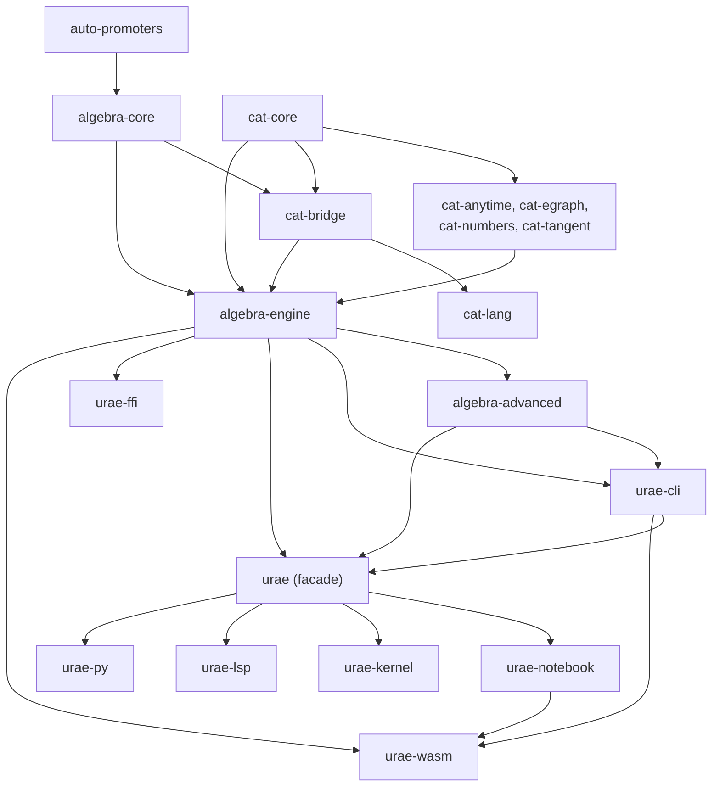

# URAE Design

*Checked 19 Nov 2026 against `dev` after v0.6.0 (unreleased changes are in the changelog). This file describes the architecture as it is built, the invariants the
code keeps, and how the long-range target in [`specs/ARCHITECTURE_SPEC.md`](specs/ARCHITECTURE_SPEC.md) grows out of it.
What is planned and in what order is in [`PLANNING.md`](PLANNING.md); what is wrong is in [`LEDGER.md`](LEDGER.md).
Sections 1 to 7 describe what is built. Section 8 is a proposal, not a description, and says so at its start.*

## 1. What URAE is

The Universal Rust Algebra Engine is a computer algebra system with a numerical and geometric core, written in Rust
(edition 2024). One expression language, one execution path and one set of verification habits serve several kinds of
work: symbolic algebra and calculus, exact and certified solving, numerical ODE/PDE and finite-element simulation,
parametric CAD and meshing, advanced mathematical domains (knots, p-adics, surreals, Clifford algebras, quantum
circuits), formal-proof export, and a set of frontends (CLI, egui notebook, WebAssembly, LSP, Jupyter kernel, Python,
C ABI).

It is a library first. Every frontend is a thin layer over the same crates.

## 2. Design invariants

These hold in the code today. Each names where to see it. A change that breaks one needs a design decision in this
file, not just a patch.

1. **One hash-consed expression arena.** Expressions are nodes in an `ExprGraph` (`algebra-core`); identical nodes share
   one `ExprId`, so equality of structure is equality of ids and subexpressions are shared, not copied. Rewrites
   build new nodes; nothing mutates a node.
2. **One operation language, one execution path.** Requests are parsed into a `MathOperation`
   (`algebra-core::operation`) and run by the executor (`algebra-engine::executor`), so the CLI, notebook, WASM, LSP
   and kernel frontends share semantics. The typed fluent API (`algebra-engine::api`) and the DSL macros sit on the
   same engine.
3. **Exact before floating point.** Where an exact answer exists it is computed exactly: rational polynomial
   arithmetic (`gosper::QPoly`), exact Gröbner bases (`poly::exact`), CAD projection and Sturm isolation over `Q`
   (`cad::projection`), exact telescoping proofs (`zeilberger_proof`), exact constant folding (`try_eval_exact`).
   Floating point is explicit: numerical evaluation goes through `numeric` and an `EvalContext`, and a float never
   silently replaces an exact value.
4. **Refuse rather than guess.** Operations return `AlgebraResult`. Unsupported input is an error that names the
   limitation (CAD with four or more variables, a solver that cannot decide, an integral outside the implemented
   families), not a plausible-looking answer. A wrong answer presented as a result is the worst failure mode; the
   ledger tracks every known instance.
5. **Results carry their evidence where they can.** Equivalence is tested by Schwartz–Zippel fingerprints
   (`algebra-core::probabilistic`) with an explicit error bound; solutions can carry a `Solution::Probabilistic`
   certificate; derivations are recorded as proof traces that export to Lean 4 and Coq (`algebra-advanced::proof`);
   recurrences found by creative telescoping are proved by a symbolic identity check; numerical code is tested
   against tabulated values and exact identities (Wronskians, Neumann sums, recurrences), not against itself.
6. **Bounded resources.** Heavy operations run under a `ResourceBudget` with soft and hard caps
   (`algebra-core::config`), and the anytime engine (`cat-anytime`) returns progressively refined, enclosed results
   under a time budget.
7. **No unsafe code outside the FFI crate; no panics on reachable input.** `unsafe_code` is denied for the workspace;
   `unwrap`, `expect` and `panic` are warnings that CI turns into errors; remaining intentional panics are the
   `std`-mirroring operators on matrices and `Uint`.
8. **Every defect gets a test that fails on the old code.** The test is the evidence the ledger cites.

## 3. Architecture as built

### 3.1 Crates

The workspace has 20 members: 19 crates and the `urae-tests` crate. About 111,000 lines of Rust live in `crates/`.



The arrows follow the crates' dependencies (`cargo metadata`). `algebra-core` has no engine knowledge; `algebra-engine`
uses the categorical crates for anytime evaluation, e-graphs, jets and the verification bridge; `urae-cli` is a
dependency of the `urae` facade, and the notebook, kernel, language server and Python crates sit on the facade; the
WebAssembly crate links the engine, the CLI and the notebook directly. `cat-lang` (the CatScript parser) is not used
by the engine.

| Crate | Role | Size |
| :--- | :--- | ---: |
| `algebra-core` | Expression arena, symbols, numbers, intervals, parser, formatters, bytecode VM, `MathOperation`, budgets, probabilistic verifier, lemma registry | 10.3k lines |
| `algebra-engine` | The computational core: simplification, calculus, solving, series, linear algebra, ODE/PDE/FEA, CAD, geometry, special functions, search | 63.4k |
| `algebra-advanced` | Formal proofs, category morphisms, quantum, cryptography, stochastic calculus, Galois theory, knots, surreals, p-adics, Clifford algebras, AI agent | 4.7k |
| `auto-promoters` | Integer arithmetic that promotes from machine words to arbitrary precision | 1.3k |
| `cat-core`, `cat-bridge`, `cat-numbers`, `cat-anytime`, `cat-tangent`, `cat-egraph`, `cat-lang` | The categorical engine: open hypergraphs, the lift/lower bridge with differential verification, hypercomplex and tensor numbers, anytime evaluation, jet/Itô/Colombeau/time-scale calculi, e-graphs and Buckingham-Pi reduction, the CatScript parser | 8.2k together |
| `urae` | Facade and prelude re-exporting the engines | 0.3k |
| `urae-notebook` | The egui reactive notebook (the largest frontend) | 19.5k |
| `urae-cli`, `urae-wasm`, `urae-lsp`, `urae-kernel`, `urae-py`, `urae-ffi` | REPL and JSON streams, WebAssembly and Workers target, language server, Jupyter kernel, Python bindings, C ABI | 3.8k together |
| `urae-tests` | Five integration suites (`core`, `engine`, `advanced`, `ecosystem`, `notebook`) | tests |

### 3.2 `algebra-engine` by area

| Area | Modules |
| :--- | :--- |
| Simplification and rewriting | `simplify` (rules, domain detector, bridges, probabilistic verification), `lifting` (domain lift and retraction), `lemma_miner`, `cat_eval` |
| Calculus | `calculus`, `limits`, `series`, `risch` (rational and elementary integration, linear-radical substitution), `gosper`, `zeilberger`, `zeilberger_proof`, `guess`, `autodiff`, `branch` |
| Solving | `solver` (`solveset`, ODE and PDE solutions), `systems` (linear, polynomial, Diophantine, differential, numerical), `poly` (multivariate, exact Gröbner, real roots), `linprog`, `smt` |
| Numerics | `numeric` (evaluation, special functions), `ode` (symbolic and adaptive numerical), `pde` (numerical solvers and FEA), `sparse`, `matrix`, `control`, `symplectic`, `neural_ode`, `pinn` |
| Geometry and simulation | `cad` (decomposition with exact projection, constraint solver, mesh builders, BVH), `geometry`, `iga`, `pipeline` (CAD to FEA bridge), `visualizer` |
| Algebraic structures | `tensor`, `cartan`, `cartan_symbolic`, `curvature`, `diffalg`, `weyl_dmodules`, `interconnect`, `exceptional_lie`, `cft`, `qft`, `padic_hodge`, `topology`, `tda`, `noneuclidean`, `tropical` |
| Search and learning | `mcts` (value head, heuristic and learned policy heads), `heuristic`, `geometric_dl` |
| Interfaces | `executor`, `api`, `macros`, `session`, `stream`, `query`, `workbench`, `html_export` |

### 3.3 Data flow

```text
text or JSON request
  -> parser (ExprParser, parse_operation)          algebra-core
  -> MathOperation                                  algebra-core
  -> executor, under an ExecutionContext/budget     algebra-engine
  -> engine module on ExprGraph nodes (exact first) algebra-engine / algebra-advanced
  -> result: ExprId, number, mesh, solution, certificate
  -> formatter (Unicode, LaTeX) or frontend view
```

Numerical evaluation is a separate step (`evalf` with an `EvalContext` of bindings and precision), never implicit in
a rewrite. The categorical crates provide the anytime and verification layer: `cat-bridge` lifts an expression into a
hypergraph and checks the lowered result differentially, and `cat-anytime` evaluates a lifted term at progressively
higher fidelity under a time budget.

## 4. Subsystem designs

**Simplification.** Rule sets are selected by a domain detector (commutative ring, non-commutative ring, trigonometric,
fractional, tropical, ...). Equality of two results is decided by exact reduction where possible and by Schwartz–Zippel
fingerprints otherwise. E-graph rewriting (`cat-egraph`) and the MCTS search (`mcts`) explore rewrite sequences; the
search scores states with a value head and orders actions with a policy head that is either the rule-based heuristic
or a `LearnedPolicy` trained from the engine's own searches (no pretrained weights are shipped).

**Calculus.** Limits combine direct substitution, L'Hôpital, Gruntz-style asymptotics and a finite-point rule for
`1^∞`-type powers. Integration is rational (Hermite reduction, Rothstein–Trager), elementary (an incomplete Risch
tower, honest refusals outside it) and a substitution rule for a polynomial times a non-integer power of a linear
form. Summation uses Gosper's algorithm for indefinite sums and creative telescoping for definite ones: the
telescoping system is solved exactly at sample points, and `zeilberger_proof` turns the recurrence into a statement
for all `n` by rebuilding the certificate as a rational function and checking the telescoping identity as an identity of
bivariate polynomials.

**Solving.** `solveset` returns exact roots (radicals, `RootOf` placeholders for transcendental equations, complex
roots as exact complex values) with extraneous-root filtering. Polynomial systems go through an exact Gröbner basis;
the back-substitution handles Shape-Lemma position only (ledger `C16`).

**Numerics.** Special functions are computed by methods that are accurate over the whole range: integral
representations by Gauss–Legendre quadrature (Bessel `Y`, `K`, non-integer orders, Airy), the trapezoid rule for
integer-order `J`, Euler–Maclaurin for zeta, Stirling with a shift for log-gamma. ODE solvers span explicit, implicit
and symplectic schemes with adaptive stepping; PDE solvers are one-dimensional method-of-lines and FEM plus the FEA
engine below.

**Geometry and CAD.** Cylindrical algebraic decomposition uses the McCallum projection (leading coefficients,
discriminants, resultants) computed exactly (resultants by interpolation of Sylvester determinants) and Sturm root
isolation, for one to three variables; lifting is over exact fibres. The constraint solver handles every 2-D constraint
kind, points in 3-D and N-D, lines and planes in space, by damped Gauss–Newton. Mesh builders produce closed,
outward-oriented solids (gears with true involutes, profile shift, cycloidal and internal forms; screws with chamfer
and key socket; airfoils; springs; marching-tetrahedra surfaces of implicit fields and CSG).

**FEA.** Element zoo: `Line2`, `Tri3`, `Tri6`, `Quad4`, `Tet4`, `Tet10`, `Hex8` for elasticity (plane stress and
strain, full 3-D) and heat conduction. Assembly is sparse; large systems are solved by Jacobi-preconditioned
conjugate gradients with a componentwise backward-error stop; Dirichlet conditions are eliminated exactly and reaction
forces reported. The CAD bridge meshes gears, wings, springs and screws as shared-prism tetrahedral solids whose
volume and stiffness are checked against the CAD solid and closed-form bar and coil formulas.

**Advanced domains.** `algebra-advanced` holds the domains that are mathematically deep but narrow: proof traces and
Lean/Coq export, braid-closure knot invariants by state sums, quantum circuits, Galois-group classification, elliptic
curves, p-adics, adeles, surreals. Several are thin and the ledger says where (`A13`–`A16`, `B16`).

**Frontends.** The notebook is a reactive document over the executor; the CLI offers a REPL and a JSON stream; WASM
targets browsers and Workers; the LSP, kernel, Python and C-ABI crates expose the same engine to editors, Jupyter and
other languages.

## 5. Quality design

- **Tests.** Five integration suites in `tests/` mirror the crate boundaries, plus per-crate tests. A defect fix adds a
  test that fails on the old code. Numerical code is tested against tabulated values to 12 to 15 digits and against
  identities that do not depend on the implementation. `known_defect_tests.rs` and the dated files named in the ledger
  are the regression record.
- **CI** (`.github/workflows/ci.yml`): lint and format (`cargo fmt`, `clippy -D warnings` over all targets and
  features), native tests with coverage, WASM browser tests, an Android and iOS build check, a dependency-licence check,
  and a version-bump check on pull requests to `main`.
- **Benchmarks.** Criterion suites for `algebra-core`, `algebra-engine`, `algebra-advanced`, `urae` and `auto-promoters`
  under a thin-LTO `[profile.bench]`; they are compiled and linted in CI but not run.
- **Documentation.** Rustdoc with KaTeX ([`../DOCUMENTATION_STANDARDS.md`](../DOCUMENTATION_STANDARDS.md)); the
  workspace sets no `missing_docs` lint, so "every public item is documented" is a convention.

## 6. Target architecture

[`specs/ARCHITECTURE_SPEC.md`](specs/ARCHITECTURE_SPEC.md) specifies a much larger system: a unified numerical analysis,
parametric CAD, multiphysics and AI platform with composable discretisations (FEM, IGA, FVM, BEM, SPH, MPM, LBM, VEM,
FEEC), a coupling algebra, a dual explicit/automatic orchestration mode, SciML and symbolic analysis of AI systems, a
certified-arithmetic and formal-proof spine, and a function registry. It is a specification, not a status report: its
section 2 states what exists, and this file and the ledger take precedence where they differ.

Its design rests on seven invariants. Four extend ones above: method-agnostic problem specification, the dual-control
paradigm (explicit composition and automatic orchestration), a unified exterior-calculus spine, and end-to-end
differentiability with symbolic, numerical and formal co-mingling. Three are new: structure preservation by
construction (symplectic, port-Hamiltonian, GENERIC), first-class analysis of AI systems, and polymorphic
carriers with shared algorithmic spines.

The spec's eight waves map to the milestones in [`PLANNING.md`](PLANNING.md):

| Wave | Scope | Builds on what exists |
| :--- | :--- | :--- |
| 1 | Carrier and operator trait hierarchy, `ScalarRing` versus `ContextualAlgebra`, numerical sparse types, Krylov and multigrid solvers, compensated arithmetic, `const` and WGSL lowering, and the audit fixes | `CsrMatrix` and conjugate gradients in the FEA engine; `numeric`; `auto-promoters` |
| 2 | Multi-representation CAD (B-Rep, NURBS, SDF), exact offsets, file-format hub, differentiable CAD | exact CAD to three variables, solid mesh builders, the constraint solver, `iga` |
| 3 | FVM, BEM, IGA extensions, VEM, HDG, FEEC | the FEA element zoo and sparse assembly |
| 4 | Particle and kinetic methods, cloth and multibody, acoustics, rough SDEs | none yet |
| 5 | Cross-method couplers and the composition DSL | wave 3 |
| 6 | The automatic orchestrator, index reduction, registry | wave 5, `cat-anytime` |
| 7 | Multi-solution discovery, expansions, risk and econometrics, physics domains, complete CAS | `risch`, `zeilberger`, `solver`, `poly` |
| 8 | SciML, AI analysis, federated loop, formal kernel, non-classical logics | `pinn`, `neural_ode`, `mcts`, `algebra-advanced::proof` |

Design decisions to settle before wave 1 starts: the trait boundary between scalar rings and contextual algebras; whether
numerical `CsrMatrix<f64>` is the generic `CsrMatrix<R>` of the carrier design or a first step toward it (the symbolic
`sparse::CsrMatrix` and the FEA CSR type already exist separately); how errors and certificates thread through the
operator traits; and how the executor's `MathOperation` grows to cover composed pipelines without becoming a
second language. Section 8 proposes answers to the last two.

## 7. Known design debts

- Two surreal-number engines (`algebra-advanced::surreal`, `cat-numbers::surreal`) with an `f64` shortcut in the
  comparison (`B16`).
- Several CSR and sparse types (symbolic `sparse`, the FEA assembly, `cat` crates) with no shared trait.
- Some modules still use `f64` coefficients where exact ones are the invariant (differential forms keep `f64`
  coefficients beside the symbolic ones, `C5`).
- Frontend coverage of the engine is uneven; the notebook is far ahead of the LSP's completion catalogue (`C15`).
- Documentation numbers (test counts, line counts) drift; the ledger and this file avoid them where they can.

## 8. Proposal: one operation model for every calling style

*Status: proposed, revision 1 (27 Nov 2026). Nothing in this section is built. It answers two of the open decisions
in section 6: how errors and certificates thread through the operator traits, how `MathOperation` grows without
becoming a second language, and where mutation and memory reclamation live.*

### 8.1 Problems this addresses

Each item below was checked against `dev` at commit `1dfd2d4`.

| # | Observation | Where |
| :--- | :--- | :--- |
| P1 | Every graph parameter is `&ExprGraph` (668 sites, no `&mut ExprGraph`), because interning works through locks inside the graph. A signature does not say whether an operation adds nodes. | `algebra-core/src/graph.rs` |
| P2 | `ExprGraph::get` returns a clone of the node; a clone allocates when the node owns heap data (a spilled `SmallVec`, a `BigInteger`, a `Matrix` `Vec`). Every node is stored twice, in the `Vec` and as the key of the deduplication map. | `graph.rs` (`get`, `intern`) |
| P3 | The graph only grows. The notebook's graph is created once and never reset, and every re-evaluation adds to it. | `urae-notebook/src/notebook/mod.rs` |
| P4 | Variations are method-name suffixes (`diff` / `diff_with_steps`; `solveset` / `solveset_outcome` / `solveset_certified`; `simplify` / `simplify_with_conditions` / `simplify_with`). Each new axis (steps, certificates, assumptions, budget, async) multiplies the methods. | `calculus.rs`, `solver.rs`, `api.rs` |
| P5 | Result types disagree: `diff` cannot fail, `integrate` returns `AlgebraResult`, `solveset_outcome` returns a typed outcome, and `SymbolicSimplifier::simplify` returns its input unchanged on failure. | `calculus.rs:15`, `simplify/mod.rs:1954` |
| P6 | Nine engine traits (`SymbolicCalculus`, `SymbolicSolver`, `NumericalEval`, ...) each have one implementation, for `ExprGraph`; `Simplifier` is a unit struct of associated functions. Nothing is generic over storage. | `impl ... for ExprGraph` |
| P7 | Async is `ComputeFuture::spawn`: one OS thread per call, and dropping the future does not stop the work. No algebra-engine module reads `ResourceBudget` (only `cat_eval.rs` uses the anytime budget). | `stream.rs` |
| P8 | `ConstRational` uses plain `i64` `*`. In a `const` context an overflow is a compile error; at run time, with `overflow-checks = false` in the release profile, it wraps silently. | `api.rs`, `Cargo.toml` |
| P9 | The C ABI is three string-in, string-out calls. Every failure is `NULL`; there is no `catch_unwind` (and release builds abort on panic, so the host process dies); `urae_session_execute` takes `&mut *session` with no lock. | `urae-ffi/src/lib.rs` |
| P10 | `urae-py` has no Python binding layer: `PyExprGraph` stores LaTeX and Unicode strings and re-parses on every call. | `urae-py/src/lib.rs` |

### 8.2 Goals and non-goals

Goals:

1. A new axis of variation (steps, certificates, budgets, async, a new frontend) costs one adapter, not one method per
   operation.
2. Types say what an operation may do: read the graph, add nodes, or mutate an owned buffer.
3. One result type carries the value, the reason for a refusal, and any evidence.
4. Memory from intermediate nodes is reclaimed at the end of the operation that made them.
5. The C ABI cannot crash its host and keeps expression handles between calls.

Non-goals: a custom global allocator (section 8.5 gives the measurements), `async fn` in the engine's traits (the
engine is CPU-bound, and async traits would spread to every caller), and changing the parser or formatter.

### 8.3 Operations are values

Each operation is a plain struct that describes the request, and one trait runs it:

```rust
pub struct Diff { pub expr: ExprId, pub wrt: SymbolId, pub order: u32 }
pub struct Simplify { pub expr: ExprId }
pub struct Solve { pub equation: ExprId, pub unknown: SymbolId }

pub trait Operation {
    type Output;
    fn run<S: ExprBuilder>(&self, cx: &mut Cx<S>) -> Outcome<Self::Output>;
}

pub struct Outcome<T> {
    pub value: Result<T, AlgebraError>, // succeeds, or refuses with a reason (invariant 4)
    pub steps: Option<Steps>,           // filled only when requested
    pub certificate: Option<Certificate>,
    pub diagnostics: Vec<Diagnostic>,   // e.g. the conditions a simplification assumed
}
```

`Cx` carries what is today a suffix or a loose argument: the assumptions, the precision, the `ResourceBudget`, a
cancellation token and the flags "record steps" and "certify". `diff_with_steps(e, x)` becomes
`Diff { expr: e, wrt: x, order: 1 }.run(&mut cx.with_steps())`. The number of methods grows with the number of
operations, not with operations times variations.

`MathOperation` becomes a serde-tagged enum over these structs, so the executor, the fluent API (`api.rs`), the macros
and every frontend dispatch to the same code. That completes invariant 2 instead of adding a second language. The
existing traits stay as thin wrappers during migration (section 8.9).

### 8.4 Reading and building are different capabilities

```rust
pub trait ExprStore: Sync {
    fn node(&self, id: ExprId) -> NodeRef<'_>; // a borrowed view; no clone
    fn len(&self) -> usize;
}
pub trait ExprBuilder: ExprStore {
    fn intern(&self, node: NodeSpec) -> ExprId;
}
```

Formatters, `equiv` and `free_symbols` take `&impl ExprStore`; operations receive an `ExprBuilder` through `Cx`.
`ExprGraph`, a scratch graph (section 8.5) and a later flat-encoded graph implement both traits, so engine code is
written once (P1, P6). `NodeRef` borrows from an append-only store whose elements never move (for example the `boxcar`
crate, which offers lock-free `push` returning the index and lock-free reads), which removes the clone in `get` and the
read lock (P2, and audit item J2).

### 8.5 Memory

**No custom global allocator.** Measured on 27 Nov 2026 with a counting allocator around ten typical commands
(simplify, diff, integrate, expand `(x+y+z)^6`, factor, solve, series, limit) run 30 times per session, release build:
about 230,000 allocations per pass, 74% of them 16 bytes or smaller, and a peak of 0.6 MB in use. mimalloc and the
system allocator were within noise of each other (588 to 731 ms). A bump allocator that never frees, which is the best
case for any arena-style global allocator, was slower (767 to 831 ms) and left 1,535 MB unreclaimed. A global
allocator sees only `alloc` and `dealloc` calls in arbitrary order; the scope information that makes region allocation
fast in languages such as Goose is not available to it, and engine results deliberately outlive the call that made
them.

**Reclaim by scope instead.** Counting the nodes a result still uses against the nodes the command created, on a fresh
graph: `simplify (x+1)^2 - (x^2+2x+1)` 1 of 24, `diff sin(x)*exp(x^2)*log(x)` 14 of 54, `series exp(x)*sin(x)` 20
of 55, `solve x^3-6x^2+11x-6 = 0` 0 of 23. So:

1. Each operation runs against a scratch graph layered over the session graph. At the end, the nodes reachable from
   the result are copied into the session graph and the scratch graph is dropped: one free for all intermediate work.
   A scratch `ExprId` is a different type from a session `ExprId`, so it cannot leak.
2. The notebook rebuilds its graph on each `evaluate_all`. It already re-parses every line, and its caches
   (`LineCache`, `PlotCache`, `ParsedLine`) hold strings and floats, never `ExprId`s, so this is safe today (P3).
3. Long-lived sessions (CLI, LSP, kernel, Python) compact when the node count passes a limit: copy what is reachable
   from the session's roots into a new graph and remap. Handles carry an epoch so a stale `ExprId` is caught.
4. The deduplication map stores hashes and ids, not a second copy of each node (P2).

### 8.6 Execution modes are adapters

- **Synchronous:** `op.run(&mut cx)`.
- **Asynchronous:** `spawn(op, cx) -> Task<Op::Output>` runs on the rayon pool (native) or is stepped by `cat-anytime`
  (wasm32). `Task` owns the cancellation token, so dropping it cancels the work (P7).
- **Budgets and cancellation:** long loops call `cx.checkpoint()?`, which checks cancellation and the `ResourceBudget`
  in one place. Gröbner S-pairs, e-graph nodes, series order and solver iterations map onto the existing budget
  fields.
- **Batches:** `run_batch(ops, cx)` over a shared read-only store.

### 8.7 `const`

Small exact kernels (gcd, checked rational arithmetic, small polynomial evaluation) are written once as `const fn`s
that return `Option` on overflow. `ConstRational`, `ConstPoly` and the run-time `Number` call the same kernels, so an
overflow is a compile error in `const` code and a promotion to big integers at run time, never a silent wrap (P8).

### 8.8 Mutability

Expressions are immutable (invariant 1), so there are no `&mut` versions of graph operations. Owned buffers
(`NumMat`, `MatrixBuffer`, `SymMat`) follow the Rust pair `simplify(&self) -> Self` and `simplify_in_place(&mut self)`,
as `api.rs` already does.

### 8.9 FFI and bindings

- One C function per operation, generated from the `Operation` types, returning a status code and writing through an
  out-parameter, for example `urae_status urae_diff(urae_session*, urae_expr, urae_symbol, urae_expr* out)`. The
  header is generated with cbindgen.
- `urae_expr` is a plain `{ uint32_t id; uint32_t epoch; }`, so expressions persist between calls; parsing and
  formatting are separate calls.
- `urae_last_error(session)` returns the error code and message; `NULL` is kept for out-of-memory only.
- Every entry point runs inside `catch_unwind`. The `cdylib` is built with `[profile.release-ffi] inherits = "release"`
  and `panic = "unwind"`: Cargo cannot override `panic` for one package, and under `abort` `catch_unwind` does nothing.
- A session sits behind a `Mutex` in its handle; read-only calls take only the shared store and may run concurrently
  (P9).
- `urae_spawn`, `urae_task_poll`, `urae_task_cancel` and `urae_task_free` expose `Task`.
- `urae_run(session, request_json, out_json)` covers every operation through the serde form of `MathOperation`.
- Python (through pyo3) and WASM sit on these layers instead of re-wrapping strings (P10).

### 8.10 Migration

1. Introduce `Outcome`, `Cx` and `Operation`; port `diff`, `simplify` and `solve`; keep the old trait methods as
   wrappers that call the new code.
2. Split `ExprStore` from `ExprBuilder`; add the scratch-graph scope; rebuild the notebook graph per evaluation.
3. Replace `ComputeFuture` with `Task`; add `checkpoint` calls to the long loops.
4. Rebuild the FFI with handles, status codes and the unwind profile; make the Python and WASM crates thin layers.

Each step starts with a failing test, as section 2 (invariant 8) requires.
