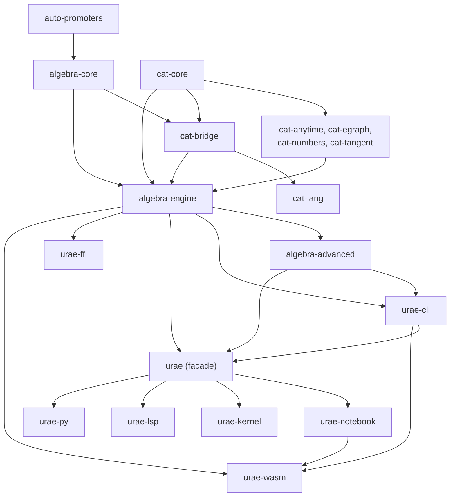
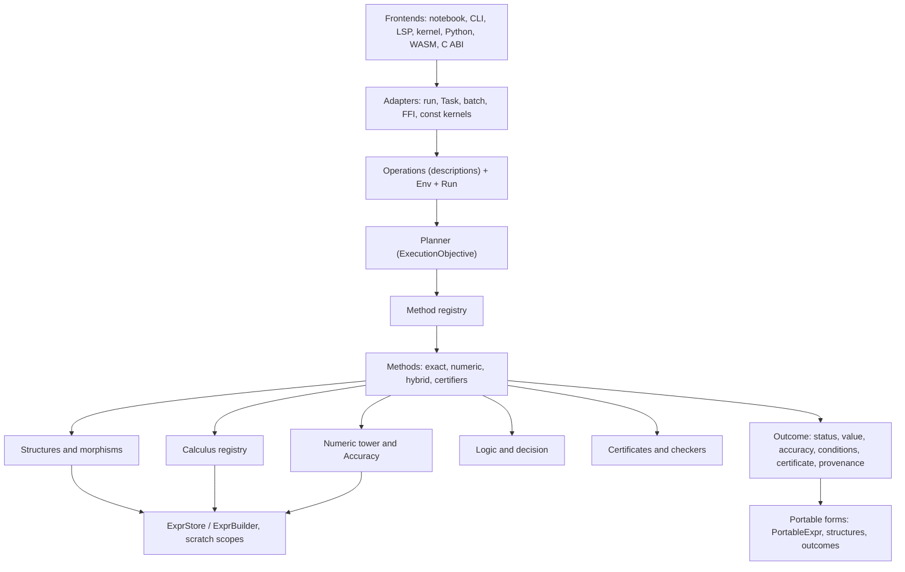

# URAE Design

*Checked 19 Nov 2026 against `dev` after v0.6.0 (unreleased changes are in the changelog). This file describes the architecture as it is built, the invariants the
code keeps, and how the long-range target in [`specs/ARCHITECTURE_SPEC.md`](specs/ARCHITECTURE_SPEC.md) grows out of it.
What is planned and in what order is in [`PLANNING.md`](PLANNING.md); what is wrong is in [`LEDGER.md`](LEDGER.md).
Sections 1 to 7 describe what is built. Section 8 is a proposal, not a description, and says so at its start.*

## 1. What URAE is

The Universal Rust Algebra Engine is a computer algebra system with a numerical and geometric core, written in Rust
(edition 2024). One expression language, one execution path and one set of verification habits serve several kinds of
work: symbolic algebra and calculus, exact and certified solving, numerical ODE/PDE and finite-element simulation,
parametric CAD and meshing, advanced mathematical domains (knots, p-adics, surreals, Clifford algebras, quantum
circuits), formal-proof export, and a set of frontends (CLI, egui notebook, WebAssembly, LSP, Jupyter kernel, Python,
C ABI).

It is a library first. Every frontend is a thin layer over the same crates.

## 2. Design invariants

These hold in the code today. Each names where to see it. A change that breaks one needs a design decision in this
file, not just a patch.

1. **One hash-consed expression arena.** Expressions are nodes in an `ExprGraph` (`algebra-core`); identical nodes share
   one `ExprId`, so equality of structure is equality of ids and subexpressions are shared, not copied. Rewrites
   build new nodes; nothing mutates a node.
2. **One operation language, one execution path.** Requests are parsed into a `MathOperation`
   (`algebra-core::operation`) and run by the executor (`algebra-engine::executor`), so the CLI, notebook, WASM, LSP
   and kernel frontends share semantics. The typed fluent API (`algebra-engine::api`) and the DSL macros sit on the
   same engine.
3. **Exact before floating point.** Where an exact answer exists it is computed exactly: rational polynomial
   arithmetic (`gosper::QPoly`), exact Gröbner bases (`poly::exact`), CAD projection and Sturm isolation over `Q`
   (`cad::projection`), exact telescoping proofs (`zeilberger_proof`), exact constant folding (`try_eval_exact`).
   Floating point is explicit: numerical evaluation goes through `numeric` and an `EvalContext`, and a float never
   silently replaces an exact value.
4. **Refuse rather than guess.** Operations return `AlgebraResult`. Unsupported input is an error that names the
   limitation (CAD with four or more variables, a solver that cannot decide, an integral outside the implemented
   families), not a plausible-looking answer. A wrong answer presented as a result is the worst failure mode; the
   ledger tracks every known instance.
5. **Results carry their evidence where they can.** Equivalence is tested by Schwartz–Zippel fingerprints
   (`algebra-core::probabilistic`) with an explicit error bound; solutions can carry a `Solution::Probabilistic`
   certificate; derivations are recorded as proof traces that export to Lean 4 and Coq (`algebra-advanced::proof`);
   recurrences found by creative telescoping are proved by a symbolic identity check; numerical code is tested
   against tabulated values and exact identities (Wronskians, Neumann sums, recurrences), not against itself.
6. **Bounded resources.** Heavy operations run under a `ResourceBudget` with soft and hard caps
   (`algebra-core::config`), and the anytime engine (`cat-anytime`) returns progressively refined, enclosed results
   under a time budget.
7. **No unsafe code outside the FFI crate; no panics on reachable input.** `unsafe_code` is denied for the workspace;
   `unwrap`, `expect` and `panic` are warnings that CI turns into errors; remaining intentional panics are the
   `std`-mirroring operators on matrices and `Uint`.
8. **Every defect gets a test that fails on the old code.** The test is the evidence the ledger cites.

## 3. Architecture as built

### 3.1 Crates

The workspace has 20 members: 19 crates and the `urae-tests` crate. About 111,000 lines of Rust live in `crates/`.



The arrows follow the crates' dependencies (`cargo metadata`). `algebra-core` has no engine knowledge; `algebra-engine`
uses the categorical crates for anytime evaluation, e-graphs, jets and the verification bridge; `urae-cli` is a
dependency of the `urae` facade, and the notebook, kernel, language server and Python crates sit on the facade; the
WebAssembly crate links the engine, the CLI and the notebook directly. `cat-lang` (the CatScript parser) is not used
by the engine.

| Crate | Role | Size |
| :--- | :--- | ---: |
| `algebra-core` | Expression arena, symbols, numbers, intervals, parser, formatters, bytecode VM, `MathOperation`, budgets, probabilistic verifier, lemma registry | 10.3k lines |
| `algebra-engine` | The computational core: simplification, calculus, solving, series, linear algebra, ODE/PDE/FEA, CAD, geometry, special functions, search | 63.4k |
| `algebra-advanced` | Formal proofs, category morphisms, quantum, cryptography, stochastic calculus, Galois theory, knots, surreals, p-adics, Clifford algebras, AI agent | 4.7k |
| `auto-promoters` | Integer arithmetic that promotes from machine words to arbitrary precision | 1.3k |
| `cat-core`, `cat-bridge`, `cat-numbers`, `cat-anytime`, `cat-tangent`, `cat-egraph`, `cat-lang` | The categorical engine: open hypergraphs, the lift/lower bridge with differential verification, hypercomplex and tensor numbers, anytime evaluation, jet/Itô/Colombeau/time-scale calculi, e-graphs and Buckingham-Pi reduction, the CatScript parser | 8.2k together |
| `urae` | Facade and prelude re-exporting the engines | 0.3k |
| `urae-notebook` | The egui reactive notebook (the largest frontend) | 19.5k |
| `urae-cli`, `urae-wasm`, `urae-lsp`, `urae-kernel`, `urae-py`, `urae-ffi` | REPL and JSON streams, WebAssembly and Workers target, language server, Jupyter kernel, Python bindings, C ABI | 3.8k together |
| `urae-tests` | Five integration suites (`core`, `engine`, `advanced`, `ecosystem`, `notebook`) | tests |

### 3.2 `algebra-engine` by area

| Area | Modules |
| :--- | :--- |
| Simplification and rewriting | `simplify` (rules, domain detector, bridges, probabilistic verification), `lifting` (domain lift and retraction), `lemma_miner`, `cat_eval` |
| Calculus | `calculus`, `limits`, `series`, `risch` (rational and elementary integration, linear-radical substitution), `gosper`, `zeilberger`, `zeilberger_proof`, `guess`, `autodiff`, `branch` |
| Solving | `solver` (`solveset`, ODE and PDE solutions), `systems` (linear, polynomial, Diophantine, differential, numerical), `poly` (multivariate, exact Gröbner, real roots), `linprog`, `smt` |
| Numerics | `numeric` (evaluation, special functions), `ode` (symbolic and adaptive numerical), `pde` (numerical solvers and FEA), `sparse`, `matrix`, `control`, `symplectic`, `neural_ode`, `pinn` |
| Geometry and simulation | `cad` (decomposition with exact projection, constraint solver, mesh builders, BVH), `geometry`, `iga`, `pipeline` (CAD to FEA bridge), `visualizer` |
| Algebraic structures | `tensor`, `cartan`, `cartan_symbolic`, `curvature`, `diffalg`, `weyl_dmodules`, `interconnect`, `exceptional_lie`, `cft`, `qft`, `padic_hodge`, `topology`, `tda`, `noneuclidean`, `tropical` |
| Search and learning | `mcts` (value head, heuristic and learned policy heads), `heuristic`, `geometric_dl` |
| Interfaces | `executor`, `api`, `macros`, `session`, `stream`, `query`, `workbench`, `html_export` |

### 3.3 Data flow

```text
text or JSON request
  -> parser (ExprParser, parse_operation)          algebra-core
  -> MathOperation                                  algebra-core
  -> executor, under an ExecutionContext/budget     algebra-engine
  -> engine module on ExprGraph nodes (exact first) algebra-engine / algebra-advanced
  -> result: ExprId, number, mesh, solution, certificate
  -> formatter (Unicode, LaTeX) or frontend view
```

Numerical evaluation is a separate step (`evalf` with an `EvalContext` of bindings and precision), never implicit in
a rewrite. The categorical crates provide the anytime and verification layer: `cat-bridge` lifts an expression into a
hypergraph and checks the lowered result differentially, and `cat-anytime` evaluates a lifted term at progressively
higher fidelity under a time budget.

## 4. Subsystem designs

**Simplification.** Rule sets are selected by a domain detector (commutative ring, non-commutative ring, trigonometric,
fractional, tropical, ...). Equality of two results is decided by exact reduction where possible and by Schwartz–Zippel
fingerprints otherwise. E-graph rewriting (`cat-egraph`) and the MCTS search (`mcts`) explore rewrite sequences; the
search scores states with a value head and orders actions with a policy head that is either the rule-based heuristic
or a `LearnedPolicy` trained from the engine's own searches (no pretrained weights are shipped).

**Calculus.** Limits combine direct substitution, L'Hôpital, Gruntz-style asymptotics and a finite-point rule for
`1^∞`-type powers. Integration is rational (Hermite reduction, Rothstein–Trager), elementary (an incomplete Risch
tower, honest refusals outside it) and a substitution rule for a polynomial times a non-integer power of a linear
form. Summation uses Gosper's algorithm for indefinite sums and creative telescoping for definite ones: the
telescoping system is solved exactly at sample points, and `zeilberger_proof` turns the recurrence into a statement
for all `n` by rebuilding the certificate as a rational function and checking the telescoping identity as an identity of
bivariate polynomials.

**Solving.** `solveset` returns exact roots (radicals, `RootOf` placeholders for transcendental equations, complex
roots as exact complex values) with extraneous-root filtering. Polynomial systems go through an exact Gröbner basis;
the back-substitution handles Shape-Lemma position only (ledger `C16`).

**Numerics.** Special functions are computed by methods that are accurate over the whole range: integral
representations by Gauss–Legendre quadrature (Bessel `Y`, `K`, non-integer orders, Airy), the trapezoid rule for
integer-order `J`, Euler–Maclaurin for zeta, Stirling with a shift for log-gamma. ODE solvers span explicit, implicit
and symplectic schemes with adaptive stepping; PDE solvers are one-dimensional method-of-lines and FEM plus the FEA
engine below.

**Geometry and CAD.** Cylindrical algebraic decomposition uses the McCallum projection (leading coefficients,
discriminants, resultants) computed exactly (resultants by interpolation of Sylvester determinants) and Sturm root
isolation, for one to three variables; lifting is over exact fibres. The constraint solver handles every 2-D constraint
kind, points in 3-D and N-D, lines and planes in space, by damped Gauss–Newton. Mesh builders produce closed,
outward-oriented solids (gears with true involutes, profile shift, cycloidal and internal forms; screws with chamfer
and key socket; airfoils; springs; marching-tetrahedra surfaces of implicit fields and CSG).

**FEA.** Element zoo: `Line2`, `Tri3`, `Tri6`, `Quad4`, `Tet4`, `Tet10`, `Hex8` for elasticity (plane stress and
strain, full 3-D) and heat conduction. Assembly is sparse; large systems are solved by Jacobi-preconditioned
conjugate gradients with a componentwise backward-error stop; Dirichlet conditions are eliminated exactly and reaction
forces reported. The CAD bridge meshes gears, wings, springs and screws as shared-prism tetrahedral solids whose
volume and stiffness are checked against the CAD solid and closed-form bar and coil formulas.

**Advanced domains.** `algebra-advanced` holds the domains that are mathematically deep but narrow: proof traces and
Lean/Coq export, braid-closure knot invariants by state sums, quantum circuits, Galois-group classification, elliptic
curves, p-adics, adeles, surreals. Several are thin and the ledger says where (`A13`–`A16`, `B16`).

**Frontends.** The notebook is a reactive document over the executor; the CLI offers a REPL and a JSON stream; WASM
targets browsers and Workers; the LSP, kernel, Python and C-ABI crates expose the same engine to editors, Jupyter and
other languages.

## 5. Quality design

- **Tests.** Five integration suites in `tests/` mirror the crate boundaries, plus per-crate tests. A defect fix adds a
  test that fails on the old code. Numerical code is tested against tabulated values to 12 to 15 digits and against
  identities that do not depend on the implementation. `known_defect_tests.rs` and the dated files named in the ledger
  are the regression record.
- **CI** (`.github/workflows/ci.yml`): lint and format (`cargo fmt`, `clippy -D warnings` over all targets and
  features), native tests with coverage, WASM browser tests, an Android and iOS build check, a dependency-licence check,
  and a version-bump check on pull requests to `main`.
- **Benchmarks.** Criterion suites for `algebra-core`, `algebra-engine`, `algebra-advanced`, `urae` and `auto-promoters`
  under a thin-LTO `[profile.bench]`; they are compiled and linted in CI but not run.
- **Documentation.** Rustdoc with KaTeX ([`../DOCUMENTATION_STANDARDS.md`](../DOCUMENTATION_STANDARDS.md)); the
  workspace sets no `missing_docs` lint, so "every public item is documented" is a convention.

## 6. Target architecture

[`specs/ARCHITECTURE_SPEC.md`](specs/ARCHITECTURE_SPEC.md) specifies a much larger system: a unified numerical analysis,
parametric CAD, multiphysics and AI platform with composable discretisations (FEM, IGA, FVM, BEM, SPH, MPM, LBM, VEM,
FEEC), a coupling algebra, a dual explicit/automatic orchestration mode, SciML and symbolic analysis of AI systems, a
certified-arithmetic and formal-proof spine, and a function registry. It is a specification, not a status report: its
section 2 states what exists, and this file and the ledger take precedence where they differ.

Its design rests on seven invariants. Four extend ones above: method-agnostic problem specification, the dual-control
paradigm (explicit composition and automatic orchestration), a unified exterior-calculus spine, and end-to-end
differentiability with symbolic, numerical and formal co-mingling. Three are new: structure preservation by
construction (symplectic, port-Hamiltonian, GENERIC), first-class analysis of AI systems, and polymorphic
carriers with shared algorithmic spines.

The spec's eight waves map to the milestones in [`PLANNING.md`](PLANNING.md):

| Wave | Scope | Builds on what exists |
| :--- | :--- | :--- |
| 1 | Carrier and operator trait hierarchy, `ScalarRing` versus `ContextualAlgebra`, numerical sparse types, Krylov and multigrid solvers, compensated arithmetic, `const` and WGSL lowering, and the audit fixes | `CsrMatrix` and conjugate gradients in the FEA engine; `numeric`; `auto-promoters` |
| 2 | Multi-representation CAD (B-Rep, NURBS, SDF), exact offsets, file-format hub, differentiable CAD | exact CAD to three variables, solid mesh builders, the constraint solver, `iga` |
| 3 | FVM, BEM, IGA extensions, VEM, HDG, FEEC | the FEA element zoo and sparse assembly |
| 4 | Particle and kinetic methods, cloth and multibody, acoustics, rough SDEs | none yet |
| 5 | Cross-method couplers and the composition DSL | wave 3 |
| 6 | The automatic orchestrator, index reduction, registry | wave 5, `cat-anytime` |
| 7 | Multi-solution discovery, expansions, risk and econometrics, physics domains, complete CAS | `risch`, `zeilberger`, `solver`, `poly` |
| 8 | SciML, AI analysis, federated loop, formal kernel, non-classical logics | `pinn`, `neural_ode`, `mcts`, `algebra-advanced::proof` |

Design decisions to settle before wave 1 starts: the trait boundary between scalar rings and contextual algebras; whether
numerical `CsrMatrix<f64>` is the generic `CsrMatrix<R>` of the carrier design or a first step toward it (the symbolic
`sparse::CsrMatrix` and the FEA CSR type already exist separately); how errors and certificates thread through the
operator traits; and how the executor's `MathOperation` grows to cover composed pipelines without becoming a
second language. Section 8 proposes answers to the first and the last two.

## 7. Known design debts

- Two surreal-number engines (`algebra-advanced::surreal`, `cat-numbers::surreal`) with an `f64` shortcut in the
  comparison (`B16`).
- Several CSR and sparse types (symbolic `sparse`, the FEA assembly, `cat` crates) with no shared trait.
- Some modules still use `f64` coefficients where exact ones are the invariant (differential forms keep `f64`
  coefficients beside the symbolic ones, `C5`).
- Frontend coverage of the engine is uneven; the notebook is far ahead of the LSP's completion catalogue (`C15`).
- Documentation numbers (test counts, line counts) drift; the ledger and this file avoid them where they can.

## 8. Proposal: one operation model across algebras, calculi and precision

*Status: proposed, revision 3 (27 Nov 2026). Nothing in this section is built. Revision 1 (commit `fbc3d09`) designed
the calling conventions: operations as values, one result type, read and build capabilities, memory by scope, async
and FFI adapters. Revision 2 (commit `e614cb3`) tested that design against the rest of URAE's scope (several calculi,
arbitrary algebraic structures, symbolic and numerical analysis together, arbitrary precision with error tracking,
automatic choice of methods) and changed it where it did not fit. Revision 3 adds what the plan and the specification
still required (logic and decision, proofs and certificates, function identity, units, interoperability,
serialisation, one registry, composition) and a performance section with measured baselines, data layouts and gates.
Section 8.20 lists the changes in each revision and why. The section proposes answers to
the first, third and fourth of the open decisions in section 6. It reuses the specification's names where one exists
(`ExecutionObjective`, `AccuracyGoal`, `NumericRep`, `RuntimeEnv`, `ScalarRing` and `ContextualAlgebra`,
certify-or-escalate) and says where it differs.*

### 8.1 Requirements

| # | Requirement | Source |
| :--- | :--- | :--- |
| R1 | One operation can be called synchronously, asynchronously, in a batch, from C, Python and WASM, and (for small exact kernels) in `const` code, without a separate implementation per style | this proposal |
| R2 | The types say whether a call reads expressions, adds expressions, or mutates an owned buffer | this proposal |
| R3 | Calculi beyond the classical one: difference and umbral calculus, q-calculus, time scales, Itô and Stratonovich stochastic calculus, Colombeau generalised functions, fractional calculus, and later rough paths | spec 24.4, `cat-tangent` |
| R4 | Any algebraic structure: groups, rings, fields, modules, non-associative algebras; finite structures; tensor algebras; structures built from others (polynomials, quotients, extensions, matrices, tensor and direct products, completions); p-adic, adelic, formal-series and surreal arithmetic | spec 27, `cat-numbers`, `algebra-advanced` |
| R5 | Symbolic and numerical analysis, separately and combined within one request | invariants 3 and 5 |
| R6 | Arbitrary precision where the problem allows it; where machines or budgets do not, a tracked and honest statement of how accurate the result is | invariants 4 and 6, spec 17 and 25.1 |
| R7 | Automatic blending of methods to reach the requested accuracy at the lowest cost, with the user able to override any choice | spec 9, 19, 44.4 |
| R8 | Every rule above keeps the existing invariants: exact before floating point, refuse rather than guess, bounded resources, no unsafe code outside the FFI crate | section 2 |
| R9 | Logics and decision: assumptions as formulas in a stated logic, classical and non-classical logics, decision procedures that return evidence | spec 35, `logic.rs`, `smt.rs` |
| R10 | Proofs: results carry checkable certificates, and proof traces export to Lean 4 and Coq with the right types and tactics | invariant 5, spec 23, `algebra-advanced::proof` |
| R11 | Interoperability: one identity per function, domains and units as part of typing, conversions between Rust carriers and external type systems | spec 38, 41, `D13`, `units.rs` |
| R12 | Serialisation: every value, structure, operation and result that leaves a session has a portable, versioned form | audit `E8` |
| R13 | One registry for operations and methods, and composed pipelines as first-class operations | spec 8, 29, 37 |
| R14 | Performance: the new layers cost nothing when unused and little when used; hot paths are measured and gated | this proposal |

### 8.2 What exists and what is in the way

Each item was checked against `dev` at commit `1dfd2d4`. P1 to P10 come from revision 1; P11 to P20 were found while
testing it against R3 to R7; P21 to P30 while testing revision 2 against R9 to R14.

| # | Observation | Where |
| :--- | :--- | :--- |
| P1 | Every graph parameter is `&ExprGraph` (668 sites, none `&mut ExprGraph`), because interning works through locks inside the graph. A signature does not say whether a call adds nodes. | `algebra-core/src/graph.rs` |
| P2 | `ExprGraph::get` returns a clone of the node, which allocates when the node owns heap data (a spilled `SmallVec`, a `BigInteger`, a `Matrix` `Vec`). Every node is stored twice: in the `Vec` and as the key of the deduplication map. | `graph.rs` |
| P3 | The graph only grows. The notebook creates its graph once and never resets it. | `urae-notebook/src/notebook/mod.rs` |
| P4 | Variations are method-name suffixes (`diff` and `diff_with_steps`; `solveset`, `solveset_outcome` and `solveset_certified`; `simplify`, `simplify_with_conditions` and `simplify_with`), so each new axis multiplies the methods. | `calculus.rs`, `solver.rs`, `api.rs` |
| P5 | Result types disagree: `diff` cannot fail, `integrate` returns `AlgebraResult`, `solveset_outcome` a typed outcome, and `SymbolicSimplifier::simplify` returns its input unchanged on failure. | `calculus.rs:15`, `simplify/mod.rs:1954` |
| P6 | Nine engine traits each have one implementation, for `ExprGraph`; `Simplifier` is a unit struct of associated functions. Nothing is generic over storage. | `impl ... for ExprGraph` |
| P7 | `ComputeFuture::spawn` starts one OS thread per call, and dropping the future does not stop the work. No algebra-engine module reads `ResourceBudget`. | `stream.rs` |
| P8 | `ConstRational` multiplies plain `i64`s. An overflow is a compile error in `const` code and wraps silently at run time (`overflow-checks = false` in the release profile). | `api.rs`, `Cargo.toml` |
| P9 | The C ABI is three string-in, string-out calls. Every failure is `NULL`; there is no `catch_unwind` and release builds abort on panic, so an engine panic ends the host process; `urae_session_execute` takes `&mut *session` with no lock. | `urae-ffi/src/lib.rs` |
| P10 | `urae-py` has no Python binding layer: `PyExprGraph` holds LaTeX and Unicode strings and re-parses on every call. | `urae-py/src/lib.rs` |
| P11 | The abstract-algebra trait hierarchy (21 traits, `MathSet` to `ValuationProvider`) has no implementation outside one test. `MathSet` requires `zero()` and `one()`, which a bare set or a group does not have, and equality is not part of any trait. | `algebra-core/src/traits.rs`, `tests/tests/engine/phase6_cartan_tests.rs` |
| P12 | Carriers are duplicated: two p-adic types (`algebra-advanced::padic`, digits `Vec<u64>`; `cat-numbers::adele`, digits `SmallVec<[u8; 8]>`, which cannot store a digit above 255), two adele types, two surreal engines (ledger `B16`), and Itô calculus twice (`cat-tangent`, on `f64` jets; `algebra-advanced::stochastic`, symbolic). | the named modules |
| P13 | `WeilJet` stores its calculus in each value, and `mul` reads only the left operand's: an Itô jet times a classical jet silently takes whichever regime is on the left. | `cat-tangent/src/weil_ideal.rs` |
| P14 | Umbral calculus exists only in spodeian-core (`sml-runtime::umbral`, integer lattices for training); in algebra-engine it is a detector flag (`has_umbral_terms`). `ExprKind::Derivative` has no field saying which calculus it belongs to. | `simplify/detector.rs`, `algebra-core/src/expr.rs` |
| P15 | `BigValue`, documented as "High-precision real number", is `Real(f64)`. `EvalContext::precision_digits` defaults to 50, but arbitrary precision exists only in `bigfloat::evaluate` for constant expressions (`N(...)`, `executor.rs:747`). `dashu` is a dependency and `numeric.rs` says it is used; no code uses it. | `numeric.rs`, `bigfloat.rs` |
| P16 | `RealInterval` ("rigorous ... directed inclusions") and `UniversalBall` round endpoints to nearest. `[0.1, 0.1] + [0.2, 0.2]` gives `[0.30000000000000004, 0.30000000000000004]`, which does not contain the exact sum of the two doubles (0.3000000000000000166...). The ledger records that the interval claims of `F5` were never checked. | `algebra-core/src/interval.rs`, `cat-core/src/ball.rs` |
| P17 | `UncertaintyKind::worst_case_radius` returns three standard deviations for a probabilistic spread, so a probabilistic estimate can be read as a worst-case bound. | `cat-core/src/enclosure.rs` |
| P18 | 41 places outside test modules in algebra-engine build a fresh `EvalContext` (`::default()` or `::new`), losing the caller's bindings and precision (spec 44.4, audit `J4`). | algebra-engine |
| P19 | Method choice is spread over the simplifier's domain detector, the lifting router (`LiftingFunctor`), the MCTS and heuristic tiers, and `cat-anytime`'s `FidelityMode`, with no shared description of what a method costs, guarantees or applies to. | `simplify/detector.rs`, `lifting/router.rs`, `heuristic.rs`, `cat-anytime` |
| P20 | Three overlapping error types (`UncertainValue`, `UncertaintyKind`, `ErrorEnclosure`), and `ErrorEnclosure::method` is a free-form `String`. | `interval.rs`, `enclosure.rs` |
| P21 | Nothing portable exists. `ExprNode` derives `Serialize`, but its children serialise as indices into one session's graph; `ExprGraph` cannot be serialised; `MathOperation` carries expressions as text (`String` fields throughout, no `ExprId`); the notebook saves only document text. Revision 2's JSON entry point assumed a portable expression format that does not exist. | `graph.rs`, `operation.rs`, `urae-notebook/src/notebook/session.rs` |
| P22 | A proof step is a rule name plus a before and an after. The Lean and Coq export types every step over `ℝ` and closes it with `ring` or leaves `sorry` / `Admitted`. Evidence from `zeilberger_proof`, the Schwartz–Zippel tier and `FormalEquivalenceProver` has three unrelated shapes. | `algebra-advanced/src/proof.rs`, `lemma_miner.rs` |
| P23 | The logic layer (`AssumptionsContext`, `Predicate`, `ThreeValuedLogic`, `GeneralizedValuedLogic<N>`, `SatSolver`, `smt.rs`) has no connection to structures or results; conditions are not formulas of a stated logic. | `logic.rs`, `smt.rs` |
| P24 | Functions are identified by name. Alias lists (`"atan" \| "arctan"`) are repeated in `vm.rs`, `numeric.rs`, `limits.rs`, `executor.rs` and `simplify/mod.rs` (`canonical_function_name` normalises some spellings at intern time, but identity is still a string). | spec 38 |
| P25 | Two unit models: `units.rs` (seven integer SI exponents) and cat-core's `DimVector` (eight rational exponents), which algebra-engine never uses. | `units.rs`, `cat-core/src/dimensions.rs` |
| P26 | Two command tables that must stay in step (`parser.rs`, `numeric_commands.rs`), an ordered hook list (`COMMAND_HOOKS`) and inline special cases before it; no single registry of operations. | `PLANNING.md` (Structure), `session.rs` |
| P27 | The deduplication maps (`ExprGraph`, `SymbolTable`, the cat-core arenas) are `DashMap`s with the default SipHash: 25–41 ns to hash a node, against 4–8 ns for ahash or FxHash (ahash is already a dependency). | `graph.rs`, `symbol.rs`, `cat-core/src/context.rs` |
| P28 | A node read costs 40–46 ns (read lock, clone, `SmallVec` copy of the children) against 2.5 ns from a flat `u32` array; a node is 72 bytes, 32 of them a `Domain`, and is stored twice. | 8.16.1 |
| P29 | Walkers are recursive (audit `E4`), and `parallel.rs`'s `contains_matching` starts a parallel iterator at every level of the tree. | `parallel.rs`, `format.rs`, `simplify` |
| P30 | The bytecode VM is `f64`-only (`LoadConst(f64)`, a fixed 32-slot stack and 16 locals), so balls and arbitrary precision have no compiled lane; the criterion suites are compiled in CI but never run, so nothing guards performance. | `vm.rs`, section 5 |

### 8.3 Overview

Seven decisions carry the design:

1. **Requests are values.** An operation is a plain description; methods carry it out; a planner picks among them
   (8.4, 8.9).
2. **Structure is data supplied by context.** The same expression can be read in `Q`, `GF(7)` or `Mat_3(Q)`; the
   structure comes from the request's context, not from the node (8.6).
3. **Every value says how well it is known.** Exact, rigorously enclosed, estimated, probabilistic or asymptotic, as
   distinct cases that never convert silently (8.7).
4. **A calculus is a registered rule set, not a fork of the engine** (8.8).
5. **Storage and calling style are adapters** around one core (8.5, 8.14, 8.15).
6. **Everything that leaves a session has a portable form,** and everything that claims to be true can carry evidence
   (8.11, 8.12).
7. **Performance is a measured contract.** Flat `u32` layouts, dense ids and monomorphised inner loops; the new layers
   are paid for only when used, and hot paths are gated (8.16).



### 8.4 Operations, environment and result

**Operations.** Each operation is a plain struct that describes the request and nothing else:

```rust
pub struct Differentiate { pub expr: ExprId, pub wrt: SymbolId, pub order: u32, pub calculus: CalculusId }
pub struct Evaluate { pub expr: ExprId, pub target: StructureId, pub goal: AccuracyGoal }
pub struct Solve { pub system: SmallVec<[ExprId; 2]>, pub unknowns: SmallVec<[SymbolId; 2]>, pub over: StructureId }

pub trait Operation: Send + Sync {
    type Output: Send;
    fn kind(&self) -> OpKind; // registry key and serde tag
}

/// Run an operation: the planner chooses and runs methods (section 8.9).
pub fn run<O: Operation>(op: &O, env: &Env, run: &mut Run<'_>) -> Outcome<O::Output>;
```

Revision 1 gave `Operation` a `run` method. That cannot express several methods for one operation with different costs
and guarantees, which R7 needs, so execution now goes through the registry.

Families of operations: structural (simplify, expand, factor, canonicalise), calculus (differentiate, integrate, sum,
limit, series, transform, each with a `CalculusId`), solving (equations, systems, ODEs, PDEs, optimisation),
evaluation (`Evaluate` into a numeric or finite structure), conversion (apply a morphism, section 8.6.4), tensor
operations (contract, symmetrise, canonicalise) and structure queries (is this a field, the order of this group).
`MathOperation` becomes a serde-tagged enum over these structs, so every frontend dispatches to the same code
(invariant 2) and the request language does not grow separately. Its fields hold portable inputs (8.12), and an input
may be another operation's output, which is how pipelines compose (8.13).

**Environment and run state.** Revision 1 had one mutable `Cx`. Parallel portfolios (8.9) and tasks (8.14) need the
shared part separated from the exclusive part:

```rust
/// Shared, immutable, cheap to clone (an Arc). The specification's `RuntimeEnv`.
pub struct Env {
    pub objective: ExecutionObjective, // time, accuracy and memory constraints (spec 44.4)
    pub knowledge: ScopeFrame,         // assumptions and the structure of each symbol (8.6.2)
    pub calculus: CalculusId,          // default calculus for d/dx, integral and sum
    pub numeric: NumericPolicy,        // representation bounds, maximum precision, rigour required
    pub overrides: Overrides,          // pin a method, a precision or a structure
    pub record: RecordFlags,           // steps, certificate, provenance detail
    pub seed: u64,
}

/// Exclusive to one execution.
pub struct Run<'a> {
    pub builder: ScratchScope<'a>, // where new nodes go (8.5)
    pub meter: BudgetMeter,        // ResourceBudget, wall clock and memory, charged as work happens
    pub cancel: CancelToken,
    pub recorder: Recorder,        // steps and provenance
    pub progress: Option<ProgressSink>, // anytime refinements (8.14)
}
```

Every engine function takes `&Env` instead of building its own context, which removes the 41 fresh `EvalContext`s
(P18). `run.checkpoint()?` checks the cancellation token and charges the meter; long loops (Gröbner S-pairs, e-graph
saturation, series terms, solver iterations, ODE steps) call it.

**Result.**

```rust
pub struct Outcome<T> {
    pub status: Status,            // Complete | GoalNotMet | Partial | Refused | Cancelled
    pub value: Option<T>,
    pub accuracy: Accuracy,        // how close `value` is known to be (8.7)
    pub relation: Relation,        // Equal, or Associated (an approximate or Colombeau-style equality, 8.7.4)
    pub holds_when: Vec<Condition>,// what the result depends on: x != 0, the principal branch, p not dividing n
    pub certificate: Option<Certificate>,
    pub steps: Option<Steps>,
    pub provenance: Provenance,    // methods considered and run, predictions against actuals, precision schedule
    pub refusal: Option<AlgebraError>,
}
```

The statuses keep invariant 4. `Complete` means the value meets the requested goal. `GoalNotMet` returns the best
value with its true accuracy and is never presented as meeting the goal. `Partial` is an anytime result cut short by
time. `Refused` has no value and names the limitation. Steps, certificates and conditions are fields, not method
variants (P4, P5).

### 8.5 Storage and memory

Revision 1's measurements stand. With a counting allocator around ten typical commands (simplify, diff, integrate,
expand `(x+y+z)^6`, factor, solve, series, limit) run 30 times per session, release build, 27 Nov 2026: about 230,000
allocations per pass, 74% of them 16 bytes or smaller, peak 0.6 MB in use. mimalloc and the system allocator were
within noise of each other (588 to 731 ms, best of five). A bump allocator that never frees, the best case for any
arena-style global allocator, took 767 to 831 ms and left 1,535 MB unreclaimed. A global allocator sees only `alloc`
and `dealloc` calls in arbitrary order; it has none of the scope information that makes region allocation fast in a
language like Goose, and engine results deliberately outlive the calls that make them. **The global allocator stays
mimalloc.**

What the measurements do support is reclaiming by scope. Nodes a result still uses, against nodes the command
created on a fresh graph: `simplify (x+1)^2 - (x^2+2x+1)` 1 of 24; `diff sin(x)*exp(x^2)*log(x)` 14 of 54;
`series exp(x)*sin(x)` 20 of 55; `solve x^3-6x^2+11x-6 = 0` 0 of 23.

- **Capabilities.**

  ```rust
  pub trait ExprStore: Sync {
      fn node(&self, id: ExprId) -> NodeRef<'_>; // a borrowed view, no clone (P2)
      fn len(&self) -> usize;
  }
  pub trait ExprBuilder: ExprStore {
      fn intern(&self, node: NodeSpec) -> ExprId;
  }
  ```

  Formatters, equivalence tests and free-symbol queries take `&impl ExprStore`; methods add nodes through `Run`'s
  builder (P1). `ExprGraph`, the scratch scope and a later flat encoding implement both, so engine code is written once
  (P6). The store's layout, a flat array of `u32` words with lock-free reads, is set out in 8.16.2.
- **Scratch scopes.** Each run interns into a scratch graph layered over the session graph. At the end the nodes the
  result reaches are copied into the session graph and the scratch graph is dropped in one step. Scratch ids continue
  the session's numbering (8.16.2), and `run` promotes every id in an `Outcome` before returning it, so a scratch id
  cannot escape the run.
- **Small nodes, payloads beside them.** Big integers, big rationals, balls and p-adic digit vectors live in side tables
  keyed by node, so nodes stay small and cheap to hash. Precision and accuracy are never stored in a node (they belong
  to values, 8.7). `Domain` leaves the node too (8.6.2).
- **The deduplication map** holds hashes and ids, not a second copy of each node.
- **Lifetimes of graphs.** The notebook rebuilds its graph on each `evaluate_all` (its caches hold strings and floats,
  never `ExprId`s, so this is safe now, P3). Long-lived sessions compact when the node count passes a limit tied to the
  memory constraint: copy what the session's roots reach, remap, and bump an epoch carried in every handle so a stale id
  is detected.

### 8.6 Algebraic structures

#### 8.6.1 Structure objects

An element type alone cannot say which structure it lives in: a `u64` may be in `Z/7Z` or `GF(2^64)`, and a polynomial
may be over `Q` or over `GF(p)[t]/(f)`. So, as `traits.rs` already does with `&self`, operations go through a
**structure object** that holds the run-time parameters (modulus, defining polynomial, Clifford signature, precision,
index spaces). This is the specification's `ContextualAlgebra`. Its `ScalarRing` is the special case of a context-free
element type, which gets a zero-sized structure object `Std<T>` by a blanket implementation.

```rust
pub trait Structure: Send + Sync {
    type Elem: Clone + Send + Sync;
    fn info(&self) -> &StructureInfo;
    fn eq(&self, a: &Self::Elem, b: &Self::Elem) -> Ternary; // True, False or Unknown
}
pub trait AdditiveGroup: Structure {
    fn zero(&self) -> Self::Elem;
    fn add(&self, a: &Self::Elem, b: &Self::Elem) -> Fallible<Self::Elem>;
    fn neg(&self, a: &Self::Elem) -> Fallible<Self::Elem>;
    /// In-place accumulation: no allocation for big numbers, balls or matrices in loops.
    fn add_into(&self, acc: &mut Self::Elem, b: &Self::Elem) -> Fallible<()> {
        *acc = self.add(acc, b)?;
        Ok(())
    }
}
pub trait Ring: AdditiveGroup {
    fn one(&self) -> Self::Elem;
    fn mul(&self, a: &Self::Elem, b: &Self::Elem) -> Fallible<Self::Elem>;
    fn mul_into(&self, acc: &mut Self::Elem, b: &Self::Elem) -> Fallible<()>;
}
pub trait Field: Ring { fn inv(&self, a: &Self::Elem) -> Fallible<Self::Elem>; }
pub trait Group: Structure { // multiplicative notation: permutation, matrix and presented groups
    fn identity(&self) -> Self::Elem;
    fn op(&self, a: &Self::Elem, b: &Self::Elem) -> Fallible<Self::Elem>;
    fn inverse(&self, a: &Self::Elem) -> Fallible<Self::Elem>;
}
pub trait Module<R: Ring>: AdditiveGroup {
    fn scale(&self, ring: &R, s: &R::Elem, v: &Self::Elem) -> Fallible<Self::Elem>;
}
pub trait Valued: Structure {           // absolute values and valuations
    fn magnitude(&self, a: &Self::Elem) -> Enclosure; // in the structure's own metric (8.7)
}
pub trait Ordered: Structure {
    fn cmp(&self, a: &Self::Elem, b: &Self::Elem) -> PartialTernary; // Less, Equal, Greater or Unknown
}
```

Choices behind the sketch:

- **`Ternary` equality.** Zero-testing real expressions is undecidable in general and so is the word problem for
  presented groups; overlapping balls are neither equal nor unequal. `Unknown` is an answer, and a rewrite guarded on
  `is_zero` treats `Unknown` as "not proven" and records a condition instead.
- **`Fallible` everywhere.** Division by zero, a reduction that does not exist (`1/3` into `GF(3)`), overflow of a
  fixed-size representation and a budget stop are errors, not panics (invariant 7). The `ScalarRing` fast path keeps
  infallible operations for types where they truly cannot fail.
- **`*_into` methods** give mutation where it belongs: on owned elements, inside loops. Expressions stay immutable.
- The 21 traits in `traits.rs` are replaced, not extended, since nothing implements them yet (P11). Laws stay
  documentation plus property tests, as now.

#### 8.6.2 What a structure promises

```rust
pub struct StructureInfo {
    pub axioms: Axioms,                 // flags known to hold (below)
    pub characteristic: Known<Natural>, // Zero, Positive(n) or Unknown
    pub cardinality: Cardinality,       // Finite(n), Countable, Uncountable or Unknown
    pub dimension: Option<(Dimension, StructureId)>, // and over what
    pub grading: Option<Grading>,
    pub topology: Topology,             // Discrete, Archimedean, NonArchimedean { p }, Formal { var }, Surreal, Product(..)
    pub decidable_eq: bool,
}
```

`Axioms` flags include associativity and commutativity of each operation, units, distributivity, division, no zero
divisors, alternativity, power-associativity, the Jacobi identity, idempotent addition (tropical) and order
compatibility. A set flag means "known to hold". A missing flag means "not known", never "known false".

Rewrite rules declare the axioms they need: reordering the factors of a `Mul` needs multiplicative commutativity,
cancelling `a*b = a*c` to `b = c` needs no zero divisors and `a` known non-zero, and `(a*b)*c = a*(b*c)` needs
associativity (octonions do not have it). The simplifier's domain detector becomes a lookup of these flags.

**Expressions are typed by context.** `Domain` leaves `ExprNode` (audit `J2`), so `x + 1` is one node whether `x` is
real, complex, in `GF(7)` or a matrix. `Env.knowledge` records each symbol's structure (`x in GF(7)`, `A in Mat_3(Q)`,
`t` on the time scale `hZ`). A typing pass assigns a structure to each node a run touches, memoised in the run, and
methods read it. Domains and physical dimensions ride on the same pass (8.12).

#### 8.6.3 Structures built from structures

Each constructor is a generic structure object over its parts, derives its `StructureInfo` conservatively, and absorbs
code that exists today:

| Constructor | Meaning | What it derives | Absorbs |
| :--- | :--- | :--- | :--- |
| `Poly<A>`, `Laurent<A>` | polynomials, Laurent polynomials | commutative if `A` is; domain if `A` is | `poly`, `gosper::QPoly` |
| `Series<A>` | formal power series known to `O(x^N)` | precision per element (8.7) | `series` |
| `Frac<A>` | field of fractions of a domain | a field | rational functions |
| `Quot<A, I>` | quotient by an ideal | a field only with a maximality certificate (for example an irreducibility proof of `f` in `F_p[x]/(f)`) | `finite::GaloisField`, `ModuloInt`, `GfArithmetic` |
| `Ext<A, f>` | algebraic extension by a root of `f` | as `Quot` | `RootOf`, number fields in `galois` |
| `Mat<A, n>` | square matrices | loses commutativity for `n > 1` | `matrix`, `matexpr` |
| `Tensor<A, B>`, `Product<A, B>` | tensor and direct products | a tensor product of fields is not assumed to be a field; a direct product has zero divisors | `structure_tensor` (Kronecker structure constants) |
| `StructureConstants<A>` | any finite-dimensional algebra given by `e_i e_j = sum c_ij^k e_k` | axioms checked from the constants, exactly, when `A` has decidable equality | `structure_tensor`, octonions, Jordan and Lie algebras, `cocycle` |
| `Clifford<A, q>`, `Exterior<A>` | `T(V)/(v (x) v - q(v))` | graded; anticommutation rules | `algebra-advanced::clifford`, `cat-numbers` multivectors, `differential_forms` |
| `TensorSpace<A>` | index slots (valence, dimension, metric), a symmetry group, coefficients in `A` | canonical form by Butler–Portugal, independent of `A` | `cat-numbers::tensor`, `butler_portugal`, `algebra-engine::tensor` |
| `GroupAlgebra<A, G>` | `A[G]` | commutative if `G` is abelian | `quantum`, representation work in spec 24.4 |
| `Completion<A, place>` | `Q_p`, the reals as balls | `Valued`, precision per element | `padic`, `cat-numbers::adele` |
| `Adeles<K>` | restricted product of all completions of `K` | finitely many places carry data; the rest are known to be integral | the two adele types (P12) |
| `Surreal` | Conway normal forms (Hahn series in `omega`) | an ordered field; truncated forms carry a halo (8.7) | the two surreal engines (`B16`) |
| `Weil<A, I>` | `A[e_1..e_k]/I`: jets and nilpotent infinitesimals | the calculus regime lives in `I` (8.8) | `cat-tangent::WeilJet`, `autodiff` |
| `Tropical<T>`, `Boolean` | max-plus and min-plus semirings, Boolean algebras | idempotent addition | `tropical`, `logic` |

#### 8.6.4 Morphisms

Moving between structures is explicit. `Hom<A, B>` covers embeddings (`Z` to `Q`, `Q` to balls at a precision),
reductions (`Z` to `Z/nZ`; `Q` to `GF(p)`, partial when `p` divides a denominator), completions (`Q` to `Q_p` to a
precision), lifts (Chinese remaindering and rational reconstruction from several `GF(p)`; Hensel lifting), evaluation (an
expression into a numeric or finite structure) and conversions between calculi (8.8). Each morphism declares whether it
is exact or approximate, total or partial, and injective, and gives an error model for the approximate case. This
generalises `cat-bridge`'s lift and lower pair, and it is the only place where precision changes (8.7).

#### 8.6.5 Particular families

- **Finite structures** (`Z/nZ`, `GF(p^n)`, finite groups, Boolean algebras) have decidable equality and small
  elements. Elements are `Copy` with the modulus in the structure object, and a const-generic `Zp<const P: u64>` serves
  the `const` tier. They are also tools: exhaustive checks for small cases, fingerprints for exact identity testing (the
  Schwartz–Zippel tier already works over `F_p`), and the images in multi-modular methods (8.9).
- **Tensor algebra** separates index structure from coefficients, so the same contraction and canonicalisation code
  serves symbolic, ball, `f64` and `GF(p)` tensors.
- **Abstract groups and non-associative algebras** get honest equality: `Unknown` for presented groups without a
  confluent rewriting system, exact for permutation and matrix groups.
- **Completions and their relatives** (p-adics, formal power series, reals, surreals, adeles) all hold elements that
  are known up to a precision measured in their own metric. That is the same problem as numerical error, and section
  8.7 treats it once.
- **Random variables** are values in a probability structure (`distributions.rs`, and `assume X ~ Normal(0, 1)` in
  8.10). They are distinct from `Probabilistic` accuracy (8.7.1), which describes uncertainty about a computed value.

### 8.7 Numbers, precision and error tracking

#### 8.7.1 What is known about a value

```rust
pub enum Accuracy {
    Exact,
    /// Rigorous: the true value lies inside.
    Enclosed(Enclosure),
    /// An error estimate that is not a guarantee (an ODE stepper's local error, a Richardson estimate).
    Estimated { abs: f64, rel: f64, basis: EstimateBasis },
    /// A statistical statement (Monte Carlo, stochastic solvers).
    Probabilistic { spread: Spread, confidence: f64 },
    /// A truncated expansion with remainder O(x^N), optionally with a bound on the constant.
    Asymptotic { order: u32, bound: Option<Enclosure> },
}

pub enum Enclosure {
    Ball { mid: BinaryFloat, rad: Mag },  // archimedean: midpoint and an upward-rounded radius
    ComplexBall { re: BinaryFloat, im: BinaryFloat, rad: Mag },
    Interval { lo: BinaryFloat, hi: BinaryFloat },
    Ultrametric { abs_precision: i64 },   // known modulo p^N
    Formal { abs_precision: u32 },        // known modulo x^N
    SurrealHalo { order: u32 },           // known up to omega^-order
    Adelic { places: SmallVec<[(Place, Enclosure); 4]> }, // integral at every other place
    LieGroup { group: LieGroupKind, center: [f64; 6], radius: [f64; 6] },
}
```

Rigorous and non-rigorous cases are different variants and never convert implicitly. Reading a probabilistic spread
as a worst-case radius (P17) becomes impossible; lowering `Enclosed` to `Estimated` is a recorded step. `Accuracy`
replaces `UncertainValue`, `UncertaintyKind` and `ErrorEnclosure` (P20); the `UniversalBall` variants become
`Enclosure` cases.

#### 8.7.2 The representation tower

The specification's `NumericRep`, ordered by cost:

| Level | Representation | Accuracy it can carry |
| :--- | :--- | :--- |
| Exact | integers, rationals, algebraic numbers (minimal polynomial plus isolating interval), expressions, finite-field and p-adic elements to stated precision | `Exact` |
| Arbitrary-precision ball | binary floating-point midpoint at `p` bits, small upward-rounded radius | `Enclosed` |
| `f64` ball or interval | outward-rounded `f64` | `Enclosed` |
| Double-double ball | 106-bit midpoint | `Enclosed` |
| Point float | `f64`, `f32`, and the specification's posit, LNS and minifloat formats | `Estimated`, or `Enclosed` only after certification (8.9) |

Rules:

- Exact stays exact unless the goal asks for a number or the budget forces a numerical route, and either is recorded.
- Going down the tower is a morphism with an error model.
- Going up is recomputation, not widening.
- Constants (`pi`, `e`, special functions) are generators that return a ball at any requested precision.
  `bigfloat.rs` already proves `2^-(p-20)` for its series and becomes the first such generator.

#### 8.7.3 Controlling precision while computing

- **Forward propagation.** Ball arithmetic carries a rigorous radius through every operation. This needs outward
  rounding in every primitive. On `wasm32`, which cannot set rounding modes, that means `next_up` and `next_down`
  after each operation (spec 17.2). Fixing P16 is a precondition.
- **Goal-driven retry (Ziv's strategy).** For an `AccuracyGoal`, evaluate at a working precision. If the enclosure is
  too wide, raise the precision geometrically and repeat, within the budget. Stop with `GoalNotMet` and the best
  enclosure, never a narrower claim.
- **Prediction instead of blind doubling.** The exact derivative gives the condition number `|x f'(x) / f(x)|` of each
  input, and a cancellation check on sums gives the precision a subexpression will lose, before evaluating anything.
  This is symbolic work making numerical work cheaper.
- **Local precision.** Each subexpression gets its own working precision, so only ill-conditioned parts pay for
  multiprecision (spec 17.2).
- **Machine limits.** `NumericPolicy` bounds the maximum precision, and `MemoryConstraint` bounds the space. On hitting
  either, the result is `GoalNotMet` with what was achieved. Non-rigorous lanes (compiled `f64`, `f32` or GPU
  surrogates) return `Estimated` unless a certifier upgrades them.
- **Non-archimedean precision.** Absolute precision `O(p^N)` propagates by the ultrametric rules: a sum is known to the
  smaller precision, and a product's precision shifts by valuations. Formal series behave the same way with `O(x^N)`,
  and surreal truncations with their halo. For p-adic linear algebra, where per-entry tracking is pessimistic,
  lattice-based precision tracking is an option to evaluate later.
- **Errors on inputs.** Uncertain parameters (`a = 5.0 +/- 0.1`) enter as `Probabilistic`, interval parameters as
  `Enclosed`, and the two are propagated separately. This replaces today's mixing of a standard deviation and an
  interval in `UncertainValue`.

#### 8.7.4 Equality of approximate things

`Structure::eq` returns `Ternary`. When balls overlap, the planner can escalate: exact methods (minimal polynomials,
recognising a constant and then proving the identity) or more precision. Otherwise the answer stays `Unknown`, with the
undecided comparison added to `holds_when`.

Approximate equality has its own name. `Relation::Associated { tolerance }` corresponds to `cat-egraph`'s weak tier and
to Colombeau association. It is never shown as `=`.

### 8.8 Calculi

#### 8.8.1 What the calculi have in common

| Calculus | Operator | Product rule | Algebraic model | Inverse | Today |
| :--- | :--- | :--- | :--- | :--- | :--- |
| Classical | `D` | `D(fg) = Df g + f Dg` | derivation; `Weil` with `e^2 = 0` | antiderivative | `calculus`, `risch`, `autodiff` |
| Difference and umbral, step `h` | `Delta_h f = (f(x+h) - f(x))/h` | `Delta(fg) = Delta f g + f Delta g + h Delta f Delta g` | sigma-derivation with `sigma` the shift `E_h`; `Weil` with `e^2 = h e` | indefinite sum | `gosper`, `zeilberger`; `sml-runtime::umbral` in spodeian-core |
| q-difference | `D_q f = (f(qx) - f(x))/((q-1)x)` | `D_q(fg) = D_q f g + f(qx) D_q g` | sigma-derivation, `sigma(x) = qx` | Jackson integral | none |
| Time scales (Hilger) | `f^Delta` | `(fg)^Delta = f^Delta g + f^sigma g^Delta` | sigma-derivation; `Weil` with `e^2 = mu(t) e` | Delta-integral | `cat-tangent` (`HilgerTimeScale`) |
| Itô | `d` | `d(XY) = X dY + Y dX + d[X, Y]` | covariation table `dW_i dW_j = rho_ij dt`, `dt^2 = dt dW = 0` | Itô integral | `cat-tangent` (`f64`), `algebra-advanced::stochastic` (symbolic) |
| Stratonovich | `o d` | classical | classical rules on paths | Stratonovich integral | `cat-tangent` |
| Colombeau | `D` on nets of smooth functions | classical on representatives | quotient of moderate by negligible nets; equality versus association | none | `cat-tangent::colombeau` |
| Fractional (Riemann–Liouville, Caputo, Grünwald–Letnikov) | `D^alpha` | no local Leibniz rule (an infinite series) | non-local operator with a kernel | `I^alpha` | none |
| Rough paths (later, spec wave 4) | signature | depends on the second level | level-2 path | none | none |

The first four rows are one family. Each is a sigma-derivation, `delta(fg) = delta(f) g + sigma(f) delta(g)`: the data
of an Ore operator. A time scale with constant graininess `h` *is* the forward-difference calculus, and the
continuous case is `sigma = id`.

So one symbolic engine over Ore operators covers difference, umbral, q and time-scale calculus. The existing Gosper and
Zeilberger code (difference case) and `weyl_dmodules` (differential case) are instances of Ore-algebra algorithms and
should be generalised rather than copied per calculus.

The umbral identities become morphisms between calculi with stated remainders: `D = (1/h) ln(I + h Delta_h)`,
`E_h = e^{hD}`, Newton series against Taylor series, and the Euler–Maclaurin bridge.

#### 8.8.2 Design

```rust
pub struct CalculusId(u16); // 0 is classical

pub struct CalculusSpec {
    pub kind: CalculusKind,         // Derivation | SigmaDerivation { sigma } | Stochastic { covariation }
                                    // | Quotient { nets } | NonLocal { kernel }
    pub product_rule: ProductRule,  // drives both the symbolic rules and jet arithmetic
    pub chain_rule: Option<ChainRule>, // absent where none holds in general (difference calculus)
    pub inverse: Option<OpKind>,    // the integral or sum that inverts it
}
```

- `ExprKind::Derivative`, `Integral` and `Sum` gain a `CalculusId`, so `d/dx`, `Delta_h`, `D_q` and Itô `d` are
  different nodes and cannot be confused (P14).
- Symbolic rules are keyed by calculus. Where a rule does not hold (no general chain rule for `Delta_h`), the method
  refuses instead of applying the classical one.
- Automatic differentiation runs on `Weil<A, I>`: the calculus lives in the structure object, not in each value (fixes
  P13), and the coefficients may be any structure. Balls give rigorous derivative enclosures, `GF(p)` gives
  fingerprints, and expressions give symbolic jets of any order.
- Conversions are operations with evidence: Itô to Stratonovich (drift correction `1/2 b db/dx`), umbral to
  continuous (a series in `Delta_h` with a remainder), and discretising a continuous problem onto a time scale (the
  truncation error as `Asymptotic` or `Enclosed`).
- Stochastic numerical solvers report `Probabilistic` accuracy (strong and weak orders), kept apart from `Enclosed`.
- One home per calculus: the two Itô implementations merge (P12). The umbral bases (falling factorials, Newton
  series, Sheffer and Appell families) join `poly` and `series` through the specification's `ApproximationBasis`.

### 8.9 Combining methods automatically

#### 8.9.1 Methods describe themselves

```rust
pub trait Method<O: Operation>: Send + Sync {
    fn id(&self) -> MethodId;
    fn applies(&self, op: &O, env: &Env) -> Applicability; // No(reason) | Yes | Partial(scope)
    fn predict(&self, op: &O, env: &Env) -> Prediction;    // time, memory, reachable Accuracy, certifying or not
    fn run(&self, op: &O, env: &Env, run: &mut Run<'_>) -> Outcome<O::Output>;
}
```

The registry lists methods per operation kind, and today's code registers as methods. For definite integrals that
means `risch`, `rational_pf`, Gauss–Legendre quadrature and series. For roots it means `solveset`, Sturm isolation,
Newton with interval verification and homotopy continuation. For simplification it means the rule sets, e-graph
saturation and MCTS. The domain detector, the lifting router and the heuristic tiers become sources of `applies` and
`predict` (P19).

#### 8.9.2 The planner

Given the `ExecutionObjective`, the planner builds one of four plans: a single method, a fallback sequence, a portfolio
raced in parallel, or a split into parts. Its default policy:

1. Try exact methods first when they are predicted to fit the budget (invariant 3).
2. Otherwise choose the cheapest plan predicted to reach the accuracy goal.
3. Under a frame-rate constraint, choose an anytime plan: a coarse enclosure within the frame, then refinements.
4. Never use a non-rigorous method alone when the goal requires `Enclosed`; such a method is always followed by a
   certifier.
5. Respect `Env.overrides`, so explicit composition and automatic orchestration (the specification's dual control)
   are the same machinery with different inputs.

#### 8.9.3 Patterns of blending

1. **Numbers guide symbols.** Numerical evaluation picks branches and signs, flags likely zeros, and proposes closed
   forms by integer-relation search (PSLQ or LLL on a high-precision value) or by `guess` for recurrences. The
   proposal is then proved exactly; a candidate that is not proved is reported as `Associated`, never as `Equal`.
2. **Symbols condition numbers.** Exact derivatives and Jacobians feed Newton steps. Simplification removes
   cancellation before evaluation. Series expansions replace quadrature near singularities and endpoints.
   Buckingham–Pi reduction (`cat-egraph`) removes variables. Symbolic structure detection (stiffness, symplectic form,
   conservation laws) chooses the stepper.
3. **Modular methods.** Compute images in several `GF(p)`, reconstruct by Chinese remaindering and rational
   reconstruction, then verify. The result is exact at close to numerical speed, for gcds, determinants, linear systems
   and Gröbner bases.
4. **Splitting.** Exact subtrees stay exact and ill-conditioned subtrees get more precision. Domains split too: a series
   near the singular point, quadrature elsewhere, with the pieces' enclosures summed.
5. **Certify or escalate** (spec section 26). A fast untrusted method (`f64`, GPU, MCTS, a learned policy) produces a
   candidate and a small checker accepts or rejects it. Checkers include ball evaluation, exact substitution,
   Krawczyk or interval Newton for roots, and differentiation for antiderivatives. On rejection the planner raises
   precision or changes method.
6. **Portfolios with cancellation.** Competing methods run as tasks; the first to meet the goal wins and the rest are
   cancelled. When two finish, their results are cross-checked (`cat-bridge`'s differential verification).

#### 8.9.4 Learning without losing reproducibility

Predictions start as static cost formulas. Each run records predicted against actual time, memory and accuracy in
`Provenance`, and per-machine calibration and the MCTS `LearnedPolicy` refine later predictions. The plan and the seed
are recorded, so a replay reproduces the run exactly; pinning a method in `Env.overrides` makes any choice explicit.
`Provenance` is the specification's "why this method?" record (spec section 19) and replaces the free-form `method`
string (P20).

### 8.10 Logic, assumptions and decision

**Truth values are structures.** Each logic is a structure object with axiom flags, exactly like the algebras of
8.6:

- Boolean algebra;
- Kleene's strong three-valued logic, which is what `Ternary` (8.6.1) implements;
- Belnap's four-valued logic;
- Heyting algebras for intuitionistic logic;
- Łukasiewicz, Gödel and product t-norm logics;
- orthomodular lattices for quantum logic;
- the probability semiring and the tropical semiring.

These form the specification's residuated-semiring continuum (spec 35). `ThreeValuedLogic` and
`GeneralizedValuedLogic<N>` (`logic.rs`) become instances.

**Formulas are expressions.** Connectives, quantifiers and predicates are function nodes with `FunctionId`s (8.12), read
in the logic that `Env` names (classical by default). So `holds_when` (8.4) is a list of formulas in a stated logic, not
opaque strings, and conditions can be combined, simplified and exported as hypotheses (8.11).

**Knowledge is formulas plus declarations.** `AssumptionsContext` becomes the facts part of `Env.knowledge`. The
specification's four declaration verbs (spec 42.2) map onto it:

| Verb | Effect on the environment |
| :--- | :--- |
| `declare` | sets a symbol's structure (`declare A in Mat_3(Q)`) or domain |
| `assume` | adds a formula (`x > 0`), or a distribution for a random variable |
| `define` | adds a scoped rewrite or alias |
| `let` | binds a value |

Inner scopes shadow outer ones and report the shadowing. A fact that contradicts the same scope makes the scope
unsatisfiable, and the next operation reports it rather than computing from it.

**Deciding is an operation.**

- `Decide { formula, logic }`, `Prove { goal, hypotheses }` and `FindModel { formula }` have methods like any other
  operation (8.9):
  - the SAT solver in `logic.rs` and the SMT layer in `smt.rs`;
  - cylindrical algebraic decomposition for real quantifier elimination;
  - Presburger arithmetic (Cooper's method) and linear arithmetic with Farkas certificates;
  - Gröbner bases with Nullstellensatz cofactors;
  - tableaux for the modal logics in spec 35.
- A `True` answer carries a certificate (8.11). A `False` answer carries a model or counterexample.

**Guards stay cheap.** When a rewrite needs `a != 0`, the planner first tries the cheapest deciders under a small fixed
budget: exact evaluation, an interval bound, a lookup in the scope's facts. Only if those fail does it record `a != 0`
in `holds_when`. A guard check must never cost more than the rewrite it protects (8.16).

### 8.11 Proofs and certificates

A certificate is evidence that a small checker can confirm without repeating the search that found it:

```rust
pub struct Certificate {
    pub claim: Claim,       // what is certified: an identity, a bound, a root, an antiderivative, a decision
    pub evidence: Evidence,
    pub trust: Trust,
}

pub enum Evidence {
    Recomputation { structure: StructureId },           // re-evaluated exactly in a decidable structure
    Enclosure(Enclosure),                               // a ball or interval proof of a bound or a sign
    RootBox { krawczyk: Enclosure },                    // existence and uniqueness of a root in a box
    Fingerprint { prime: u64, points: u32, error_bound: f64 }, // Schwartz–Zippel: probabilistic
    Telescoping { certificate: ExprId },                // creative telescoping (`zeilberger_proof`)
    Antiderivative,                                     // checked by differentiation and simplification
    Farkas { multipliers: Vec<BigRational> },           // infeasibility of a linear system
    SumOfSquares { gram: ExactMatrix },                 // positivity
    Nullstellensatz { cofactors: Vec<ExprId> },         // inconsistency of polynomial equations
    Primality(PrimalityCertificate),
    Rewrite(ProofTrace),                                // a chain of rule applications
    External { system: ProofSystem, artefact: ContentHash },
}

pub enum Trust { CheckedHere(CheckerId), CheckableExternally(ProofSystem), Unchecked }
```

- **Checkers are methods.** Each evidence kind has a registered checker, and `Complete` with a certificate means the
  checker accepted it.
  - Probabilistic evidence (fingerprints) keeps its error bound. It is never reported as a proof of an exact claim;
    the outcome's `relation` stays `Equal` only with deterministic evidence.
  - The specification's formal kernel (spec 23) is one more checker, not a separate path.
- **Proof steps record what they relied on.** Each step records the rule's id, the structure it ran in, the axiom flags
  it used and the conditions it added. Today's step is a rule name plus a before and an after (P22). The export to Lean
  4 and Coq can then:
  - use the right types (`ℚ`, `ℂ`, `ZMod n`, `GaloisField p n`, `Matrix (Fin n) (Fin n) R`, `Polynomial R`) instead of
    typing every step over `ℝ`;
  - turn `holds_when` into hypotheses;
  - choose the tactic from the axioms: `ring` for commutative rings, `noncomm_ring`, `field_simp` with the non-zero
    side goals, `norm_num`, `linarith` given the Farkas multipliers, `positivity` given the sum of squares, `decide`
    for finite structures.

  A step that cannot be closed stays `sorry` or `Admitted`, and the certificate's trust says `Unchecked`.
- **Equivalence classification** (`morphism.rs`, audit `A13`) answers through certificates, so a claimed isomorphism is
  either evidenced or reported as unknown.
- **Cost.** Proof objects live in side tables and are built only when `Env.record` asks for them (8.16).

### 8.12 Identity, interoperability and serialisation

**Function identity.** `FunctionId(u32)` (spec 38) names each function once, with its arities and a `DisplayAliasTag`
so printing can reproduce the user's spelling.

- The parser resolves a name to its id once.
- Rules, methods, numeric kernels and certificates key on the id. That removes the alias lists repeated today in
  `vm.rs`, `numeric.rs`, `limits.rs`, `executor.rs` and `simplify/mod.rs` (P24).
- User-defined functions get ids in the session's table.

**Structures and domains.** A structure (8.6) is the algebraic carrier. A domain (spec 41's `MathDomain`) is a subset of
a carrier: an interval, a punctured or slit set, a union, a manifold chart.

- Symbols carry both, in `Env.knowledge`.
- The typing pass gives each node a structure and, where known, a domain.
- `FunctionContract` reports, for each function over a structure, its domain, range and properties.

So "`x` in `R`" and "`x` in `(0, oo)`" are one structure with two domains, not two types.

**Units and dimensions.** A physical quantity lives in `Quantity<A>`: a value in `A` together with a dimension vector.

- The dimension vector is cat-core's `DimVector`: eight base dimensions including angle (audit `J5`), with rational
  exponents.
- Multiplication adds dimension vectors. Addition requires equal dimensions and is an error otherwise.
- Converting units is a morphism with a scale and, for temperatures, an offset.
- `units.rs` (seven integer SI exponents) and `DimVector` (unused by algebra-engine today, P25) merge into this one
  model.
- Dimensions are checked in the typing pass as small fixed-size arrays, so the check costs almost nothing.

**Conversions in Rust.** Exact, injective morphisms implement `From`; partial ones implement `TryFrom`. The dynamic
value used at boundaries (the specification's `MathValue`) is an enum of:

- an expression;
- an integer, a rational, a ball, a p-adic element;
- a finite-structure element (structure plus a word);
- a matrix, a tensor, a mesh;
- a truth value.

**Mapping to external type systems:**

| System | Mapping |
| :--- | :--- |
| Lean 4, Coq | the types in 8.11 |
| SMT-LIB | `Int`, `Real`, `BitVec`, `Array` sorts; finite fields where the solver supports them |
| Python | `int`, `fractions.Fraction`, mpmath `mpf` and interval values for balls, NumPy arrays through the buffer protocol |
| JavaScript | `BigInt`, `Number`, typed arrays |
| C | the tagged `urae_value` of 8.15 |

**Serialisation.** Today nothing portable exists (P21):

- `ExprNode` derives `Serialize`, but its children serialise as indices into one session's graph;
- `ExprGraph` cannot be serialised at all;
- `MathOperation` carries expressions as text (`String` fields throughout, no `ExprId`), so every request is re-parsed.

Every artefact that leaves a session gets a portable, versioned form:

- **`PortableExpr`**:
  - `schema_version`;
  - a symbol table and a function table (canonical names);
  - a payload table (big integers as limbs, binary floats as exact mantissa and exponent);
  - the node words in the flat layout of 8.16.2, with local, dense ids and children before parents;
  - the roots.

  Loading re-interns into the target store in one linear pass. It checks that every child id is smaller than its
  parent's, that arities and tags are valid, and that payload indices are in range, so untrusted input cannot build a
  cycle or read out of bounds.
- **Structures** serialise as their constructor tree with parameters (for example
  `Quot(Poly(GF(7)), x^3 + x + 1)` or `Balls(256)`). Ids are resolved again on load.
- **Accuracy and enclosures** keep midpoints exact (mantissa and exponent as integers, never a rounded decimal) and
  radii rounded upward.
- **Operations, outcomes, certificates and provenance** use serde with a `schema_version`. `MathOperation`'s fields
  become `Input<...>` over portable values (8.13). Text stays an input syntax, not the wire format.
- **Formats.**
  - A binary form (little-endian words) for FFI, caches and bulk data.
  - JSON for interoperability and debugging.
  - Renderers (LaTeX, Unicode, MathML, SMT-LIB, Lean) registered per operation and type (8.13).
- **Compatibility.** Readers accept the current and the previous schema version (audit `E8`). A saved notebook keeps its
  document text as the source of truth, with an optional `PortableExpr` cache beside it.

### 8.13 Registry, discovery and composition

**One registry.** Each operation kind has one descriptor (the specification's `OperationDescriptor` in its
`SubsystemRegistry`, spec 29) holding:

- the canonical name and argument schema;
- parser aliases and natural-language triggers;
- serialisers and renderers;
- GUI metadata;
- the methods of 8.9.

That one table replaces the two command tables that must stay in step (`parser.rs` and `numeric_commands.rs`), the
ordered `COMMAND_HOOKS` in `session.rs` and the inline special cases before them (`PLANNING.md`, P26).

- Registration is explicit: each crate exposes `register(&mut Registry)`, and the `urae` facade calls them in a fixed
  order. This avoids link-section tricks, which behave differently on `wasm32`.
- A CI test checks that every public operation module has a descriptor (spec 29's completeness gate).

**Composition.** An operation's input can be another operation's output:

```rust
pub enum Input<T> { Given(T), From(StepRef) }
pub struct Pipeline { pub steps: Vec<AnyOperation>, pub outputs: SmallVec<[StepRef; 2]> } // a DAG; itself an Operation
```

A pipeline is the specification's `AnalysisPlan` (spec 37) in data form. The planner plans it whole:

- adjacent symbolic steps share one scratch scope, so nothing is promoted between them;
- a representation is kept across steps (a ball stays a ball rather than being made exact and then approximated again);
- the pipeline streams anytime refinements end to end.

Pipelines nest and serialise. The composition DSL (spec 8) and notebook cells compile to them, and the notebook's
dependency tracking becomes the pipeline's DAG plus content hashes. A changed cell then re-runs only the steps
downstream of it.

**"Interpreted as."** The parser records, in provenance, the canonical form it chose and the alternatives it rejected
(spec 45). Each reinterpretation of input (an English phrase, a shorthand, a retry after a failed parse) is a
registered input method with its guards and tests. `PLANNING.md` records that almost every wrong answer found by the
usability probes came from such rewrites; making each one visible and tested is the fix.

### 8.14 Calling styles: sync, async, batch, mutation and `const`

- **Synchronous:** `run(&op, &env, &mut run)`.
- **Asynchronous:** `spawn(op, env) -> Task<T>` runs on the rayon pool on native targets and is stepped by
  `cat-anytime` on `wasm32`.
  - `Task::latest()` returns the current `Outcome`, an anytime refinement with its accuracy, matching `cat-anytime`'s
    `FidelityStream`.
  - `Task::wait()` returns the final outcome.
  - Dropping a task cancels it (P7).
  - The engine itself has no `async fn`: it is CPU-bound, and async traits would spread to every caller.
- **Batches and parallel work:** a shared `Env` and read-only store, each task with its own `Run` and scratch scope.
- **Mutation:** expressions are immutable. Owned elements are updated through the `*_into` methods (8.6.1), and owned
  buffers (`NumMat`, `MatrixBuffer`, `SymMat`) keep the Rust pair `x()` and `x_in_place()`.
- **`const`:**
  - Small exact kernels (gcd, checked rational arithmetic, modular arithmetic, small polynomial evaluation,
    outward-rounded `f64` interval steps) are written once as `const fn`s that return `Option` on overflow.
  - `ConstRational`, `ConstPoly`, `Zp<const P: u64>` and the run-time structures all call those kernels. An overflow
    is a compile error in `const` code and a promotion at run time, never a silent wrap (P8).
  - Trait methods cannot be `const` on stable Rust, so the `const` tier is free functions, not `Structure` methods.
  - The specification's `ConstLoweringPass` generates `const` code from an operation with fixed inputs.

### 8.15 FFI and bindings

- **One C function per operation**, generated from the operation types. Each returns a status and writes its result
  through an out-parameter, for example
  `urae_status urae_differentiate(urae_session*, const urae_env*, urae_expr, urae_symbol, urae_outcome* out)`. The
  header is generated with cbindgen.
- **Handles.**
  - `urae_expr` is `{ uint32_t id; uint32_t epoch; }`, so expressions persist between calls.
  - Structures (`urae_structure_gf(p, n)`, `urae_structure_balls(bits)`, `urae_structure_padic(p, n)`) and
    environments (objective, calculus, overrides) are handles too.
- **Values with their accuracy.** `urae_value` is tagged:
  - exact values as rational or decimal text, or as bytes;
  - balls as a midpoint string, a radius and a precision in bits;
  - p-adic values as digits and an absolute precision.

  `urae_outcome` carries the status, the accuracy kind, the conditions and a provenance summary, so error tracking
  survives the ABI.
- **Errors.** `urae_last_error(session)` returns a code and a message; `NULL` is kept for out-of-memory only.
- **No crossing panics.** Every entry point runs inside `catch_unwind`. The `cdylib` builds with
  `[profile.release-ffi] inherits = "release"` and `panic = "unwind"`: Cargo cannot override `panic` for one package,
  and under `abort` `catch_unwind` does nothing (P9).
- **Thread safety.** A session sits behind a `Mutex` in its handle; read-only calls take only the shared store and may
  run concurrently.
- **Tasks.** `urae_spawn`, `urae_task_latest`, `urae_task_wait`, `urae_task_cancel` and `urae_task_free`.
- **One generic entry point.** `urae_run(session, request_json, out_json)` reaches every operation through the serde
  form of `MathOperation`; the typed functions are the fast path, and `urae_run_batch` amortises the crossing.
- **Expressions leaving a session** cross as `PortableExpr` in its binary form (8.12), not as text.
- **Python and WASM.** Python (through pyo3) and WASM sit on the same two layers, and a Python `Expr` holds a handle,
  not strings (P10).

### 8.16 Performance

Revision 2 added layers: structures, accuracy, a planner, certificates. Each must cost nothing when it is not used and
little when it is. This section sets the data layouts, dispatch rules and gates that keep it so.

#### 8.16.1 Baseline

Measured on 27 Nov 2026, release build, mimalloc, on a graph of 8,006 nodes (polynomial and `sin` terms), two runs
each:

| Path | Cost today |
| :--- | :--- |
| `get()` and `children()` of a node (read lock, clone, `SmallVec` copy) | 40–46 ns |
| interning a node that already exists (a deduplication hit) | 69–113 ns |
| hashing an `ExprNode` with the default SipHash (what the `DashMap`s use) | 25–41 ns |
| the same hash with ahash / FxHash | 6–8 ns / 4–6 ns |
| reading the same node's children from a flat `Vec<u32>` | 2.5 ns |
| node storage: 72 bytes per node plus a second copy as the map key, against a flat encoding of the same structure | 1.15 MB plus map overhead, against 128 KB |

With the allocation figures of 8.5 (about 230,000 allocations per probe pass, 74% of them 16 bytes or smaller), this
says the cost today is in layout, locking, cloning and hashing, not in arithmetic or the allocator. The flat-encoding
figure covers node headers and child lists only; leaf payloads add one to three words per leaf.

#### 8.16.2 The node store: flat `u32` words

- **Ids.** `ExprId`, `SymbolId`, `FunctionId` and payload indices are `u32`. `StructureId`, `CalculusId`, `MethodId`
  and `OpKind` are `u16`. Ids are dense, so per-node data is a `Vec<T>` indexed by id (8.16.3). The epoch of 8.5 lives
  in FFI handles and in the session, not in every `ExprId`, so ids do not double in size.
- **Encoding.** Each store holds `words: Vec<u32>` and `offsets: Vec<u32>`, where `offsets[id]` is the node's first
  word.
  - A node is a header word (6-bit tag, 2-bit flags, 24-bit arity), then `arity` child ids, then payload words for its
    tag.
  - Payloads:

    | Node | Payload |
    | :--- | :--- |
    | symbol | `SymbolId` |
    | integer fitting in `i32` | inline, one word |
    | other `i64` | two words |
    | `f64` | two words of bits |
    | big integer or big rational | an index into the payload table |
    | function | `FunctionId` before the arguments |
    | derivative | `wrt`, `order` and `CalculusId` |
    | matrix | `rows` and `cols` before the elements |
    | integral, sum, product | which bounds are present, in the flags |

  - Arity up to 2^24 covers any matrix the engine will hold as one node.
  - Numbers stay out of the hash key's heavy path: big values are hashed once, when they enter the payload table.
- **No implicit reordering.** The store never sorts children: commutativity is a property of the structure (8.6.2), not
  of the syntax. Canonical ordering is a rewrite that needs the axiom.
- **Children before parents.** Hash-consing appends a node only after its children exist, so every child id is smaller
  than its parent's. A bottom-up pass (typing, constant folding, numerical evaluation, the dimension check, free
  symbols) is then a single forward loop over ids: no recursion, no hashing, no visited set. This also settles audit
  `E4`'s stack-overflow risk for those passes.
- **Reads.** `NodeRef<'a>` is a header and a `&'a [u32]` with typed accessors. `children()` yields `ExprId`s by mapping
  `u32` words, so no `unsafe` cast is needed; the `bytemuck` crate's safe wrappers are the alternative if a slice is
  required. Reading is an index, a load and a slice: the 2.5 ns case above, with no lock and no clone.
- **Deduplication.**
  - Each store keeps `hashes: Vec<u32>` beside `offsets`, plus a `hashbrown::HashTable<ExprId>`: ids only, the node
    words being the key.
  - The hash of a node is computed over its words with ahash, which is randomised and so resists collision attacks from
    untrusted input (FFI, WASM, notebooks loaded from files).
  - Internal maps keyed by ids, where the input cannot be chosen by an attacker, use FxHash.
  - Equality first compares the stored hashes and then the word slices.
- **Concurrency without locks on reads.**
  - A run's scratch store is owned by that run, so it is a plain `Vec<u32>` with no locks or atomics.
  - Scratch ids continue the session's numbering (`id >= base` means scratch), so one comparison routes a read.
  - The session store, which is shared and mostly read, is a list of immutable segments (`Arc<[u32]>`, 2^12 words
    each) behind `arc-swap`; `offsets` and `hashes` are segmented the same way. A reader takes a snapshot with one
    atomic load and then indexes without locks.
  - Writes happen only when a run promotes its result, once per operation, under a mutex. Full segments are never
    touched again; the partial last segment is copied and republished, so a promotion copies at most 16 KB plus its
    own nodes. This is the lock-free read path that audit `J2` asks for, without `unsafe` code in the workspace.
  - The session's deduplication table is consulted only while interning. It is a sharded map of ids (`DashMap` with
    ahash), so a lookup takes one shard's read lock briefly; node reads never do.
  - Parallel methods inside a run give each worker a child scratch store over the shared view, and merge at the join by
    re-interning the results. That bounded cost is paid once per join, not per node.
- **Promotion** copies the nodes a result reaches, in id order (already topological), remapping through a `Vec<u32>`.
  Its cost is proportional to the result, not to the work done.

#### 8.16.3 Side tables and traversals

- Per-node facts (structure, domain, dimension, memoised results, visited marks) are `Vec<T>` or bitsets
  (`Vec<u64>`) indexed by dense id. They are not `HashMap<ExprId, T>`: one index instead of a hash and a probe, and
  sequential memory for forward sweeps.
- Top-down traversals use explicit worklists (`Vec<u32>` stacks) with a bitset for visited nodes, and charge the budget
  in batches.
- Coarse-grained parallelism only. `parallel.rs`'s `contains_matching` starts a parallel iterator at every level of the
  tree (P29); parallel work belongs at the level of operations, batches, portfolios and large independent subtrees, with
  a minimum size before splitting.

#### 8.16.4 Dispatch: generic inside, dynamic at the edges

- **Inner loops are monomorphised.** Arithmetic, jets, tensor contractions and the numeric kernels are generic over the
  structure and element types. A `Ring<Elem = i64>` add inlines to an add with an overflow check.
- **Choices are made once per batch.** `dyn Method`, registry lookups and the representation tower's `match` happen once
  per operation or batch, never once per element.
- **Rules are compiled per structure.** The rule set for a structure is filtered by its axiom flags once and cached by
  `StructureId`. A rule's guard check is then a bit test on a `u64`.
- **Exact arithmetic stays small.** Machine-word integers and rationals are checked and inline, and promote to big
  numbers (`auto-promoters`) only on overflow. The `*_into` methods (8.6.1) reuse buffers in loops.

#### 8.16.5 Overheads of the new layers

| Layer | Rule that bounds its cost |
| :--- | :--- |
| `Outcome<T>` | Hot fields inline (status, value, a small `Accuracy`); rare fields (certificate, steps, conditions, detailed provenance) behind one `Option<Box<_>>` that stays `None` unless `Env.record` asks. Large `Enclosure` cases (adelic, Lie group) are boxed so `Accuracy` stays small. |
| `Env` | One `Arc`, cloned by reference count; nothing per call. |
| `Run::checkpoint()` | Decrements a local counter; every 1,024 calls it loads the cancel flag (relaxed atomic) and reads the clock. |
| Planner | A fast path runs a single applicable, exact and cheap method directly. Plans are cached by operation kind, a shape hash of the input and the objective class. Portfolios start only above a predicted cost threshold, so small requests never spawn threads. |
| Typing pass | One forward sweep (8.16.2), memoised per run; dimension checks are fixed-size arrays. |
| Guards (8.10) | A fixed small budget for cheap deciders before a condition is recorded. |
| Certificates and proofs (8.11) | Built only when asked for or when the goal requires certification. |
| Provenance | A fixed-size default record (method, precision, elapsed time); full detail only when asked. |

#### 8.16.6 Numerical paths

- **Cheapest representation that can meet the goal.** Most enclosures should be `f64` balls. Outward rounding uses
  `f64::next_up` and `next_down`, skipped when an error-free transformation (`TwoSum`, `TwoProd`) shows the operation
  was exact. Arbitrary precision starts only where the prediction of 8.7.3 says `f64` cannot reach the goal, and only for
  those subexpressions.
- **Compile once, run in batches.** An expression is compiled once per structure and precision tier into the flat
  instruction stream of `vm.rs`, and the program is cached by node and tier.
  - Lanes are structure-of-arrays: `f64`; `f64` balls as two arrays; jets; double-double.
  - The stack and local sizes are computed at compile time instead of today's fixed 32 stack slots and 16 locals.
  - `vm.rs` is `f64`-only today (P30). The same compiled form feeds the specification's WGSL and `const` lowering
    (spec 13) as further methods.
- **Big numbers in payload tables**, so expression nodes stay hashable in a few nanoseconds whatever the size of their
  numbers.

#### 8.16.7 Serialisation and FFI

- `PortableExpr` uses the store's own word layout (8.12), so writing is a copy of words plus the tables, and loading is
  a linear validation and re-intern. No text is parsed.
- The C ABI passes handles (8.15), adds `urae_run_batch`, and converts to strings only when the caller asks for text.

#### 8.16.8 Gates

Timing on shared CI runners is noisy; allocation counts and node counts are not. So the gates come in two kinds:

- **Hard gates (deterministic, every pull request).** A test with a counting allocator runs the probe workload of 8.5
  and fails if allocations per pass or session-graph growth exceed the recorded limits. Node-count tests check that
  scratch scopes reclaim their nodes.
- **Tracked timings (scheduled job on a fixed runner).** The existing criterion suites (`hash_cons_hot_interning`,
  `vm_eval_scalar`, `vm_eval_batch_1024`, the formatters) plus the probes of this section run against stored
  baselines. A regression beyond 10% opens an issue. Today the suites are compiled in CI but never run (P30).

Targets, to be confirmed by the phase that delivers each:

| Path | Today | Target | Phase (8.18) |
| :--- | :--- | :--- | :--- |
| node hash | 25–41 ns | 8 ns or less | 0 |
| node read (`node()` and children) | 40–46 ns | 5 ns or less | 2 |
| deduplication hit | 69–113 ns | 20 ns or less | 2 |
| allocations per probe pass | about 230,000 | 50,000 or fewer | 2 |
| session-graph growth from intermediates | grows | none | 2 |
| `Outcome`, `Env` and planner overhead on the probe workload | not applicable | 2% or less | 1 and 6 |
| `f64` ball evaluation against plain `f64` in the VM | not applicable | 4× or less | 4 |

### 8.17 Consolidations the design requires

- One p-adic engine (the `cat-numbers` type, limited to digits below 256, is replaced), one adele type built as
  `Adeles<Q>`, one surreal engine (ledger `B16`), one Itô implementation (P12).
- `traits.rs` replaced by the structure traits (P11).
- `UncertainValue`, `UncertaintyKind` and `ErrorEnclosure` replaced by `Accuracy` and `Enclosure` (P20).
- The tensor code shares index structures and canonicalisation (`cat-numbers::tensor`, `butler_portugal`,
  `algebra-engine::tensor`).
- Either `dashu` is used for the arbitrary-precision ball midpoints or it is removed (P15).
- One command registry in place of the two command tables, `COMMAND_HOOKS` and the inline cases (P26).
- One unit model (`DimVector`'s) in place of two (P25).
- One `Certificate` type for the Schwartz–Zippel tier, `zeilberger_proof`, `FormalEquivalenceProver` and the proof
  traces (P22).
- One hashing policy: ahash for tables fed by input, FxHash for id-keyed internal maps (P27).

### 8.18 Migration

Each step starts with a failing test and ends with a ledger entry, as for any defect (invariant 8). Each phase also has
a performance gate (8.16.8); a phase is done when both pass.

| Phase | Work | Exit test (examples) | Performance gate |
| :--- | :--- | :--- | :--- |
| 0 | Fixes that need none of the redesign: outward rounding in `RealInterval` and `UniversalBall` (P16); an honest `BigValue` (P15); `WeilJet` refusing mixed calculi (P13); `worst_case_radius` not answering for probabilistic spreads (P17); checked `ConstRational` (P8); FFI `catch_unwind`, unwind profile and session lock (P9); notebook graph rebuilt per evaluation (P3); ahash for the deduplication maps (P27); the counting-allocator gate and the scheduled benchmark job | `[0.1, 0.1] + [0.2, 0.2]` contains the exact sum of the two doubles (fails today); a release-build `ConstRational` overflow is an error, not a wrap; a panicking call through the C ABI returns an error code; the notebook's node count stays flat over 1,000 slider steps | node hash 8 ns or less; allocation and node-count gates recorded at today's values |
| 1 | `Outcome`, `Env`, `Run`, `Operation`; the registry with descriptors replacing the command tables and hooks (8.13); `FunctionId`; `PortableExpr` and schema versions (8.12); one method each for differentiate, simplify, solve and evaluate; the old traits become wrappers; `Env` threaded through in place of fresh `EvalContext`s | every existing test passes through the wrappers; one test per status value; every expression in the test suites round-trips through `PortableExpr`; a malformed `PortableExpr` (a cycle, a bad arity, an out-of-range payload) is rejected; one command table remains | `Outcome` and `Env` overhead 2% or less on the probe workload |
| 2 | The flat store (8.16.2): words, offsets, hashes, payload tables, scratch scopes with promotion, the segmented session store, forward-sweep passes, worklist traversals | the probe of 8.5 shows no session growth from intermediates; deep expressions (depth 10^5) format and evaluate without stack overflow on `wasm32` | node read 5 ns or less; deduplication hit 20 ns or less; 50,000 allocations or fewer per probe pass |
| 3 | Structure traits, `StructureInfo`, the typing pass with domains and dimensions; logic structures; `declare`, `assume`, `define` and `let` filling `Env.knowledge`; structures for `Z`, `Q`, `Z/nZ`, `GF(p^n)`, `Poly`, `Mat`, `StructureConstants`, `Quantity`; merged p-adic, adele and surreal carriers; rewrite rules declaring their axioms | octonion expressions are never reassociated; `x*y - y*x` simplifies to `0` over `Q` and not over `Mat_2(Q)`; field axioms are checked from structure constants; `3 m + 2 s` is refused and `3 m * 2 s` is `6 m s`; a contradictory scope is reported | typing pass 10% or less of the cost of the operation it serves on the probe workload |
| 4 | Arbitrary-precision balls, constant generators, the precision retry loop, `Accuracy` in every numerical path; ball and double-double lanes in the VM | `evaluate(pi - 355/113, goal = 1e-60)` meets the goal with a rigorous enclosure; an unreachable goal returns `GoalNotMet` with the enclosure achieved | `f64` ball evaluation within 4× of plain `f64` |
| 5 | The calculus registry: `CalculusId` on nodes, sigma-derivation rules for `Delta_h`, `D_q` and time scales, generic `Weil` jets, the Itô and Stratonovich conversion, umbral bases and bridges | the time-scale product rule with `mu = h` equals the difference rule; Itô's lemma for `exp(W_t)` gives drift `exp(W_t)/2`; Newton and Taylor series of a polynomial agree | jets carry no per-value calculus field (checked by a size test) |
| 6 | Method predictions and the planner for evaluate, definite integration and root finding; blending patterns 1, 2, 5 and 6; multi-modular gcd and determinant; decision operations with certificates and checkers (8.10, 8.11); proof export with structure-aware types and tactics | a definite integral with a closed form is found by recognition and then proved; `x^2 + 1 > 0` is proved by a sum-of-squares certificate checked in URAE; an identity over `GF(7)` exports to Lean with `ZMod 7`; the portfolio cancels losing methods; replaying a provenance record reproduces the plan | planner overhead 2% or less on the probe workload; fast path 1 µs or less per trivial operation |
| 7 | `Task` with refinements; the new FFI with `PortableExpr`, handles and batches; pyo3 bindings; WASM on the same layers; pipelines and "interpreted as" (8.13) | dropping a task stops its work within one checkpoint interval; an outcome round-trips through C with its accuracy; editing one notebook cell re-runs only the steps downstream of it | a batch of 1,000 calls through `urae_run_batch` within 10% of the same calls in process |

Phases 0 to 3 fit milestone M3 (architecture wave 1). Phases 4 to 7 overlap waves 1 and 6.

### 8.19 Open questions

- **Which multiprecision float.** `dashu` is already a dependency and pure Rust, which keeps `wasm32` builds simple, but
  its speed against the needs of 8.7 is unmeasured. The choice should follow a benchmark of the ball kernels, not
  precede it.
- **Segment size and dependencies.** 2^12-word segments bound the republish copy at 16 KB per promotion; the probe
  should confirm that against real promotion sizes. `arc-swap` and `hashbrown` become direct dependencies.
- **Header limits.** A 6-bit tag allows 64 node kinds. Today's 17 `ExprKind` variants become about 23 once numbers
  split by size, plus the calculus and logic additions; an escape tag with a kind word covers growth beyond that.
- **Trusting derived axioms.** Who certifies maximality of an ideal, or irreducibility of a defining polynomial, and is
  an unproven `DIVISION` flag ever allowed? This proposal says no.
- **Ore generalisation risk.** Generalising Gosper, Zeilberger and the holonomic code to Ore operators touches proven
  code; each step needs the existing proofs and tests to pass unchanged.
- **Planner determinism against learning.** Learned predictions change plans between versions. Recording the plan
  keeps a run reproducible, but results may still differ across versions within their stated accuracy; is that
  acceptable for the notebook's saved documents?
- **Serialisation stability.** The serde form of operations and outcomes becomes an external format (C, JSON, saved
  notebooks), so it needs the versioning that audit item `E8` asks for (`PortableExpr`, `schema_version`).
- **Cost of the typing pass** on large DAGs, and whether `Ternary` must reach every rewrite guard or only the guards
  that divide or cancel.
- **Rough paths and fractional operators** fit the registry's `NonLocal` and stochastic kinds on paper. Neither has
  code, so both are the least tested parts of this design.
- **Determinism with randomised hashing.** Ids follow insertion order, not hash order, so results stay deterministic
  with ahash's random keys; this holds only while nothing iterates a hash table to produce output, which a lint or test
  should check.
- **Units.** Which base dimensions (`DimVector`'s eight against SI's seven plus angle), and whether exponents stay
  rational or become small integers for speed.
- **Proof export coverage.** Which Mathlib types and tactics to target first; the order in 8.11 is a suggestion.
- **External deciders.** Calling an external SMT solver or proof assistant needs a process boundary and a licence
  check (`deny.toml`); URAE's own checkers stay the default.

### 8.20 Revision history

**Revision 1** (commit `fbc3d09`): operations as values with a `run` method; one `Outcome` with value, steps,
certificate and diagnostics; one mutable `Cx`; `ExprStore` and `ExprBuilder`; memory reclaimed by scope with the
allocator measurements; `Task`, budgets and cancellation as adapters; shared `const` kernels; a C ABI with handles,
status codes, panic containment and locking.

**Revision 2** (commit `e614cb3`) tested revision 1 against R3 to R7 and changed it:

1. **Operations became pure descriptions,** run through a method registry and a planner. A single `run` method could
   not offer several methods with different costs and guarantees for one operation (R7).
2. **`Cx` split into a shared `Env` and an exclusive `Run`.** Portfolios and tasks need shared, immutable settings
   beside per-execution state; `Env` is the specification's `RuntimeEnv`, and passing it removes the fresh
   `EvalContext`s (P18).
3. **`Outcome` gained** a status (including `GoalNotMet` and `Partial`), accuracy, the relation (equal or
   associated), conditions and provenance. Precision goals and anytime results cannot be expressed with a bare
   `Result`.
4. **A structure layer was added (8.6).** Revision 1 assumed every value is an expression in one implicit domain, which
   cannot express finite, tensor, composite, p-adic, adelic or surreal arithmetic (R4).
5. **A numeric tower and `Accuracy` were added (8.7).** Revision 1 had only a precision setting, with no way to say how
   accurate a result is or to tell a guarantee from an estimate (R6). Testing against R6 also found P15 to P17.
6. **A calculus registry was added (8.8),** with the observation that difference, umbral, q and time-scale calculus
   share one Ore-operator engine (R3). Testing against R3 found P13 and P14.
7. **`Task` gained progressive refinements** (anytime results), and the FFI gained typed values with their accuracy,
   structure handles and environment handles.
8. **The structure traits gained `*_into` methods** for allocation-free loops, and the `const` tier gained
   const-generic structures.
9. **Migration gained phase 0** (fixes that do not wait for the redesign) and phases 3 to 6, each with an exit test.

**Revision 3** (this text) tested revision 2 against R9 to R14, the topics of the plan and the specification that it
left out, and the cost of its own layers:

1. **Logic, assumptions and decision were added (8.10).** Logics are structures, formulas are expressions, the four
   declaration verbs fill the environment, decision procedures are methods that return evidence, and guard checks
   have a fixed small budget.
2. **Proofs and certificates were added (8.11).** Evidence is typed and has checkers and a trust level. Proof steps
   record their structure and axioms, so export uses the right types and tactics.
3. **Identity, interoperability and serialisation were added (8.12):** `FunctionId`, domains as subsets of structures,
   one unit model, Rust and external type mappings, `PortableExpr` and portable forms for everything else. Revision 2's
   operations held `ExprId`s and offered a JSON entry point with no portable expression format to carry them; this
   fixes that inconsistency (P21).
4. **One registry and composition were added (8.13).** Descriptors replace the command tables; pipelines are
   operations; every reinterpretation of input is visible.
5. **A performance section was added (8.16), with measured baselines:** a flat `u32` node store, dense ids and side
   tables, forward sweeps, ahash, lock-free reads through immutable segments, monomorphised inner loops, bounded
   overheads for every new layer, and deterministic allocation gates. Revision 2 left node storage as an open question;
   the measurements settled it in favour of the flat layout.
6. **Scratch ids now continue the session's numbering** instead of being a separate type, so one comparison routes a
   read; ids leave a run only through promotion.
7. **Migration gained a performance gate per phase,** and the new work went into phases 0, 1, 3, 6 and 7.
